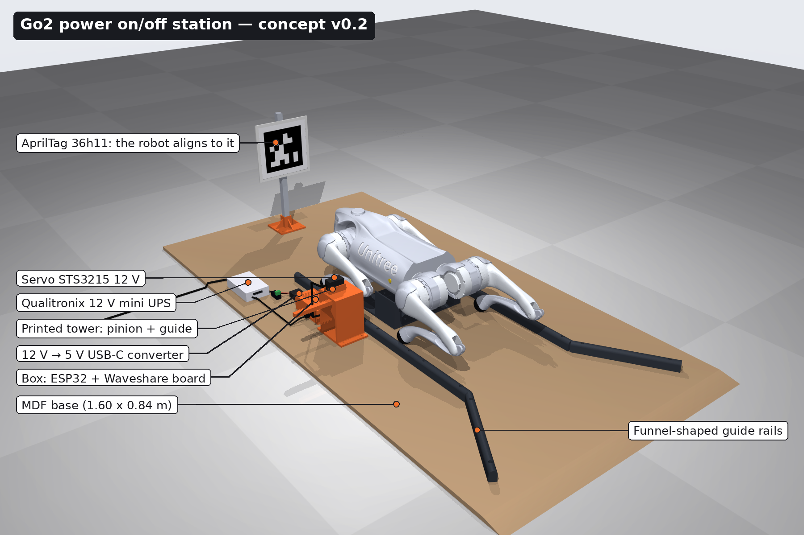
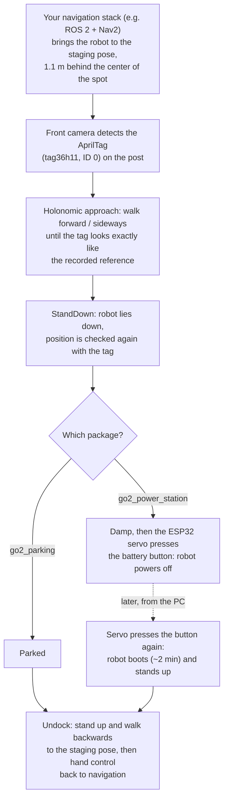
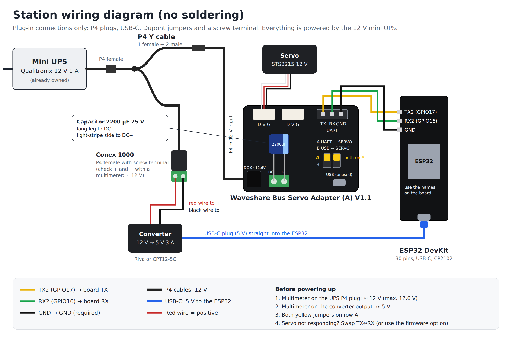
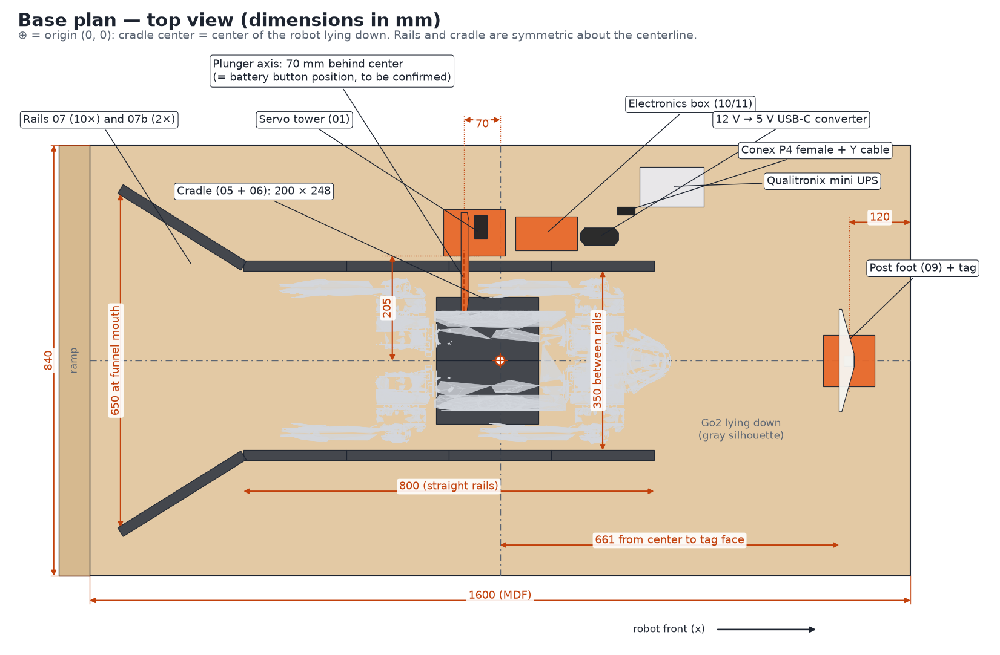

**English** · [Português](README.pt-BR.md)

# Unitree Go2 EDU — Parking and Power Station

Open designs for a home-made station for the **Unitree Go2** quadruped robot. The robot walks into the station on its own, guided by an AprilTag. It stops in exactly the same spot every time and lies down. Optionally, a small servo mechanism presses the robot's battery button to **power it off and on again** remotely.



> **This station does not charge the robot.** Nothing here connects to the Go2's charging contacts. The official Unitree dock is the charging solution. From it, this project only borrows the idea of a marker on a post in front of the robot.

---

## What is in this repository

The project is available in two languages, as two complete copies:

| Folder | Language | Contents |
|---|---|---|
| [`en/`](en/) | English | `go2_parking/` and `go2_power_station/` (this README describes these) |
| [`pt-BR/`](pt-BR/) | Portuguese (original) | `go2_estacionamento/` and `estacao_go2/`, the same project with Portuguese names, text and images. See [README.pt-BR.md](README.pt-BR.md) |

Each language folder contains two self-contained packages. The second one builds on the first.

| Package | Version | What it does | Start here |
|---|---|---|---|
| [`go2_parking/`](en/go2_parking/) | 1.0 | **Parking only.** An MDF board, a tape centerline with an X, and an AprilTag post. The robot parks with its body center over the X and lies down. | [go2_parking/README.md](en/go2_parking/README.md) |
| [`go2_power_station/`](en/go2_power_station/) | 0.2 (concept) | **Parking + power on/off.** Adds a 3D-printed cradle, guide rails and a servo-driven plunger that presses the battery button, controlled by an ESP32 over Wi-Fi. | [go2_power_station/README.md](en/go2_power_station/README.md) |

**Which one do you need?**
- If you only want the robot to return to a fixed place at the end of a mission, build **`go2_parking`**. It takes an afternoon, needs no electronics and costs little more than a sheet of MDF.
- If you also want to switch the robot off when it is parked and switch it on again from your PC, build **`go2_power_station`**.

Each package is split into numbered parts. **Build** parts are step-by-step guides for you in the workshop. **Software** parts are detailed specifications written to be handed to an AI coding assistant ([Claude Code](https://claude.com/claude-code)). The **parking software** has been implemented and tested on a real Go2 EDU (see [Results on a real Go2](#results-on-a-real-go2-november-2026)); its code is not yet published in this repository. The **power station software** is still only a specification.

---

## How it works



### 1. Precise parking with an AprilTag

- A printed **AprilTag** (family tag36h11, ID 0, 144 mm black square) is mounted on a post **in front of** the parking spot. It sits on the centerline, 300 mm above the board.
- The robot arrives at a **staging pose** 1.1 m behind the spot. It sees the tag with its **front camera** and walks in forwards.
- The approach uses **teach and repeat**. Once, you place the robot by hand in the correct spot. The software records how the tag looks from the camera, both standing (`REF_STANDING`) and lying down (`REF_LYING`). From then on, the controller drives the robot until the live tag pose matches the recorded one. This avoids any dependence on the exact camera position or tilt.
- The Go2 can walk sideways, so the controller corrects forward, lateral and yaw errors at the same time, with low speed limits near the target.
- **Target accuracy (standing) — design target, not yet measured in millimeters and degrees:** ≤ 5 mm forward/backward, ≤ 10 mm sideways, ≤ 2° yaw, in at least 18 of 20 consecutive runs. The tests on the real robot used a simpler pass/fail criterion (see [Results on a real Go2](#results-on-a-real-go2-november-2026)).
- After lying down, the robot checks its position with the tag again. If it is out of tolerance, it stands up, backs off and retries (up to two more times).

### 2. Pressing the battery button (power station only)

- The Go2 is powered on and off with the battery button: a **short press followed by a long press (≥ 2 s)**. To power off, the robot must be lying down.
- An **STS3215 servo** (the same one used in the SO-101 arm) sits on a printed tower next to the robot. It turns a pinion that drives a **rack-shaped plunger** sideways towards the button. When retracted, the plunger hides inside the tower, so the robot can stand up and leave freely.
- An **ESP32** drives the servo through a **Waveshare Bus Servo Adapter (A)**. It exposes a small HTTP API on the local Wi-Fi (`go2-station.local`). It detects contact with the button through the servo's own load reading, and limits the torque to ~25%.
- A Python program on the PC decides when to press. It checks whether the robot is on or off (by ping or DDS), puts the robot in `StandDown` and then `Damp` before powering off. After a power-on it waits up to 180 s and **never** presses the button a second time while the robot is booting.
- Everything is wired **without soldering**: P4 barrel plugs, a USB-C converter, Dupont jumpers and a screw terminal. Power comes from a 12 V mini UPS.



---

## Results on a real Go2 (November 2026)

The parking software (`go2_parking`) was implemented and tested on a real Unitree Go2 EDU. The code was written with the help of Claude Code from the [Part 2 specification](en/go2_parking/part2_parking_software/README.md); the repository author built the test base, made the adjustments and ran the tests on the real Go2. The code is not yet published in this repository.

| Round | Attempts | Correct attempts |
|---|---|---|
| 1 | 20 | 8 |
| 2 (after adjustments) | 20 | 18 |

- **Test base:** the tests used the printed guide rails from the power station (parts [07/07b](en/go2_power_station/part3_mechanism_build/README.md)). Only the rails were used: the servo, the ESP32 and the power on/off mechanism have not been validated on the real robot.
- **When an attempt counted as correct:** the rule is based on the rails on the base. If the robot fitted correctly into the rails, the attempt was correct.
- **Adjustments between the rounds:** mainly to how the robot came in before reaching the parking position.
- **Not measured yet:** the parking error in millimeters and degrees. The accuracy figures in [How it works](#1-precise-parking-with-an-apriltag) (≤ 5 mm, ≤ 10 mm, ≤ 2°) are design targets and were not checked in these tests.
- Apart from the guide rails used as the test base, the power station (`go2_power_station`) is still a concept (v0.2) and has not been validated on the real robot.

The results above cover only the parking that was tested; other functions described in this README may not be implemented yet.

---

## Key dimensions at a glance

All heights are measured from the top of the MDF board, where the robot stands. The origin is the center of the spot (the X, or the cradle center).

| Item | Value |
|---|---|
| Base board | MDF 1600 × 840 mm, 15–18 mm thick |
| AprilTag | tag36h11, ID 0. Black square 144 mm, printed paper 180 × 180 mm, backing plate 200 × 200 mm |
| Tag center height | 300 mm (adjustable: the plate slides on the post) |
| Tag face → spot center | 661 mm (post center at 680 mm, 120 mm from the front edge) |
| Staging pose | 1100 mm behind the spot center, facing the tag |
| Battery button (assumed) | Robot's left side, 125 mm high when lying down, 70 mm behind the body center. **Confirm on your robot before printing** |
| Plunger drive | Pinion module 1.5, 32 teeth → 150.8 mm per servo turn. 121 mm stroke (≈ 289°) |
| Guide rails (power station) | 350 mm apart, opening to a 650 mm funnel mouth |



---

## Repository layout

```
.
├── README.md                             This file (English)
├── README.pt-BR.md                       The same overview in Portuguese
│
├── en/                                   ENGLISH VERSION
│   ├── go2_parking/                      Parking-only package (v1.0)
│   │   ├── part1_apriltag_build/         Build guide: board, centerline, X, post, tag. STLs + tag PDF
│   │   ├── part2_parking_software/       Spec: ROS 2 package go2_dock (tag detection, controller, teach mode)
│   │   └── images/                       Step-by-step drawings and renders
│   │
│   └── go2_power_station/                Parking + power on/off package (v0.2, concept)
│       ├── part1_apriltag_build/         Build guide for the tag post. STLs 08–09 + tag PDF
│       ├── part2_apriltag_software/      Spec: autonomous parking (same approach as go2_parking)
│       ├── part3_mechanism_build/        Build guide: cradle, rails, servo tower, electronics box, wiring, tests
│       │   └── stl/                      Printable parts 01–11 (+ reference assemblies, not for printing)
│       ├── part4_mechanism_software/     Spec: ESP32 firmware (PlatformIO) + PC client + optional ROS 2 node
│       ├── cad_source/                   Parametric Python CAD that generates every STL, render and drawing
│       └── images/                       Renders, dimensioned plans, wiring diagrams
│
└── pt-BR/                                PORTUGUESE VERSION (original)
    ├── go2_estacionamento/               = en/go2_parking
    └── estacao_go2/                      = en/go2_power_station
```

The STL files are identical in both versions; only their names differ (for example `01_torre_servo.stl` = `01_servo_tower.stl`).

---

## Getting started

### Parking only (`go2_parking`)
1. Build the spot following [Part 1](en/go2_parking/part1_apriltag_build/README.md), steps 1–6, and write down the measured values (section 5).
2. Give [Part 2](en/go2_parking/part2_parking_software/README.md) and your measurements to Claude Code. It will ask about your robot model, ROS 2 setup and camera topic before writing code.
3. Fine-tune the tag height while watching the camera image (Part 1, step 7).
4. Record the reference position with the robot over the X. From then on, the robot parks by itself.

### Power station (`go2_power_station`)
1. **Mechanism first** ([Part 3](en/go2_power_station/part3_mechanism_build/README.md) + [Part 4](en/go2_power_station/part4_mechanism_software/README.md)). Measure your robot's button position, print and assemble the tower, and flash the firmware. Then test power on/off with the robot **placed by hand** in the cradle.
2. **Then parking** ([Part 1](en/go2_power_station/part1_apriltag_build/README.md) + [Part 2](en/go2_power_station/part2_apriltag_software/README.md)). Build the tag post and make the robot park by itself.
3. **Finally, chain them together.** Park → lie down → power off, and power on → stand up → leave.

The full bill of materials, with links and prices, is in [go2_power_station/README.md](en/go2_power_station/README.md#complete-bill-of-materials). The electronics you need to buy cost about R$ 187 (Brazilian reais, October 2026). Expect about 1.1–1.8 kg of PETG for the printed parts.

### Changing a dimension
All printable parts of the power station are generated by [`go2_power_station/cad_source/`](en/go2_power_station/cad_source/README.md). Edit the parameters at the top of `parts.py`, for example `RZ` (button height), and run `python3 parts.py ./stl`. The same folder regenerates the renders, the dimensioned drawings and the wiring diagrams.

---

## Requirements and assumptions

- **Robot:** Unitree Go2. The specs assume the **EDU** variant, which gives SDK access over DDS (`unitree_sdk2`), but they also cover WebRTC access (`go2_ros2_sdk`).
- **Navigation:** an existing stack (for example ROS 2 + Nav2 with a map and localization) that can bring the robot near the station. The final approach is done outside Nav2.
- **Workshop:** a 3D printer with a bed of at least 220 × 220 mm for the 200 mm tag plate (or use a 6 mm MDF plate), a multimeter and basic hand tools. **No soldering anywhere.**
- **To confirm before building:** the battery button position (measured on Unitree's official 3D model, not on a real robot), the board dimensions and the servo horn hole pattern. See [Assumptions you need to confirm](en/go2_power_station/README.md#assumptions-you-need-to-confirm).

## Safety

- Power the robot off **only when it is lying down**. A Go2 switched off while standing falls.
- `Damp` (motors limp) is sent only by the power station, right before powering off, and only with the robot lying in the cradle. The parking-only package never sends it.
- The servo torque is limited in the firmware and switched off at rest. Keep your fingers away from the plunger while the ESP32 is powered.
- The ESP32 never moves the servo on boot or on Wi-Fi reconnect. Commands that move the servo require a token.

## Notes

- The drawings and renders in `en/go2_parking/images/` still have Portuguese labels baked in (there is no source script to regenerate them). The text of the guides has all the measurements in English. All images in `en/go2_power_station/images/` are in English.
- The power station is a **concept (v0.2)**: the parts and wiring are designed and checked in CAD (including a robot/part collision check), but have not yet been validated on a real robot.

## Credits

- Go2 3D model used in the renders: [MuJoCo Menagerie](https://github.com/google-deepmind/mujoco_menagerie/tree/main/unitree_go2), derived from the [official Unitree URDF](https://github.com/unitreerobotics/unitree_ros/tree/master/robots/go2_description) (BSD-3 license, Unitree Robotics).
- AprilTag image: [AprilRobotics/apriltag-imgs](https://github.com/AprilRobotics/apriltag-imgs), family tag36h11, ID 0.
- Waveshare [Bus Servo Adapter (A)](https://www.waveshare.com/wiki/Bus_Servo_Adapter_(A)) and [ST3215 servo](https://www.waveshare.com/wiki/ST3215_Servo) documentation.
