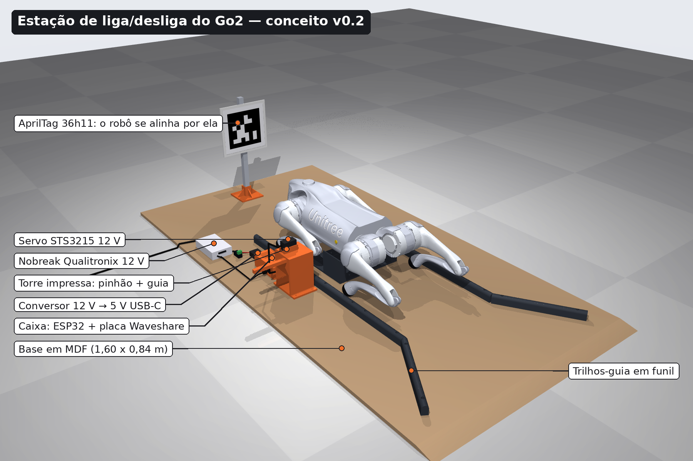
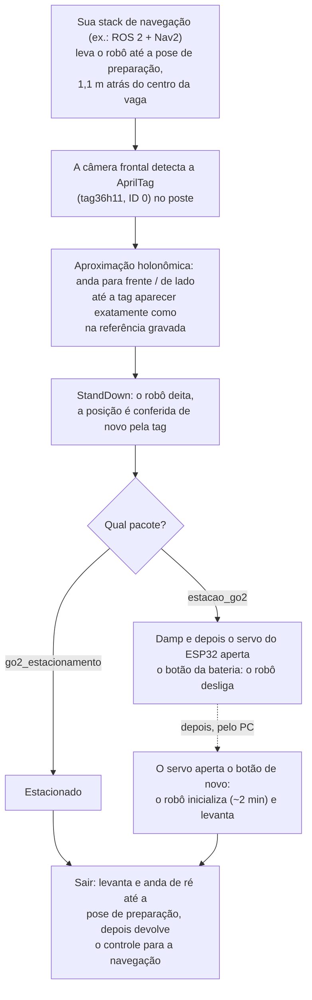
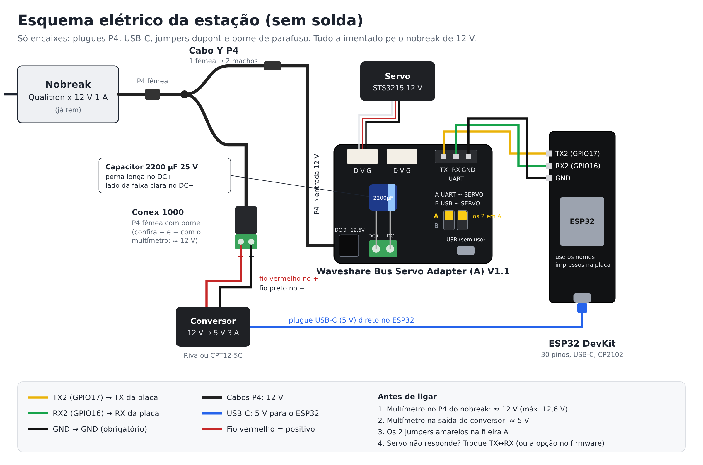
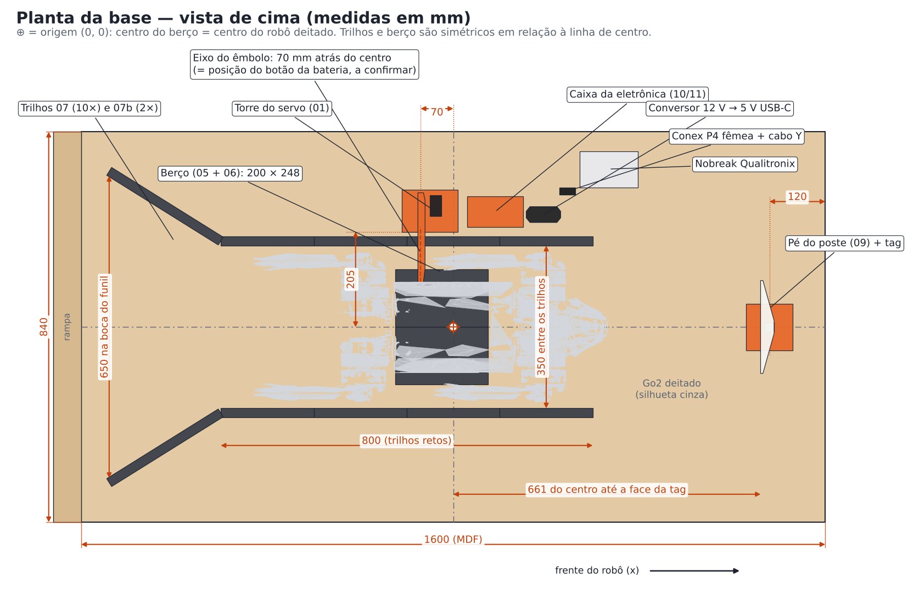

[English](README.md) · **Português**

# Unitree Go2 EDU — Estacionamento e estação de liga/desliga

Projetos abertos de uma estação caseira para o robô quadrúpede **Unitree Go2**. O robô entra na estação sozinho, guiado por uma AprilTag, para sempre no mesmo lugar e se deita. Opcionalmente, um pequeno mecanismo com servo aperta o botão da bateria para **desligar e ligar o robô** à distância.



> **Esta estação não carrega o robô.** Apesar do nome do repositório, nada aqui se liga aos contatos de carga do Go2. Quem carrega é o dock oficial da Unitree. Dele, este projeto só aproveita a ideia do marcador num poste à frente do robô.

---

## O que tem neste repositório

O projeto está em dois idiomas, em duas cópias completas:

| Pasta | Idioma | Conteúdo |
|---|---|---|
| [`pt-BR/`](pt-BR/) | Português (original) | `go2_estacionamento/` e `estacao_go2/` (este README descreve estas) |
| [`en/`](en/) | Inglês | `go2_parking/` e `go2_power_station/`: o mesmo projeto, com nomes, textos e imagens em inglês. Veja o [README.md](README.md) |

Cada pasta de idioma tem dois pacotes independentes. O segundo amplia o primeiro.

| Pacote | Versão | O que faz | Comece por |
|---|---|---|---|
| [`go2_estacionamento/`](pt-BR/go2_estacionamento/) | 1.0 | **Só estacionamento.** Uma chapa de MDF, uma linha de centro e um X de fita, e um poste com AprilTag. O robô para com o centro do corpo sobre o X e deita. | [go2_estacionamento/README.md](pt-BR/go2_estacionamento/README.md) |
| [`estacao_go2/`](pt-BR/estacao_go2/) | 0.2 (conceito) | **Estacionamento + liga/desliga.** Acrescenta um berço impresso em 3D, trilhos-guia e um êmbolo movido por servo que aperta o botão da bateria, comandado por um ESP32 pelo Wi-Fi. | [estacao_go2/README.md](pt-BR/estacao_go2/README.md) |

**Qual você precisa?**
- Se você só quer que o robô volte para um lugar fixo no fim da missão, monte o **`go2_estacionamento`**. Dá para fazer numa tarde, não tem eletrônica e custa pouco mais que uma chapa de MDF.
- Se você também quer desligar o robô quando ele estiver estacionado, e ligá-lo de novo pelo PC, monte a **`estacao_go2`**.

Cada pacote é dividido em partes numeradas. As partes de **construção** são guias passo a passo para você na oficina. As partes de **software** são especificações detalhadas, escritas para entregar a um assistente de programação com IA ([Claude Code](https://claude.com/claude-code)), que escreve e testa o código na sua configuração do robô. O repositório guarda os projetos de hardware e essas especificações. O software do robô ainda não foi escrito.

---

## Como funciona



### 1. Estacionamento preciso com AprilTag

- Uma **AprilTag** impressa (família tag36h11, ID 0, quadrado preto de 144 mm) fica num poste **à frente** da vaga, na linha de centro, a 300 mm de altura.
- O robô chega a uma **pose de preparação** 1,1 m atrás da vaga, vê a tag com a **câmera frontal** e entra andando de frente.
- A aproximação usa **referência gravada** (*teach and repeat*). Uma vez, você coloca o robô à mão no lugar certo, e o software grava como a tag aparece na câmera, em pé (`REF_EM_PE`) e deitado (`REF_DEITADO`). Daí em diante, o controlador move o robô até a pose atual da tag coincidir com a gravada. Assim, nada depende da posição ou da inclinação exata da câmera.
- O Go2 anda de lado, então o controlador corrige ao mesmo tempo o erro para frente, o lateral e o de yaw, com velocidades baixas perto do alvo.
- **Precisão desejada (em pé):** ≤ 5 mm para frente/trás, ≤ 10 mm para os lados, ≤ 2° de yaw, em pelo menos 18 de 20 estacionamentos seguidos.
- Depois de deitar, o robô confere a posição pela tag de novo. Se estiver fora da tolerância, ele levanta, recua e tenta outra vez (no máximo mais duas vezes).

### 2. Apertar o botão da bateria (só na estação)

- O Go2 liga e desliga pelo botão da bateria: **toque curto e, logo depois, toque longo (≥ 2 s)**. Para desligar, o robô precisa estar deitado.
- Um **servo STS3215** (o mesmo do braço SO-101) fica numa torre impressa ao lado do robô. Ele gira um pinhão que empurra um **êmbolo dentado** (cremalheira) de lado, até o botão. Recolhido, o êmbolo fica escondido dentro da torre, e o robô pode levantar e sair livremente.
- Um **ESP32** comanda o servo por uma **Waveshare Bus Servo Adapter (A)**. Ele oferece uma pequena API HTTP no Wi-Fi local (`estacao-go2.local`), detecta o toque no botão pela carga que o próprio servo informa e limita o torque a ~25%.
- Um programa Python no PC decide quando apertar. Ele confere se o robô está ligado ou desligado (por ping ou DDS) e põe o robô em `StandDown` e depois em `Damp` antes de desligar. Depois de ligar, espera até 180 s e **nunca** aperta o botão uma segunda vez enquanto o robô inicializa.
- Toda a ligação é **sem solda**: plugues P4, um conversor USB-C, jumpers dupont e um borne de parafuso. A energia vem de um nobreak de 12 V.



---

## Medidas principais

Todas as alturas são medidas a partir do topo da chapa de MDF, onde o robô pisa. A origem é o centro da vaga (o X, ou o centro do berço).

| Item | Valor |
|---|---|
| Base | MDF 1600 × 840 mm, 15–18 mm de espessura |
| AprilTag | tag36h11, ID 0. Quadrado preto de 144 mm, papel impresso de 180 × 180 mm, placa de fundo de 200 × 200 mm |
| Altura do centro da tag | 300 mm (ajustável: a placa desliza no poste) |
| Face da tag → centro da vaga | 661 mm (centro do poste a 680 mm, a 120 mm da borda da frente) |
| Pose de preparação | 1100 mm atrás do centro da vaga, de frente para a tag |
| Botão da bateria (suposto) | Lado esquerdo do robô, 125 mm de altura com o robô deitado, 70 mm atrás do centro do corpo. **Confirme no seu robô antes de imprimir** |
| Acionamento do êmbolo | Pinhão de módulo 1,5 com 32 dentes → 150,8 mm por volta do servo. Curso de 121 mm (≈ 289°) |
| Trilhos-guia (estação) | 350 mm entre eles, abrindo num funil de 650 mm na entrada |



---

## Organização do repositório

```
.
├── README.md                             Visão geral em inglês
├── README.pt-BR.md                       Este arquivo (português)
│
├── pt-BR/                                VERSÃO EM PORTUGUÊS (original)
│   ├── go2_estacionamento/               Pacote só de estacionamento (v1.0)
│   │   ├── parte1_construcao_apriltag/   Guia de construção: chapa, linha de centro, X, poste, tag. STLs + PDF da tag
│   │   ├── parte2_software_estacionamento/  Especificação: pacote ROS 2 go2_dock (detecção da tag, controlador, modo de ensino)
│   │   └── imagens/                      Desenhos passo a passo e renders
│   │
│   └── estacao_go2/                      Pacote de estacionamento + liga/desliga (v0.2, conceito)
│       ├── parte1_construcao_apriltag/   Guia de construção do poste da tag. STLs 08–09 + PDF da tag
│       ├── parte2_software_apriltag/     Especificação: estacionamento autônomo (mesma abordagem do go2_estacionamento)
│       ├── parte3_construcao_mecanismo/  Guia de construção: berço, trilhos, torre do servo, caixa da eletrônica, ligações, testes
│       │   └── stl/                      Peças 01–11 para imprimir (+ montagens de referência, não imprimir)
│       ├── parte4_software_mecanismo/    Especificação: firmware do ESP32 (PlatformIO) + programa do PC + nó ROS 2 opcional
│       ├── fonte_cad/                    CAD paramétrico em Python que gera todas as STLs, renders e desenhos
│       └── imagens/                      Renders, plantas com medidas, esquemas elétricos
│
└── en/                                   VERSÃO EM INGLÊS
    ├── go2_parking/                      = pt-BR/go2_estacionamento
    └── go2_power_station/                = pt-BR/estacao_go2
```

As STLs são idênticas nas duas versões; só os nomes mudam (por exemplo, `01_torre_servo.stl` = `01_servo_tower.stl`).

---

## Como começar

### Só estacionamento (`go2_estacionamento`)
1. Monte a vaga seguindo a [Parte 1](pt-BR/go2_estacionamento/parte1_construcao_apriltag/README.md), passos 1 a 6, e anote os valores medidos (seção 5).
2. Entregue a [Parte 2](pt-BR/go2_estacionamento/parte2_software_estacionamento/README.md) e as suas medidas ao Claude Code. Antes de escrever código, ele vai perguntar o modelo do robô, a configuração do ROS 2 e o tópico da câmera.
3. Faça o ajuste fino da altura da tag olhando a imagem da câmera (Parte 1, passo 7).
4. Grave a posição de referência com o robô sobre o X. Daí em diante, o robô estaciona sozinho.

### Estação de liga/desliga (`estacao_go2`)
1. **Primeiro o mecanismo** ([Parte 3](pt-BR/estacao_go2/parte3_construcao_mecanismo/README.md) + [Parte 4](pt-BR/estacao_go2/parte4_software_mecanismo/README.md)). Meça a posição do botão no seu robô, imprima e monte a torre e grave o firmware. Depois, teste ligar e desligar com o robô **colocado à mão** no berço.
2. **Depois o estacionamento** ([Parte 1](pt-BR/estacao_go2/parte1_construcao_apriltag/README.md) + [Parte 2](pt-BR/estacao_go2/parte2_software_apriltag/README.md)). Monte o poste da tag e faça o robô estacionar sozinho.
3. **Por fim, junte as duas coisas.** Estacionar → deitar → desligar, e ligar → levantar → sair.

A lista de materiais completa, com links e preços, está em [estacao_go2/README.md](pt-BR/estacao_go2/README.md#lista-de-materiais-completa). A eletrônica que precisa ser comprada custa cerca de R$ 187 (outubro de 2026). Conte com 1,1–1,8 kg de PETG para as peças impressas.

### Mudar uma medida
Todas as peças imprimíveis da estação são geradas pelo [`estacao_go2/fonte_cad/`](pt-BR/estacao_go2/fonte_cad/README.md). Altere os parâmetros no topo do `parts.py`, por exemplo `RZ` (altura do botão), e rode `python3 parts.py ./stl`. A mesma pasta gera de novo os renders, os desenhos com medidas e o esquema elétrico.

---

## Requisitos e premissas

- **Robô:** Unitree Go2. As especificações supõem o modelo **EDU**, que dá acesso ao SDK por DDS (`unitree_sdk2`), mas também cobrem o acesso por WebRTC (`go2_ros2_sdk`).
- **Navegação:** uma stack que já funciona (por exemplo, ROS 2 + Nav2 com mapa e localização) e leva o robô até perto da estação. A aproximação final é feita fora do Nav2.
- **Oficina:** uma impressora 3D com mesa de pelo menos 220 × 220 mm para a placa da tag de 200 mm (ou use uma placa de MDF de 6 mm), um multímetro e ferramentas manuais simples. **Nada de solda.**
- **Para confirmar antes de montar:** a posição do botão da bateria (medida no modelo 3D oficial da Unitree, não num robô real), as medidas das placas e a furação do horn do servo. Veja [Premissas que você precisa confirmar](pt-BR/estacao_go2/README.md#premissas-que-você-precisa-confirmar).

## Segurança

- Desligue o robô **só com ele deitado**. Desligado em pé, o Go2 cai.
- O `Damp` (motores soltos) só é mandado pela estação, imediatamente antes de desligar, e só com o robô deitado no berço. O pacote só de estacionamento nunca manda `Damp`.
- O torque do servo é limitado no firmware e desligado em repouso. Mantenha os dedos longe do êmbolo enquanto o ESP32 estiver ligado.
- O ESP32 nunca move o servo ao ligar nem ao reconectar o Wi-Fi. Os comandos que movem o servo exigem um token.

## Observações

- A estação de liga/desliga é um **conceito (v0.2)**: as peças e as ligações foram projetadas e conferidas no CAD (inclusive uma checagem de colisão entre o robô e as peças), mas ainda não foram validadas num robô real.
- Na versão em inglês (`en/`), os renders e desenhos da estação foram gerados de novo com rótulos em inglês. As imagens do `go2_parking/` continuam com rótulos em português, porque não há script de origem para gerá-las de novo.

## Créditos

- Modelo 3D do Go2 usado nos renders: [MuJoCo Menagerie](https://github.com/google-deepmind/mujoco_menagerie/tree/main/unitree_go2), derivado do [URDF oficial da Unitree](https://github.com/unitreerobotics/unitree_ros/tree/master/robots/go2_description) (licença BSD-3, Unitree Robotics).
- Imagem da AprilTag: [AprilRobotics/apriltag-imgs](https://github.com/AprilRobotics/apriltag-imgs), família tag36h11, ID 0.
- Documentação da Waveshare: [Bus Servo Adapter (A)](https://www.waveshare.com/wiki/Bus_Servo_Adapter_(A)) e [servo ST3215](https://www.waveshare.com/wiki/ST3215_Servo).
