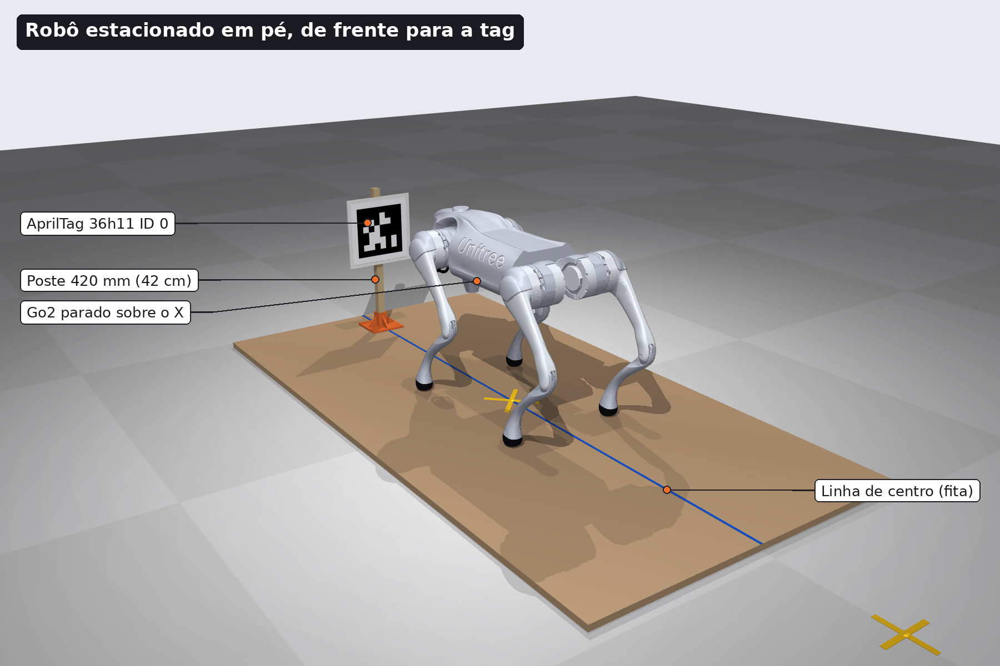
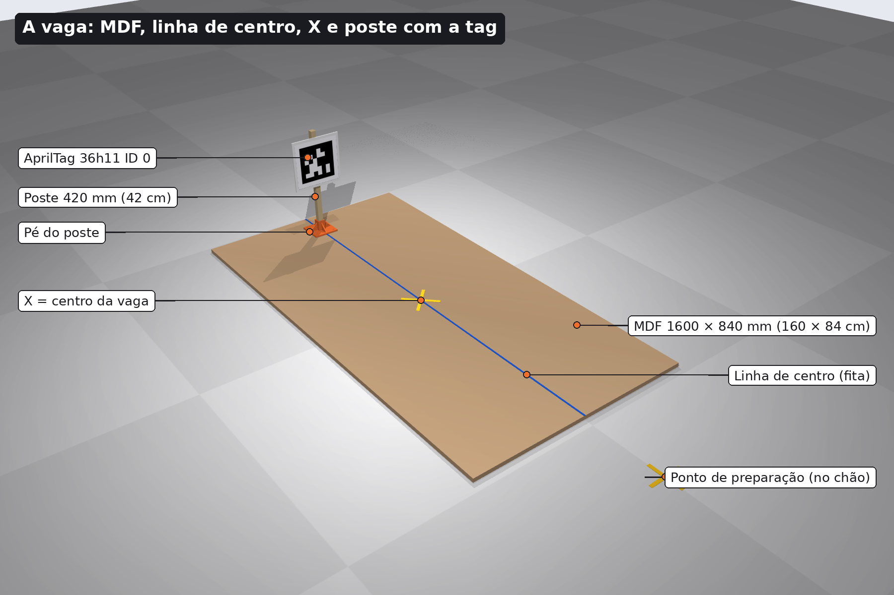
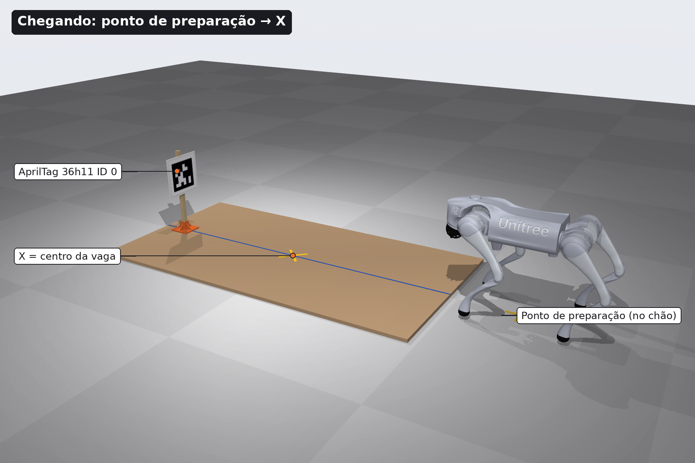
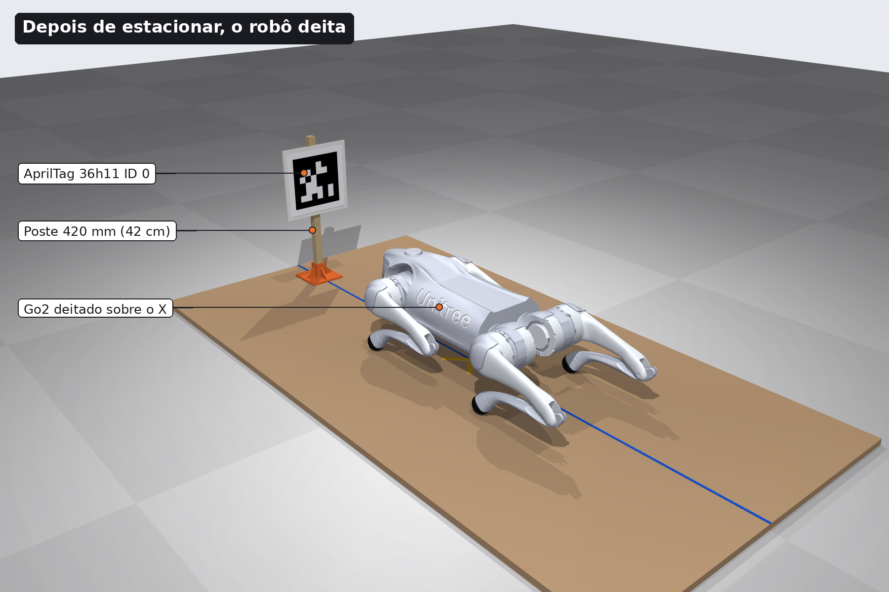

# Unitree Go2 Parking with an AprilTag

Version 1.0 · 2026-10-31

The robot finishes its navigation, goes to a point in front of the parking spot, sees an AprilTag mounted on a post and walks in forwards until it stops **always in the same place**: with the center of its body over an **X** marked on the floor. Then it lies down there. To leave, it stands up and walks backwards.

> **Status (November 2026):** the parking software was implemented and tested on a real Go2 EDU. See [Results on a real Go2](#results-on-a-real-go2-november-2026). Its code is not yet published in this repository.

> Note: the drawings and renders in `images/` still have Portuguese labels; the measurements are the same as in this text.

## Is this all you need?

**Yes.** To park you only need:

1. an MDF board with a centerline and an X marked with tape;
2. a post with the AprilTag, in front of the X;
3. the software that reads the tag through the Go2's front camera and guides the robot to the X.

This package contains exactly that, in two parts.

| Part | Folder | What it contains | Who uses it |
|---|---|---|---|
| 1. Build | `part1_apriltag_build/` | Step-by-step drawings, bill of materials, tag PDF, 2 parts to print | You (workshop) |
| 2. Software | `part2_parking_software/` | Full parking specification | Claude Code |
| — | `images/` | Dimensioned drawings and 3D images | Everyone |

## Order of work

1. **Build the parking spot** following Part 1, steps 1 to 6. It can be done in an afternoon.
2. **Hand Part 2 to Claude Code**, together with the values you measured (Part 1, section 5).
3. **Do the fine adjustment** (Part 1, step 7) once the software is already showing the camera image.
4. **Record the reference position**: you place the robot over the X and the software memorizes how the tag looks. From then on the robot parks by itself.

---

## The parking spot in one image

All measurements are in **mm** and, in parentheses, in **cm**.

| What | Measurement |
|---|---|
| MDF board | 1600 × 840 mm (160 × 84 cm), thickness 15–18 mm (1.5–1.8 cm) |
| Centerline | Along the length, 420 mm (42 cm) from each long edge |
| X (center of the spot) | On the centerline, 800 mm (80 cm) from each end: the middle of the board |
| Post center (P) | On the centerline, 120 mm (12 cm) from the FRONT edge, which puts it 680 mm (68 cm) in front of the X |
| Post | 420 mm (42 cm) tall, 20 × 20 mm (2 × 2 cm) cross-section |
| Tag plate | 200 × 200 mm (20 × 20 cm) |
| Tag paper | 180 × 180 mm (18 × 18 cm) |
| Black square of the tag | 144 mm (14.4 cm) |
| Tag center | 300 mm (30 cm) above the top of the MDF |
| Tag face to the X | 661 mm (66.1 cm) |
| Staging point (on the floor) | 1100 mm (110 cm) behind the X, i.e. 300 mm (30 cm) behind the back edge of the MDF |

**Front** is the post side. **Back** is the side the robot enters from. The robot walks in forwards, facing the tag.

| | |
|---|---|
|  |  |
|  |  |

---

## Bill of materials

| Item | Quantity | Note |
|---|---|---|
| MDF board 15 or 18 mm (1.5 or 1.8 cm), 1600 × 840 mm (160 × 84 cm) | 1 | Have it cut at the lumber yard. The Go2 climbs this edge without any problem |
| Pine batten 20 × 20 mm (2 × 2 cm), 420 mm (42 cm) long, **or** 20 × 20 aluminum extrusion (V-slot), 420 mm (42 cm) long, **or** post printed in PETG (2 halves) | 1 | Post |
| 200 × 200 mm (20 × 20 cm) plate: 6 mm (0.6 cm) MDF **or** the printed plate | 1 | Tag backing. It must be flat |
| Printed post foot (`post_foot.stl`) **or** a 50 mm (5 cm) L-bracket | 1 | Holds the post upright |
| PETG | ~200 g (plate and foot) + ~210 g (post) | Only what you are going to print |
| Wood screw 4 × 20 mm | 6 | 4 in the foot, 2 in the plate (wooden or printed post) |
| M3 × 20 mm flat-head (countersunk) screw + M3 nut | 2 + 2 | Printed post only, to join the halves |
| Epoxy glue (Araldite type) | 1 | Printed post only |
| M4 × 10 mm screw + M4 T-nut | 2 + 2 | Only if the post is an aluminum extrusion |
| Matte A4 sheet (90 g/m² office paper or **matte** photo paper) | 1–2 | To print the tag |
| Spray adhesive for paper, or thin double-sided tape | — | To glue the tag to the plate |
| Colored tape (electrical tape or floor marking tape), blue and yellow | 1 roll of each | Centerline and X |
| Tape measure, 1 m (100 cm) ruler, square, pencil, power screwdriver | — | Tools |

The details and the options for each material are in Part 1.

---

## Results on a real Go2 (November 2026)

The software from Part 2 was implemented and tested on a real Unitree Go2 EDU. The code was written with the help of Claude Code from the [Part 2 specification](part2_parking_software/README.md); the repository author built the test base, made the adjustments and ran the tests on the real Go2. The code is not yet published in this repository.

| Round | Attempts | Correct attempts |
|---|---|---|
| 1 | 20 | 8 |
| 2 (after adjustments) | 20 | 18 |

- **Test base:** the tests used the printed guide rails from the power station (parts [07/07b](../go2_power_station/part3_mechanism_build/README.md)). Only the rails were used: the servo, the ESP32 and the power on/off mechanism have not been validated on the real robot.
- **When an attempt counted as correct:** the rule is based on the rails on the base. If the robot fitted correctly into the rails, the attempt was correct.
- **Adjustments between the rounds:** mainly to how the robot came in before reaching the parking position.
- **Not measured yet:** the parking error in millimeters and degrees. The accuracy figures in [Part 2, section 3](part2_parking_software/README.md#3-goal-and-success-criteria) (≤ 5 mm, ≤ 10 mm, ≤ 2°) are design targets and were not checked in these tests.

The results above cover only the parking that was tested; other functions described in this README may not be implemented yet.

---

## Credits

- Go2 3D model used in the images: [MuJoCo Menagerie](https://github.com/google-deepmind/mujoco_menagerie/tree/main/unitree_go2), derived from the [official Unitree URDF](https://github.com/unitreerobotics/unitree_ros/tree/master/robots/go2_description) (BSD-3 license, Unitree Robotics).
- AprilTag image: [AprilRobotics/apriltag-imgs](https://github.com/AprilRobotics/apriltag-imgs), family tag36h11, ID 0.
