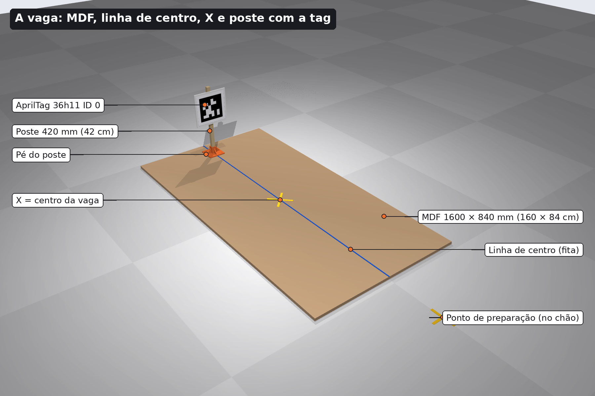
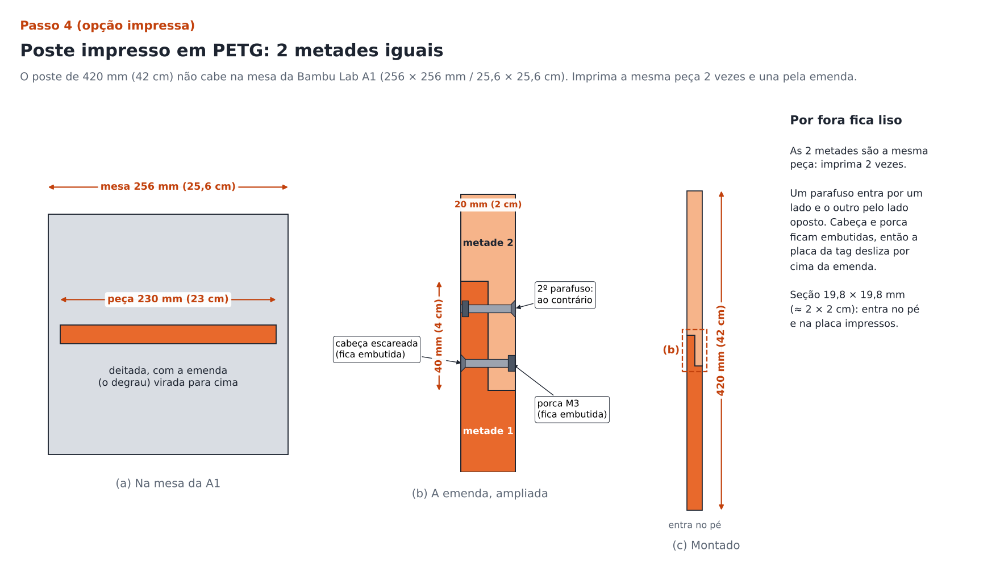
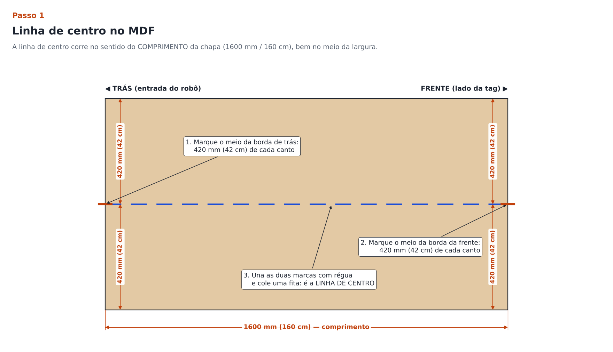
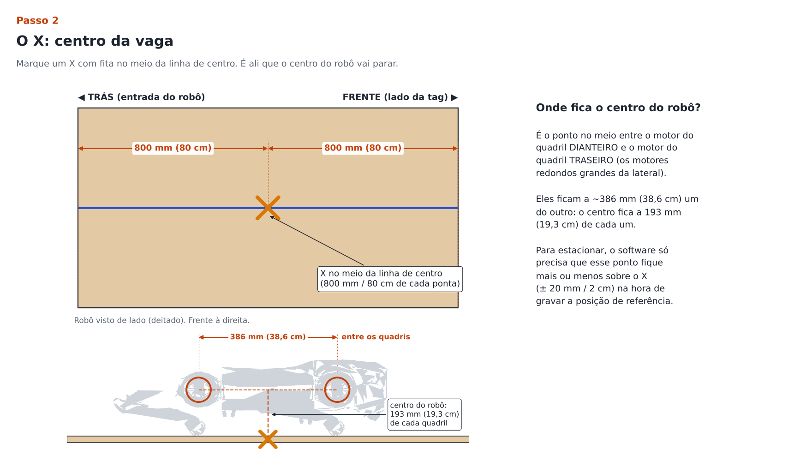
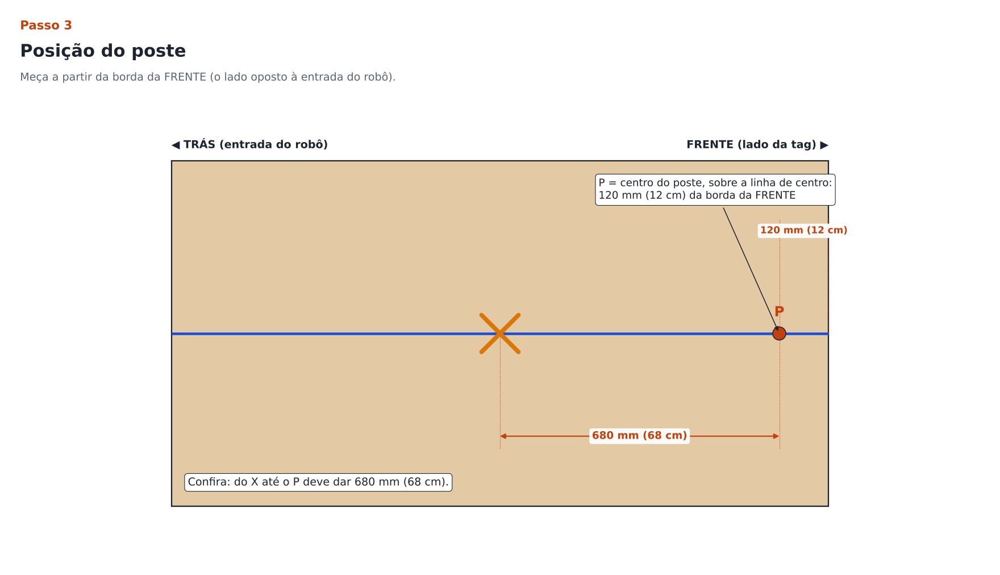
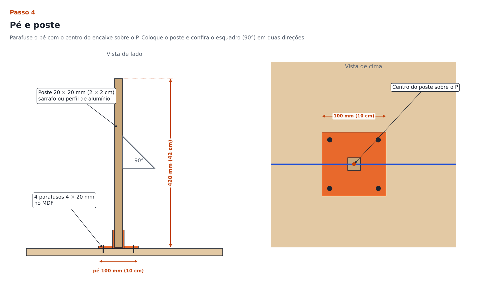
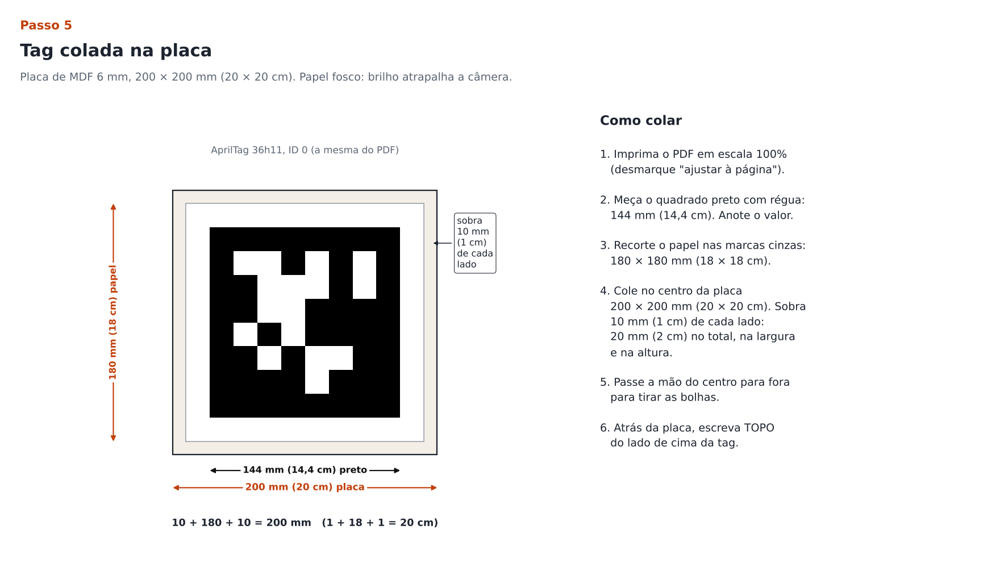
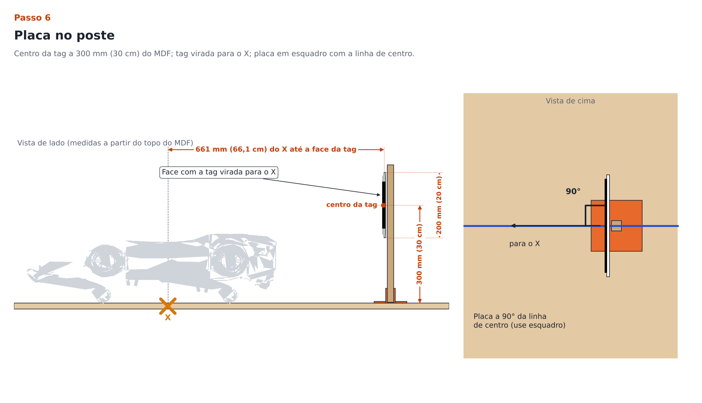
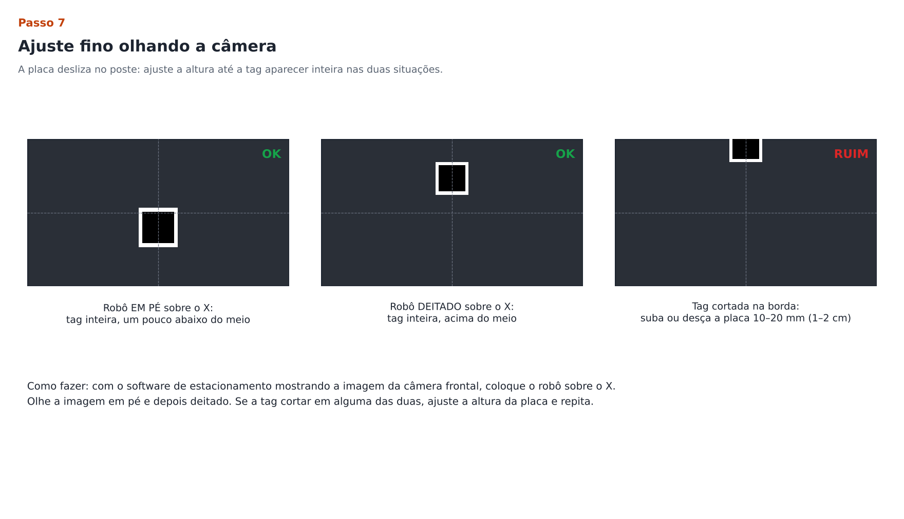

# Part 1 — Building the parking spot and the AprilTag post

The AprilTag sits on a post **in front of the robot**, on the centerline of the parking spot. The robot walks in forwards, sees the tag with its front camera and uses the tag's position to stop with the center of its body over the **X**.

All measurements are in **mm** and, in parentheses, in **cm**. Heights are measured from the **top of the MDF**, which is where the robot stands.

---

## 1. Words used in the drawings

| Word | What it is |
|---|---|
| **Length** | The long side of the board: 1600 mm (160 cm) |
| **Width** | The short side of the board: 840 mm (84 cm) |
| **Front** | The short edge where the post goes. The parked robot faces it |
| **Back** | The opposite short edge. The robot enters from it |
| **Centerline** | A straight line along the length, exactly in the middle of the width |
| **X** | The center of the spot, in the middle of the centerline. The robot's center stops over it |
| **P** | The point where the center of the post goes |

---

## 2. Main measurements

| What | Measurement | Why |
|---|---|---|
| Tag family and ID | tag36h11, ID 0 | Standard family, robust against misreads |
| Black square of the tag | **144 mm (14.4 cm)** per side | This is the number that goes into the software (`tag_size = 0.144`) |
| Printed paper, with the white border | 180 × 180 mm (18 × 18 cm) | The white border is part of the tag: do not cut it off |
| Backing plate | **200 × 200 mm (20 × 20 cm)** | Leaves 10 mm (1 cm) on each side of the paper: 20 mm (2 cm) in total |
| Height of the tag **center** | **300 mm (30 cm)** | Explanation right below |
| Bottom and top edges of the plate | 200 mm (20 cm) and 400 mm (40 cm) | Follows from the line above |
| Post | **420 mm (42 cm)** tall, 20 × 20 mm (2 × 2 cm) cross-section | Leaves room to raise or lower the plate |
| Post center (P) | On the centerline, **120 mm (12 cm)** from the front edge | It ends up 680 mm (68 cm) from the X |
| Tag face to the X | **661 mm (66.1 cm)** | Goes into the software |
| Gap between the robot's nose and the tag | ≈ 330 mm (33 cm) | The robot does not touch the plate |

### Why the tag center is at 300 mm (30 cm)

The Go2's front camera is about **355 mm (35.5 cm)** above the floor with the robot **standing** and about **170 mm (17 cm)** with the robot **lying down** (measured on the official 3D model; the standing value is an estimate).

- Standing, approaching from a distance, the tag is almost at camera height.
- Standing, over the X, the tag appears a little below the middle of the image.
- Lying down, the tag appears above the middle of the image, but whole. This lets the software check the position after the robot lies down.

300 mm (30 cm) is the compromise. The plate **slides on the post**, so you adjust it while watching the camera (step 7).

---

## 3. Materials and options

### Base (MDF board)

| Item | Detail |
|---|---|
| 15 or 18 mm (1.5 or 1.8 cm) MDF | 1600 × 840 mm (160 × 84 cm). Have it cut at the lumber yard, with square edges |
| Centerline tape | Electrical tape or floor marking tape, **blue** (any color that contrasts with the MDF) |
| X tape | **Yellow** tape, two pieces of about 100 mm (10 cm) crossed |

The Go2 climbs the 15–18 mm (1.5–1.8 cm) edge without difficulty.

### Printed tag

| Item | Recommendation |
|---|---|
| File | `apriltag_36h11_id0_A4.pdf` (in this folder). There is also `apriltag_36h11_id0_2000px.png`, if you need it |
| Printing | A4 sheet, **100%** scale (uncheck "fit to page"). A laser printer is preferred: the black comes out more even |
| Paper | Matte: 90 g/m² office paper or **matte** photo paper. Do not use glossy paper or glossy lamination: reflections confuse the camera |
| Check | Measure the black square with a ruler: it must be **144 mm (14.4 cm)**. If it comes out 143 or 145 mm (14.3 or 14.5 cm), that is fine, but write the value down and pass it to the software |

### Backing plate (where the paper is glued)

It must be **rigid and flat**. Any curvature distorts the tag and the robot computes the wrong position.

| Material | Suitable? | Note |
|---|---|---|
| **Printed plate (`stl/apriltag_plate.stl`)** | **Recommended** | Already has the sliding clip for a 20 × 20 mm (2 × 2 cm) post. Needs a print bed of at least 220 × 220 mm (22 × 22 cm) |
| **6 mm (0.6 cm) MDF, 200 × 200 mm (20 × 20 cm)** | **Recommended** | Cheap and flat. Fix it to the post with 2 screws through the front, outside the paper area, or with hot glue on the back |
| Expanded PVC or foam board 5 mm (0.5 cm) | Suitable | Light and flat. Glue it to a batten and fix the batten to the post |
| Acrylic 3 mm (0.3 cm) | Suitable | Use matte paper on top because of reflections |
| Cardboard | Quick test only | Warps with humidity. If you use it, glue two layers together and replace it with MDF later |

### Post (vertical rod)

| Option | Size | How the printed plate attaches |
|---|---|---|
| **Pine batten 20 × 20 mm (2 × 2 cm)** | 420 mm (42 cm) | 2 wood screws 4 × 20 mm through the holes on the side of the clip. If the batten does not fit in the clip, sand it until it fits snugly |
| **20 × 20 aluminum extrusion (V-slot)** | 420 mm (42 cm) | 2 M4 × 10 mm screws through the side holes + 2 M4 T-nuts in the extrusion slot |
| **Post printed in PETG** (`stl/post_half_print_2x.stl`) | 420 mm (42 cm) assembled, from 2 halves of 230 mm (23 cm) | 2 wood screws 4 × 20 mm through the side holes. Drill a 3 mm pilot hole in the post first |
| Broomstick (round) | 420 mm (42 cm) | Does not fit the printed foot or plate. Use an L-bracket and cable ties |

#### Printed post (if you do not want to buy a batten)

The full post is 420 mm (42 cm) long and does not fit on the Bambu Lab A1 bed, which is 256 × 256 mm (25.6 × 25.6 cm). That is why it comes in **2 identical halves** of 230 mm (23 cm): print the same part **2 times**. The halves overlap by 40 mm (4 cm) in a stepped joint, and the total is 230 + 230 − 40 = 420 mm (23 + 23 − 4 = 42 cm).

- **To join them:** spread epoxy glue (Araldite type) on both faces of the step, fit them together and tighten 2 M3 × 20 mm flat-head (countersunk) screws with M3 nuts. One screw goes in from one side and the other from the opposite side: each hole has a conical countersink for the head and, on the other side, a hex pocket for the nut. Head and nut sit flush, so the tag plate slides over the joint.
- **19.8 × 19.8 mm (≈ 2 × 2 cm) cross-section:** slightly under 20 mm so it slides into the foot and the plate clip with some clearance.
- **Stiffness:** PETG is more flexible than wood, but it is more than enough to hold the tag plate. Just do not lean on the post.

If your printer is the **A1 mini** (180 × 180 mm / 18 × 18 cm bed), the 200 mm (20 cm) printed plate does not fit: use the 6 mm MDF plate.

### Post foot

| Option | How |
|---|---|
| **Printed foot (`stl/post_foot.stl`)** | 100 × 100 mm (10 × 10 cm), 4 wood screws 4 × 20 mm into the MDF. The post goes into the square socket. If it is loose, wrap one turn of masking tape around the end of the post |
| 50 mm (5 cm) metal L-bracket | 2 screws into the MDF and 2 into the post |
| Wooden block | Screw the block to the MDF from below and the post to the block |

### Parts to print

All of them already open in the correct print orientation, with no supports.

| File | Size | PETG | How to print |
|---|---|---|---|
| `stl/apriltag_plate.stl` | 200 × 200 × 29 mm (20 × 20 × 2.9 cm) | ~140 g | Smooth face on the bed (already oriented that way). 4 walls, 25% infill |
| `stl/post_foot.stl` | 100 × 100 × 46 mm (10 × 10 × 4.6 cm) | ~55 g | Base on the bed. 4 walls, 25% infill |
| `stl/post_half_print_2x.stl` (optional, **2 copies**) | 230 × 20 × 20 mm (23 × 2 × 2 cm) each | ~105 g each, ~210 g for both | Lying flat, with the step facing up (already oriented that way). **100%** infill, so it is stiff and the screws bite |

PETG, starting point: nozzle 235–245 °C, bed 75–80 °C, fan 30–50%. On the Bambu Lab A1, use the PETG profile in Bambu Studio and the textured (PEI) plate that comes with the printer. On a **smooth** PEI bed, apply glue stick first (PETG sticks too much).

---

## 4. Step-by-step assembly

### Step 1 — Centerline

1. Lay the board where the parking spot will be. Decide which short edge is the **front** (where the post goes).
2. On the **back** edge, measure 420 mm (42 cm) from one corner and mark it. Check by measuring from the other corner: it must also be 420 mm (42 cm).
3. Do the same on the **front** edge.
4. Join the two marks with a long straightedge (or a taut string) and draw the line. Put the blue tape over it.

### Step 2 — The X (center of the spot)

1. On the centerline, measure 800 mm (80 cm) from the **back** edge and mark it. Check from the front: it is also 800 mm (80 cm).
2. Stick two pieces of yellow tape crossed to form an X, with the crossing exactly on the mark.

The **robot's center** is the point midway between the front hip motor and the rear hip motor (the large round motors on the side). They are about 386 mm (38.6 cm) apart. You will use this at the end, when you place the robot over the X to record the reference.

### Step 3 — Post position (P)

1. On the centerline, measure **120 mm (12 cm)** from the **front** edge and mark a point: this is **P**.
2. Check: from the X to P it must be **680 mm (68 cm)**.

### Step 4 — Foot and post

1. Place the foot with the center of the socket over P and its edges parallel to the centerline.
2. Mark the 4 holes, drill a thin pilot hole and screw it down with the 4 × 20 mm screws.
3. Fit the post. If it is printed, glue and screw the 2 halves together beforehand and wait for the glue to cure (see the time on the package).
4. Check with the square that the post is at 90° to the MDF, looking from the side and from the front.

### Step 5 — Tag on the plate

1. Print the PDF at 100% scale.
2. Measure the black square: 144 mm (14.4 cm). Write down the measured value.
3. Cut the paper at the gray marks: 180 × 180 mm (18 × 18 cm).
4. Apply spray adhesive (or cover the area with thin double-sided tape) and glue it in the center of the plate. There is 10 mm (1 cm) left on each side: 10 + 180 + 10 = 200 mm (1 + 18 + 1 = 20 cm), in width and in height.
5. Smooth it with your hand from the center outwards to remove bubbles.
6. On the back of the plate, write **TOP** on the upper side of the tag. If the tag is rotated later, the software computes everything wrong.

### Step 6 — Plate on the post

1. Slide the plate onto the post with the **tag facing the X**.
2. Raise or lower it until the tag center is **300 mm (30 cm)** above the top of the MDF. The bottom edge of the plate is then at 200 mm (20 cm) and the top edge at 400 mm (40 cm).
3. Rest a square on the centerline and against the plate: it must be at 90° to the line.
4. Tighten the 2 screws on the side of the clip.
5. Check with the tape measure: from the X to the tag face it must be **661 mm (66.1 cm)**.

### Step 7 — Fine adjustment using the camera

Do this step once the software (Part 2) is already showing the front camera image.

1. Place the robot **standing** with its center over the X, facing the tag. The tag should appear whole, a little below the middle of the image.
2. Tell the robot to **lie down**. The tag should still be whole, now above the middle.
3. If it gets cut off in either situation, raise or lower the plate 10–20 mm (1–2 cm) and repeat.
4. Write down the final height of the tag center.

---

## 5. Write down these values for Part 2

Measure your build and give these numbers to Claude Code together with Part 2.

| Value | Design | Measured on your build |
|---|---|---|
| Side of the black square (`tag_size`) | 144 mm (14.4 cm) | |
| Tag face to the X | 661 mm (66.1 cm) | |
| Height of the tag center above the top of the MDF | 300 mm (30 cm) | |
| MDF thickness | 15–18 mm (1.5–1.8 cm) | |
| Lateral offset of the tag center from the centerline | 0 mm (0 cm) | |

---

## 6. Optional: testing before you have the large board

You can start on the software without the 1600 × 840 mm (160 × 84 cm) board:

- screw the foot to a 300 × 300 mm (30 × 30 cm) piece of MDF and put a weight on it so the post does not tip over;
- stick the centerline and the X directly on the floor, with the X 680 mm (68 cm) from the center of the post;
- measure the tag height from the **floor**.

When the large board arrives, the robot will be 15–18 mm (1.5–1.8 cm) higher. Rebuild following steps 1 to 6 and **record the reference again** in the software.

---

## 7. Checklist

- [ ] Centerline 420 mm (42 cm) from both long edges
- [ ] X 800 mm (80 cm) from both ends
- [ ] P 120 mm (12 cm) from the front edge, 680 mm (68 cm) from the X
- [ ] Post at 90° in both directions
- [ ] Tag printed at 100% and black square measured
- [ ] Paper without bubbles and TOP written on the back
- [ ] Tag facing the X, center 300 mm (30 cm) above the MDF, face 661 mm (66.1 cm) from the X
- [ ] Plate at 90° to the centerline
- [ ] Section 5 values written down
