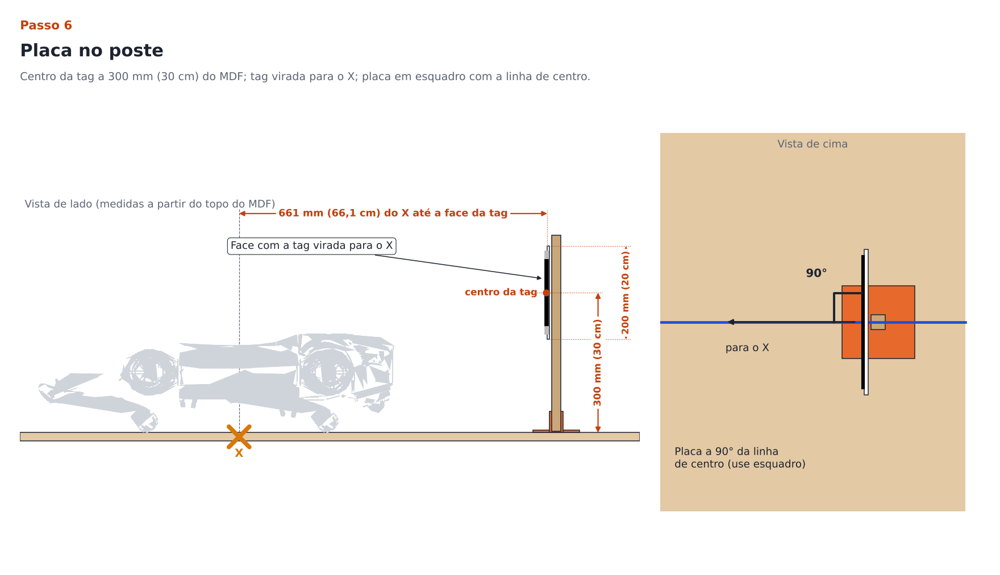
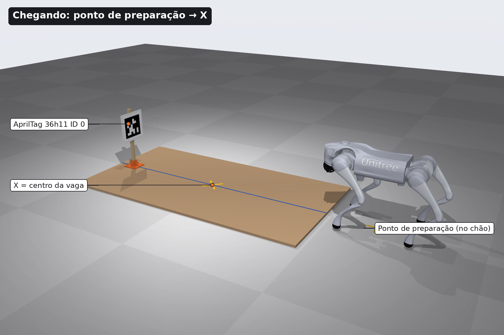
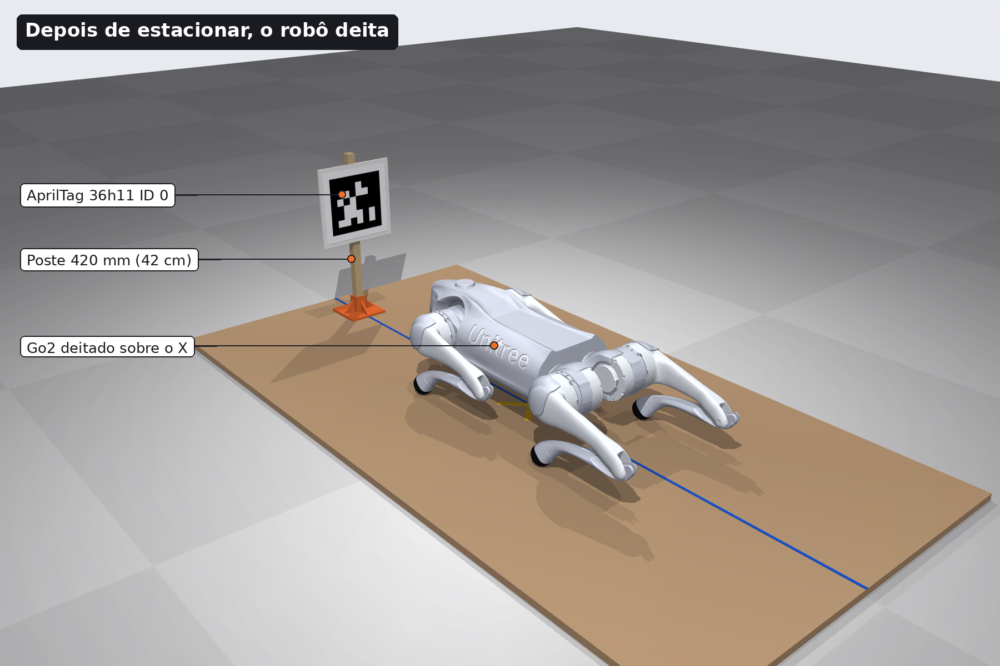

# Part 2 — AprilTag parking software

> **For Claude Code.** This document is the specification. Read all of it before writing code. Before you start, inspect the user's repository to find out which navigation stack already exists. Ask the user the questions in section 11 that the repository does not answer.
>
> Units: in the code, use meters and radians. In this text, every measurement appears in meters and also in mm and cm, because the user checks everything with a tape measure.


---

## 1. Context

- **Robot:** Unitree Go2 (quadruped), probably EDU. Confirm with the user the model and how the PC talks to the robot: `unitree_sdk2` (DDS, Ethernet cable, robot at 192.168.123.161) or WebRTC (`go2_ros2_sdk`).
- **What already exists:** a working navigation stack (probably ROS 2 + Nav2, with a map and localization). It takes the robot to somewhere near the parking spot.
- **What is missing (your task):**
  1. take the robot from the end of navigation into the parking spot and make it **stop precisely** over the X;
  2. make it **lie down** there and check the lying-down position;
  3. make it **leave**: stand up and walk backward to the staging point, handing control back to navigation.
- **Parking spot hardware** (built by the user):
  - an MDF sheet of 1600 × 840 mm (160 × 84 cm), 15–18 mm (1.5–1.8 cm) thick, lying on the floor;
  - a taped centerline along the length, and a taped **X** in the middle of it, which is the center of the parking spot;
  - a post at the front of the spot with an **AprilTag tag36h11, ID 0, black square of 0.144 m (144 mm / 14.4 cm)**, facing the X.
- **Out of scope:** powering the robot on or off. **Do not call `Damp` (API 1001)** in any state.
- **Constraint:** the user does not solder. Do not propose hardware changes that require soldering.

## 2. Parking spot geometry

Use these values as defaults in a YAML parameter file. The user measures the real build and may pass different values.

Define the **`dock`** frame:

- origin on top of the MDF, exactly at the crossing of the X;
- **x** points toward the tag (the "forward" direction of the parked robot);
- **y** to the robot's left;
- **z** up.

| Element | Position in the `dock` frame |
|---|---|
| Center of the parked robot (projection of `base_link` on the floor) | (0, 0, 0), yaw = 0 |
| Tag center | x = 0.661 m (661 mm / 66.1 cm); y = 0; z = 0.300 m (300 mm / 30 cm). Face pointing toward −x, i.e. toward the robot |
| Side of the tag's black square | 0.144 m (144 mm / 14.4 cm) |
| Post center | x = 0.680 m (680 mm / 68 cm), y = 0 |
| MDF sheet | x from −0.800 to +0.800 m (±800 mm / ±80 cm); y from −0.420 to +0.420 m (±420 mm / ±42 cm) |
| Staging pose | x = −1.10 m (−1100 mm / −110 cm), y = 0, yaw = 0. It is on the floor, 0.30 m (300 mm / 30 cm) behind the rear edge of the MDF, facing the tag |



**MDF step.** During the approach, the robot climbs the 15–18 mm (1.5–1.8 cm) edge. The measured tag pose oscillates at that moment. Keep the speed low and rely on the filter (section 7). Also check whether the Nav2 costmap marks the MDF edge or the post as an obstacle: the final approach is done outside Nav2, so only the staging pose needs to be free.

**Tag axis convention.** Detectors differ: in `apriltag` (C) the tag's z points into the tag; in other packages, out of it. Do not assume. With the detector running, place the camera facing the tag, look at the axes in RViz, and only then write the fixed `tag → dock` transform.

**Go2 camera (approximate values, just to get started).** Lens at the front of the head, about 0.32 m (320 mm / 32 cm) ahead of the body center and 0.044 m (44 mm / 4.4 cm) above it. Standing, that gives ~0.355 m (355 mm / 35.5 cm) above the surface the robot stands on; lying down, ~0.17 m (170 mm / 17 cm). The tilt is unknown. Prefer the **recorded reference** method in section 5, which does not depend on these values.



## 3. Goal and success criteria

1. Starting from the staging pose, the robot walks in forward and stops with its center over the X.
2. **Accuracy at the final point, still standing:**
   - longitudinal (x) ≤ 5 mm (0.5 cm);
   - lateral (y) ≤ 10 mm (1 cm);
   - yaw ≤ 2°.

   The target is tight because the user plans to later install a fixed accessory in the parking spot that depends on the robot always stopping in the same place. Nothing mechanical corrects the position: everything depends on the control.
3. The robot **lies down** (`StandDown`, API 1005) and the software **checks the lying-down position** using the tag. Out of tolerance: stand up, back off and try again (at most 2 retries).
4. **Leave:** the robot stands up and walks backward to the staging pose, then hands control back to navigation.
5. 18 out of 20 consecutive parkings within tolerance (section 9).

## 4. Proposed architecture

Create a ROS 2 package `go2_dock`. Adapt the names to the existing stack.

```
front camera ──► calibration (camera_info) ──► AprilTag detector ──► tag pose
                                                                       │
Nav2 (already exists) ──► goes to the staging pose                     ▼
                                     dock_controller (state machine, holonomic control)
                                                    │  cmd_vel or SportClient.Move(vx, vy, vyaw)
                                                    │  StandDown / StandUp / BalanceStand / RecoveryStand
                                                    ▼
                                                  Go2
```

Components:

1. **Image source.** Use whatever exists:
   - `go2_ros2_sdk` (WebRTC) publishing `/camera/image_raw`;
   - `unitree_sdk2` / `unitree_sdk2_python` with `VideoClient` (DDS, EDU models);
   - an extra USB camera, if the user prefers.
2. **Intrinsic calibration.** `camera_calibration` (`cameracalibrator`) with a checkerboard. The Go2 camera is wide-angle: evaluate whether the `plumb_bob` model is enough or whether a fisheye model is needed. Save a `camera_info` YAML and publish it along with the image.
3. **Detector.** `apriltag_ros` for ROS 2 (christianrauch) or equivalent: family `36h11`, `size: 0.144`, `ids: [0]`, frame `dock_tag`. Output: detections and the camera → tag TF.
4. **`dock_controller`.** The main node (sections 5 to 7).
5. **Interfaces.** A `dock` action or service and an `undock` one, to be called from the behavior tree or from the mission. If the stack uses the Nav2 Docking Server (`opennav_docking`), consider exposing interfaces compatible with `DockRobot` / `UndockRobot`. The Nav2 approach controller was designed for differential-drive robots. For the Go2, which can walk sideways, a custom holonomic controller is simpler and more accurate; justify the choice in the README.
6. **Visualization for fine adjustment.** A mode that shows the camera image with the detection drawn on it (or instructions to open it in RViz / `rqt_image_view`). The user needs this to adjust the plate height (Part 1, step 7) before recording the reference.

## 5. Accuracy: recorded reference (*teach and repeat*)

The final position is defined by the **tag pose as seen by the camera**, not by computed geometry. This removes extrinsic calibration errors (camera position and tilt).

1. **Teach mode** (`ros2 run go2_dock teach`):
   - the user places the robot standing, by hand (or with the remote), with the body center over the X and aligned with the centerline. The body center is the midpoint between the front and rear hip motors;
   - record the tag pose in the camera frame, standing: **REF_STANDING** (average of 2 s of detections);
   - command it to lie down (`StandDown`), wait for it to settle and record **REF_LYING**;
   - save both in a YAML file, together with the measured standard deviation.
2. **While parking,** the controller drives the error between the current tag pose and REF_STANDING to zero.
3. **After lying down,** compare the current pose with REF_LYING. The difference in x, in the body frame, is the final longitudinal error.



## 6. `dock_controller` state machine

| State | What it does | Exits when |
|---|---|---|
| `GO_TO_STAGING` | Nav2 `NavigateToPose` to the staging pose (`map` frame; the parking spot pose in the map is stored as a parameter) | Arrived → `SEARCH_TAG` |
| `SEARCH_TAG` | Stopped; waits for tag ID 0 in ≥ 5 consecutive frames | Seen → `APPROACH`; 5 s without seeing it → rotate ±15° and retry; failed → `ERROR` |
| `APPROACH` | Holonomic control toward REF_STANDING (section 7). **Turn off the Go2's native obstacle avoidance** during this phase (the post is close to the robot's nose) and turn it back on afterwards. In `unitree_sdk2` this is usually the `ObstaclesAvoidClient`; confirm what exists in the user's version | Error within tolerance for 1 s → `SETTLE`; tag lost > 1 s → `BACK_OFF` |
| `SETTLE` | Zero velocity for 1 s; checks the error again | Ok → `LIE_DOWN`; out → `APPROACH` |
| `LIE_DOWN` | `StandDown` (API 1005); waits ~2 s | → `VERIFY_LYING` |
| `VERIFY_LYING` | Compares against REF_LYING | Ok → `PARKED`; out → `STAND_UP_AND_RETRY` |
| `STAND_UP_AND_RETRY` | Stands up (see `UNDOCK`); backs off 0.30 m (300 mm / 30 cm) | → `APPROACH` (up to 2 times) → `ERROR` |
| `BACK_OFF` | Slow reverse until the tag is seen again, at most back to the staging pose | → `SEARCH_TAG` |
| `PARKED` | Publishes the state and the final error (standing and lying down) | — |
| `UNDOCK` (`undock` action) | Stands up: `StandUp` (1004) followed by `BalanceStand` (1002), or `RecoveryStand` (1006); confirm which sequence the user's SDK version requires to walk again. Then reverse at 0.10 m/s to the staging pose, correcting y and yaw from the tag while it is visible | → hands control back |
| `ERROR` | Stops, publishes the reason | User intervention |

## 7. Approach controller

- Error in the body frame: (ex, ey, eyaw), between the current tag pose and REF_STANDING, already converted into body motion.
- Commands: `vx = kx·ex`, `vy = ky·ey`, `vyaw = kyaw·eyaw`. Start with kx = ky = 0.8 1/s and kyaw = 1.0 1/s.
- Saturation:
  - |vx| ≤ 0.15 m/s, and ≤ 0.05 m/s in the last 0.10 m (100 mm / 10 cm);
  - |vy| ≤ 0.08 m/s;
  - |vyaw| ≤ 0.3 rad/s.
- **Go2 dead zone:** very small velocities may not produce any step at all. Measure the smallest velocity that moves the robot and, near the target, use short pulses (move 0.3 s, stop 0.5 s, measure again).
- **Filter:** median of the last 5 detections + low-pass (α ≈ 0.3). Discard detections with a high decoding error or with the tag at a steep angle.
- Control rate: 10–20 Hz. No new detection for 0.3 s → zero velocity.

## 8. Safety

- Stop button (topic or service) that zeroes velocities and cancels the action.
- Velocity limits always active. Overall timeout of 90 s for the whole parking maneuver.
- Never send `Damp`.
- If the tag disappears during `APPROACH`, stop before backing off. No blind walking forward.
- Log every attempt with the final standing and lying-down errors: this feeds the test in section 9.

## 9. Acceptance tests

1. **Detector:** with the robot stopped 1.0 m (1000 mm / 100 cm) from the tag, the standard deviation of the tag pose over 10 s must be ≤ 2 mm (0.2 cm) and ≤ 0.5°.
2. **Repeatability:** 20 consecutive parkings, starting from random poses 1–2 m (100–200 cm) from the staging pose. Record the standing and lying-down errors. Target: ≥ 18/20 with x ≤ 5 mm (0.5 cm), y ≤ 10 mm (1 cm), yaw ≤ 2°.
3. **Physical check:** in 5 of the 20 attempts, the user measures with a ruler the distance from the robot's center to the X. Compare it with the error the software reported.
4. **Leave:** 10 consecutive exits to the staging pose without touching the post.
5. **Faults:** cover the tag in the middle of the approach; the robot must stop and back off.

If criterion 2 fails on the x axis, report the numbers to the user. Do not invent corrections without data.

## 10. Deliverables

- `go2_dock` package with: `dock_controller`, `teach` tool, launch files, `params.yaml` (geometry from section 2, gains, tolerances, parking spot pose in the map), RViz configuration.
- Calibration files: `camera_info` and recorded references.
- Unit tests for the controller and the transforms, running on recorded data (rosbag).
- Package `README.md` covering: how to calibrate the camera, how to do the plate fine adjustment, how to record the reference, how to call `dock` and `undock`, how to integrate into the mission.

## 11. Questions for the user (ask before coding)

1. Which Go2: Air, Pro or EDU? How does the PC talk to the robot: cable (DDS) or Wi-Fi (WebRTC)?
2. Which ROS 2 distribution, and where does the stack run: on the robot's computer or on a PC?
3. How does navigation send velocity today: `cmd_vel` to which bridge?
4. Is there already a front camera image on a topic? What resolution?
5. Where is the parking spot in the map (approximate pose of the X and direction of the centerline, in the `map` frame)?
6. The measured values from Part 1 (section 5): `tag_size`, distance from the tag face to the X, height of the tag center, MDF thickness and lateral offset.
