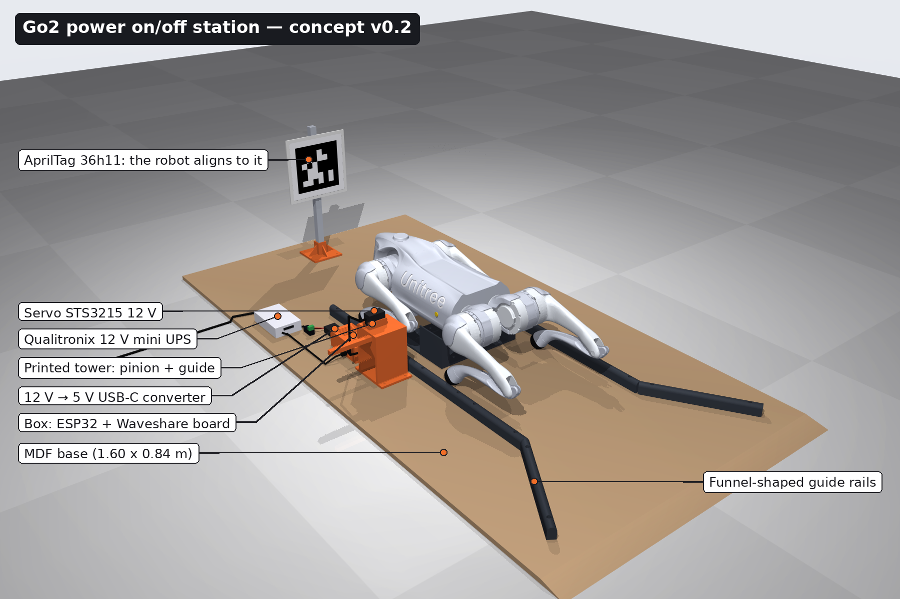
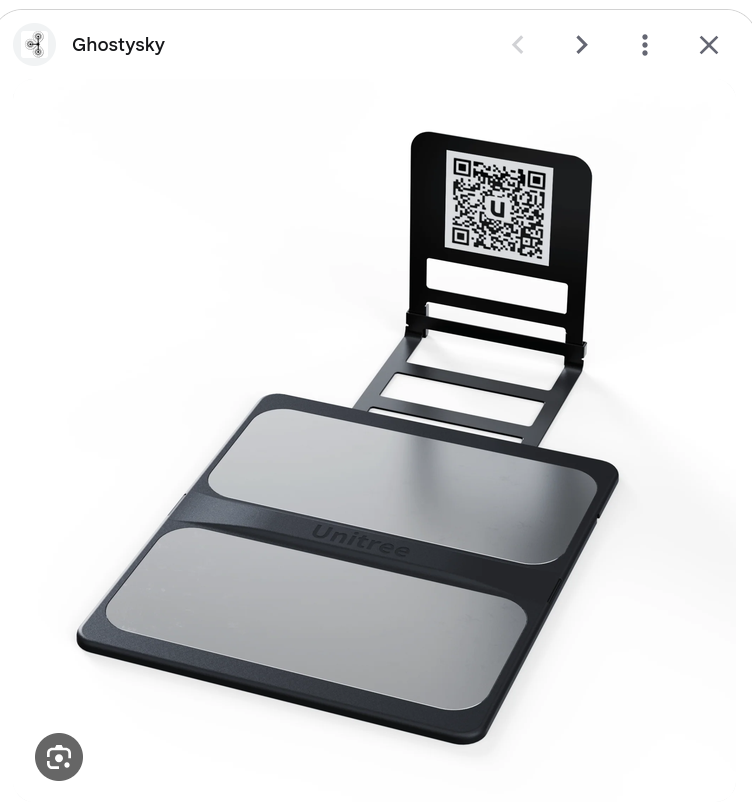
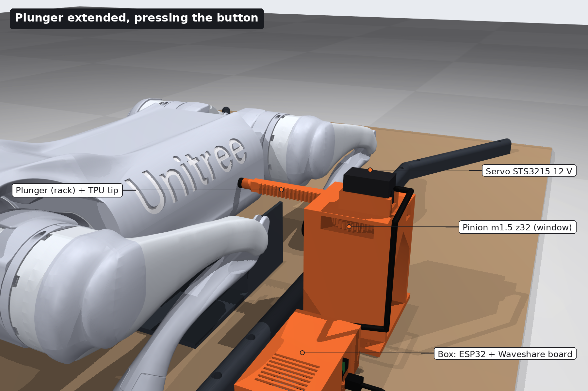
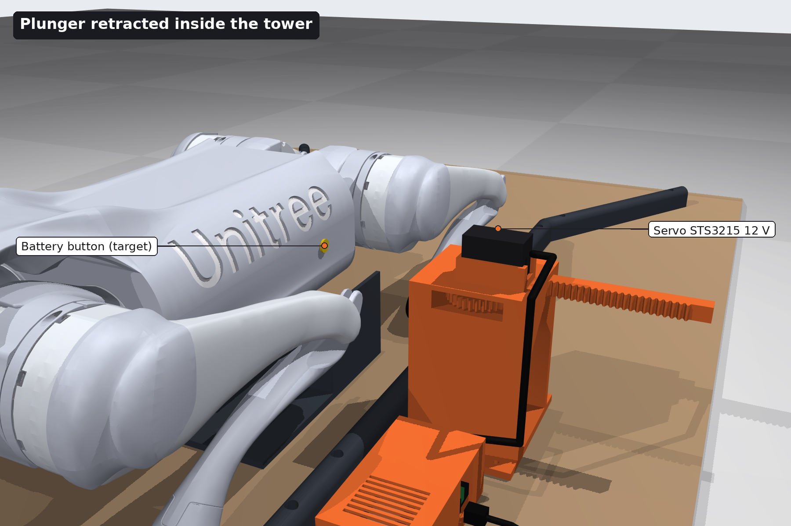
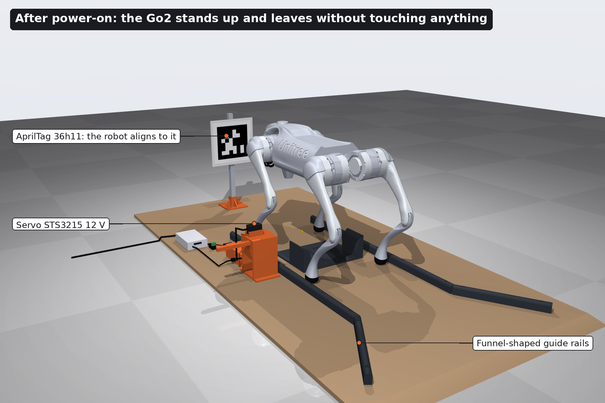
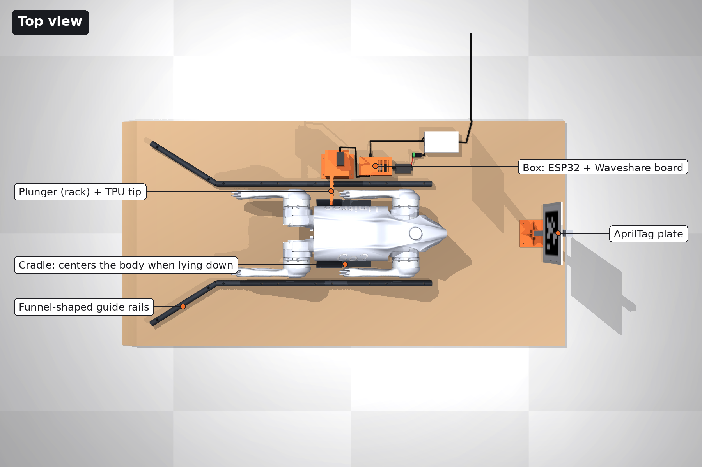
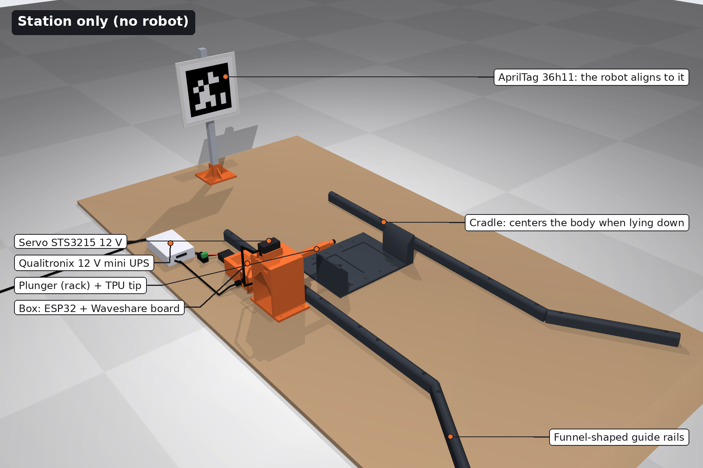
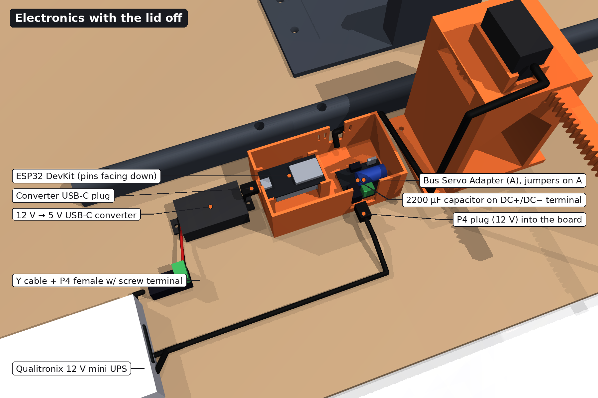
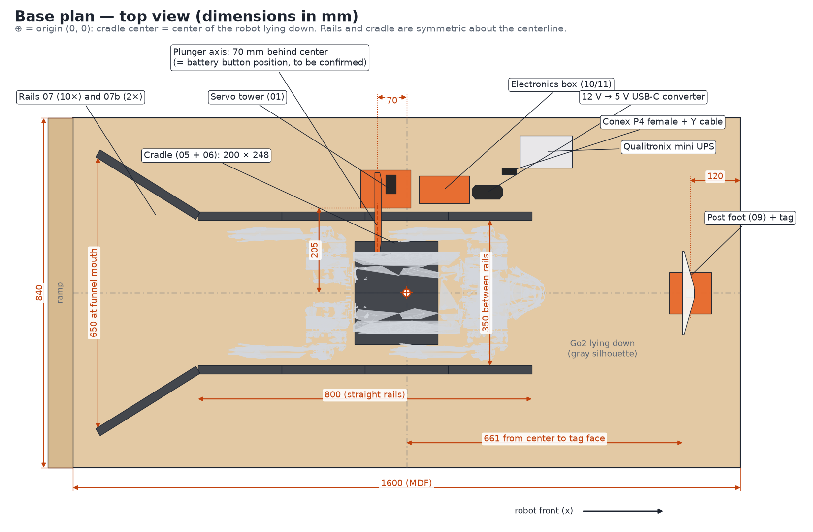

# Unitree Go2 power on/off station

Version 0.2 · 2026-10-31

The robot walks into the station, guided by an AprilTag. It lies down in a 3D-printed cradle. An STS3215 servo pushes a plunger that presses the battery button to **power on** or **power off** the Go2. The command comes from your PC over Wi-Fi. The station **does not charge** the robot.

The official Unitree dock (below) charges the battery. From it we only borrow the idea of a marker on a post in front of the robot.

---

## How the package is organized

| Part | Folder | What it contains | Who uses it |
|---|---|---|---|
| 1. AprilTag build | `part1_apriltag_build/` | Post and plate dimensions, material options, tag PDF, STLs 08 and 09 | You (workshop) |
| 2. AprilTag software | `part2_apriltag_software/` | Specification for autonomous parking | Claude Code |
| 3. Mechanism build | `part3_mechanism_build/` | STLs, assembly, wiring, tests | You (workshop) |
| 4. Mechanism software | `part4_mechanism_software/` | Specification for the ESP32 firmware and the PC program | Claude Code |
| — | `images/` | Renders, dimensioned plan, wiring diagram | Everyone |
| — | `cad_source/` | Python code that generates the parts, the renders and the drawings | To change dimensions |

### Suggested order

1. **Parts 3 and 4 first.** Build the mechanism, flash the firmware and test powering on and off with the robot **placed by hand** in the cradle. This validates the button position before anything else.
2. **Then Parts 1 and 2.** Build the tag post and make the robot park on its own.
3. Finally, connect the two: park → lie down → power off, and power on → stand up → leave.

---

## Complete bill of materials

Prices are in Brazilian reais (BRL), checked on Mercado Livre on 2026-10-31. They may change.

### To buy

| Item | What for | Link | Price |
|---|---|---|---|
| ESP32 DevKit WROOM-32, USB-C, CP2102, 30 pins | Receives the command over Wi-Fi and moves the servo | [Mercado Livre](https://www.mercadolivre.com.br/esp32-devkit-modulo-microcontrolador-wroom32-memoria-placa/up/MLBU3867919063?pdp_filters=item_id:MLB6539552690) | R$ 43.89 |
| Riva 12 V → 5 V 3 A converter, USB-C plug | Powers the ESP32 from the mini UPS | [Mercado Livre](https://www.mercadolivre.com.br/conversor-riva-12v-para-5v-3a-15w-usb-tipo-c-para-moto-e-carro/p/MLB29792316?pdp_filters=item_id:MLB7631137154) | R$ 78.99 |
| P4 Y cable (1 female, 2 male) | Splits the mini UPS's 12 V between the board and the converter | [Mercado Livre](https://www.mercadolivre.com.br/cabo-y-p4-macho-e-femea-1-femea-2-machos-alimentacao-energia/up/MLBU787797870?pdp_filters=item_id:MLB4632104828) | R$ 19.98 |
| Kit of 10 P4 female connectors with screw terminal, Intelbras Conex 1000 | Connects the converter wires to the Y cable without soldering | [Mercado Livre](https://www.mercadolivre.com.br/kit-10-conector-p-camera-conex-1000-p4-femea--intelbras/up/MLBU3384910543?pdp_filters=item_id%3AMLB4180196627) | R$ 8.94 |
| Kit of 10 female-female dupont jumpers, 20 cm | TX, RX and GND between the ESP32 and the Waveshare board | [Mercado Livre](https://www.mercadolivre.com.br/kit-jumper-femea-femea-20cm-10-unidades-para-protoboard-conector-dupont/p/MLB52686612?pdp_filters=item_id:MLB5851698888) | R$ 11.00 |
| Kit of 10 electrolytic capacitors 2200 µF 25 V 105 °C | Absorbs the servo's current peaks | [Mercado Livre](https://www.mercadolivre.com.br/capacitor-eletrolitico-2200uf-x-25v-105-kit-com-10-pecas/p/MLB2107006497?pdp_filters=item_id:MLB1493902058) | R$ 24.00 |
| | | **Total** | **R$ 186.80** |

Before buying the ESP32, ask the seller whether the board comes **with the pin headers already soldered**. The project must not require any soldering.

### Already have

| Item | Note |
|---|---|
| Feetech STS3215 12 V servo (the one from the SO-101) | Just one |
| Waveshare Bus Servo Adapter (A) V1.1 | Move **both** yellow jumpers to row **A** |
| Qualitronix 12 V 1 A mini UPS | P4 output. Measure it: it must read close to 12 V (12.6 V max) |
| Short USB-A to USB-C cable | Only for flashing the firmware. Check that it carries data (see Part 4) |
| 3D printer and multimeter | — |

### Building materials

| Item | Quantity | Used in |
|---|---|---|
| PETG 1.75 mm | ~1.1 kg without the printed rails, ~1.8 kg with them (2 spools) | Parts 1 and 3 |
| TPU (optional) | A few grams | Plunger tip (or use a small rubber foot) |
| MDF 15–18 mm, 1600 × 840 mm | 1 sheet | Base for everything |
| 2 × 2 cm × 42 cm batten, or 20 × 20 aluminum profile | 1 | Tag post |
| Flat 200 × 200 mm plate (6 mm MDF or printed part 08) | 1 | Tag backing |
| Wood screws 4 × 20 mm (flat head) | ~40 | Fixing the parts to the MDF |
| M4 × 30 screws (+ T-nuts, if using V-slot profile) | 2 | Fixing the tag plate to the post |
| M2.5 × 6 mm self-tapping screws | 4 | Waveshare board in the box (or double-sided tape) |
| Double-sided foam tape | 1 small roll | ESP32 on its supports, servo on the tower |
| 30 cm cable ties (zip ties) | 2 | Holding the servo on the tower |
| Spray adhesive or thin double-sided tape | — | Gluing the tag to the backing |

---

## Assumptions you need to confirm

1. **Battery button position.** The design assumes the button is on the robot's **left side**, **125 mm** above the floor with the robot lying down and **70 mm behind the robot's center**. This was measured on Unitree's official 3D model. Confirm it on your Go2 before printing the tower (see Part 3, section 2).
2. **Board dimensions.** The box was designed with clearance for an ESP32 DevKit 50–56 mm long and for the 42 × 33 mm Waveshare board (manufacturer's data). Check with a ruler when the boards arrive.
3. **Servo horn holes.** The pinion has 4 holes on a 16 mm circle, plus the center hole. Check against the metal horn of your STS3215.

## Known risks

- **Front-to-back accuracy.** The cradle centers the robot sideways, but not along the forward direction. The plunger tip has to land on the button. Part 2 records a reference position and checks the position after the robot lies down. Part 04b (20 mm wide tip) gives more tolerance.
- **1 A mini UPS.** It works with the servo torque limited to ~25% and with the capacitor. Measure the current during the first test.

## Images

| | |
|---|---|
|  |  |
|  |  |
|  |  |

## Credits and sources

- Go2 3D model: [MuJoCo Menagerie](https://github.com/google-deepmind/mujoco_menagerie/tree/main/unitree_go2), derived from the [official Unitree URDF](https://github.com/unitreerobotics/unitree_ros/tree/master/robots/go2_description) (BSD-3 license, Unitree Robotics).
- AprilTag image: [AprilRobotics/apriltag-imgs](https://github.com/AprilRobotics/apriltag-imgs), family tag36h11, ID 0.
- Waveshare Bus Servo Adapter (A): [wiki](https://www.waveshare.com/wiki/Bus_Servo_Adapter_(A)) and [product page](https://www.waveshare.com/bus-servo-adapter-a.htm) (42 × 33 mm, 2.5 mm holes at 37 × 28 mm).
- ST3215 servo: [Waveshare wiki](https://www.waveshare.com/wiki/ST3215_Servo) (6 to 12.6 V input).
- Go2 manual: power on and off with a short press followed by a long press of 2 s or more, always with the robot lying down when powering off.
