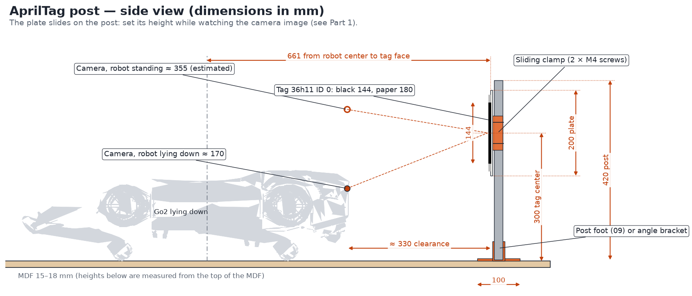
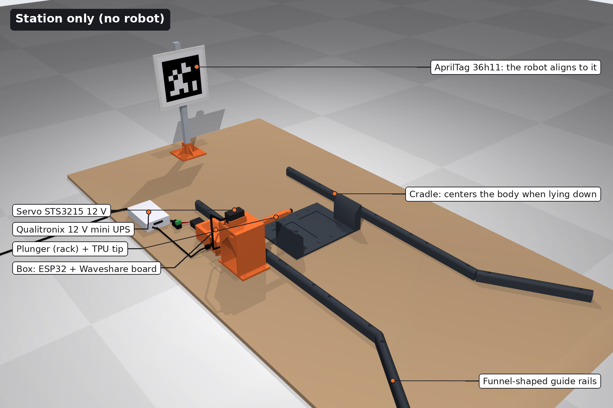

# Part 1 — Building the AprilTag post

The AprilTag sits on a post **in front of the robot**, on the station's center axis, as on the official Unitree dock. The robot walks in forwards, sees the tag with its front camera and uses its position to stop in the right place.

---

## 1. Main dimensions

All heights are measured from the **top of the MDF**, which is where the robot stands.

| What | Dimension | Why |
|---|---|---|
| Tag family and ID | tag36h11, ID 0 | Standard family, robust against misreads |
| Black square of the tag | **144 mm** per side | This is the number that goes into the software (`tag_size = 0.144`) |
| Printed paper (with the white border) | 180 × 180 mm | The white border is part of the tag; do not cut it off |
| Backing plate (the "square") | **200 × 200 mm** | 10 mm margin around the paper |
| Height of the tag **center** | **300 mm** | See the explanation below |
| Bottom and top edges of the plate | 200 mm and 400 mm | — |
| Post (vertical rod) | **420 mm** long, 20 × 20 mm section | Leaves 20 mm above the plate and allows height adjustment |
| Post position | On the center axis, post center **680 mm** from the cradle center (120 mm from the front edge of the MDF) | — |
| Tag face to cradle center | **661 mm** | Goes into the software |
| Free space between the robot's nose and the tag | ≈ 330 mm | The robot does not touch the plate |

### Why the center is at 300 mm

I measured the front camera on the official 3D model. With the robot **standing**, the camera is about **355 mm** above the floor (estimated: the Go2 is 40 cm tall overall when standing). With the robot **lying down**, it is about **170 mm**.

- Standing, approaching from 1.5 m away, the tag is practically at camera height.
- Standing, already in the final position (~33 cm from the tag), the tag is slightly below the center of the image.
- Lying down, the tag is above the center of the image, but still fully visible. This allows the position to be checked after the robot lies down.

300 mm is the compromise. The plate **slides on the post**, so you adjust it while looking at the camera image (assembly step 7).

---

## 2. Bill of materials for this part

### Printed tag

| Item | Recommendation |
|---|---|
| File | `apriltag_36h11_id0_A4.pdf` (in this folder). There is also `apriltag_36h11_id0_2000px.png`, if you need it |
| Printing | A4 sheet, **100%** scale (untick "fit to page"). A laser printer is preferred: the black comes out more even |
| Paper | Matte: plain 90 g/m² office paper or **matte** photo paper. Do not use glossy paper or glossy lamination, because reflections interfere with detection |
| Check | Measure the black square with a ruler: it must be **144 mm**. If it is 143 or 145, that is fine, but write down the measured value and use it in the software |

### Backing plate (the square the paper is glued to)

It must be **rigid and perfectly flat**. Any curvature distorts the tag and the robot computes the wrong position.

| Material | Suitable? | Note |
|---|---|---|
| **6 mm MDF, 200 × 200** | **Recommended** | Cheap, flat, easy to cut. Fix it to the post with 2 screws |
| **Printed part 08 (`stl/08_apriltag_plate.stl`)** | **Recommended** | Already includes the sliding clip for a 20 × 20 post. Print it with the smooth face down on the bed |
| Expanded PVC or 5 mm foam board | Suitable | Light and flat. Glue it to a strip of wood to fix it to the post |
| 3 mm acrylic | Suitable | Watch out for reflections; use matte paper on top |
| Cardboard | Quick test only | Warps with humidity and over time. If you use it, glue two layers together and replace it with MDF later |

### Vertical rod (post)

| Option | Length | How to fix the plate |
|---|---|---|
| **2 × 2 cm pine batten** | 420 mm | Wood screws straight into the batten, at any height. If you use the printed foot, sand the batten until it fits the 20.4 mm socket |
| **20 × 20 aluminum profile (V-slot)** | 420 mm | 2 M4 screws + 2 T-nuts in the channel; slides to adjust the height |
| Broomstick (round) | 420 mm | Does not fit the printed foot. Use an angle bracket and fix the plate with cable ties |

### Post base

| Option | How |
|---|---|
| **Printed part 09 (`stl/09_tag_post_foot.stl`)** | 100 × 100 mm, 4 × 4 × 20 screws into the MDF. The post fits into the square socket |
| 50 mm metal L angle bracket (or shelf bracket) | 2 screws into the MDF + 2 into the post |
| Wooden block | Screw the block to the MDF from below and the post to the block |

### Screws and gluing

- 4 wood screws 4 × 20 mm (foot to MDF)
- 2 M4 × 30 screws (or 4 × 30 wood screws) for the plate on the post
- Spray adhesive for paper, or thin double-sided tape covering the whole paper area

---

## 3. Step-by-step assembly

1. **Draw the centerline on the MDF**, along the length (1600 mm), and mark the cradle center. See the plan in `../images/base_plan_dimensions.png`.
2. **Mark the post center** on the centerline, **680 mm** from the cradle center, in the direction the robot faces (120 mm from the front edge).
3. **Fix the foot** (part 09 or angle bracket) with the center of the socket on that mark.
4. **Insert the post** and check with a square that it is at 90° to the MDF in both directions.
5. **Glue the tag to the plate.** Cut the paper along the gray marks (180 × 180 mm), center it on the plate and smooth it from the center outwards to remove bubbles. Write "TOP" on the back of the plate, on the top side of the tag: rotating the tag changes the reference frame computed by the software.
6. **Fix the plate to the post** with the tag **facing the robot** (towards the cradle), with the tag center **300 mm** above the top of the MDF. Rest a square on the MDF centerline to set the plate at 90° to the line.
7. **Fine adjustment with the camera** (once the Part 2 software is showing the image):
   - Place the robot standing in the final position (its center over the cradle center).
   - The tag should appear fully and slightly below the center of the image.
   - Command the robot to lie down: the tag should remain fully in the image.
   - If it is cut off in either situation, raise or lower the plate by 1–2 cm and repeat.

---

## 4. Write down these values for Part 2

Measure your actual build and hand these numbers to Claude Code together with the Part 2 specification.

| Value | Design | Measured on your build |
|---|---|---|
| Side of the black square (`tag_size`) | 0.144 m | |
| Distance from the tag face to the cradle center | 0.661 m | |
| Height of the tag center above the top of the MDF | 0.300 m | |
| MDF thickness | 15–18 mm | |
| Is the tag on the centerline? (lateral offset) | 0 mm | |

## 5. Checklist

- [ ] Tag printed at 100% and black square measured
- [ ] Plate flat, paper without bubbles, "TOP" marked on the back
- [ ] Post plumb, 680 mm from the center, on the centerline
- [ ] Plate at 90° to the centerline, tag center at 300 mm
- [ ] Measured values written down for Part 2
