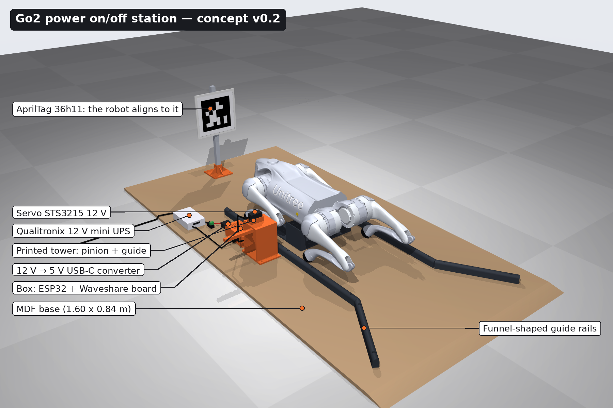
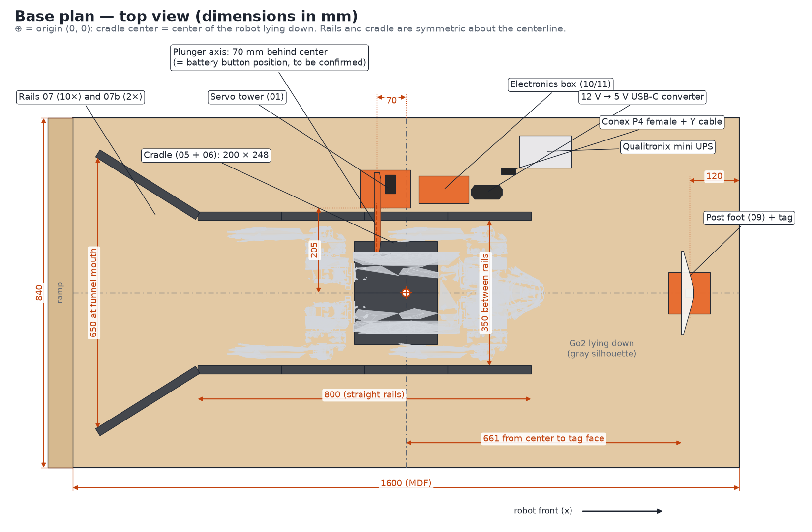

# Part 2 — AprilTag parking software

> **For Claude Code.** This document is the specification. Read all of it before writing code. Before you start, inspect the user's repository to find out which navigation stack already exists. Ask the user the questions in section 11 that the repository does not answer.



---

## 1. Context

- **Robot:** Unitree Go2 (quadruped). Confirm with the user: Air, Pro or EDU; access through `unitree_sdk2` (DDS, cable) or through WebRTC (`go2_ros2_sdk`).
- **What already exists:** a working navigation stack (probably ROS 2 + Nav2, with a map and localization). It takes the robot to somewhere near the station.
- **What is missing (your task):** make the robot **park precisely** in a physical station, **lie down**, and later **leave** it.
- **Station hardware** (already built by the user, Parts 1 and 3):
  - an MDF base with a printed cradle that centers the body sideways when the robot lies down;
  - funnel-shaped rails at the entrance;
  - an **AprilTag tag36h11, ID 0, 0.144 m black square**, on a post in front of the robot;
  - a servo mechanism that presses the battery button (software in Part 4).
- **Constraint:** the user does not solder. Do not propose hardware changes that require soldering.

## 2. Station geometry

Use these values as defaults in a YAML parameter file. The user measures the real build in Part 1 (section 4) and may pass different values.

Define the **`dock`** frame:
- origin on top of the MDF, exactly under the center of the cradle;
- **x** points toward the tag (the "forward" direction of the parked robot);
- **y** to the robot's left;
- **z** up.

| Element | Position in the `dock` frame |
|---|---|
| Center of the parked robot (projection of `base_link` on the floor) | (0, 0, 0), yaw = 0 |
| Tag center | (0.661, 0, 0.300) m, face pointing toward −x (toward the robot) |
| Tag: black square side | 0.144 m |
| Staging pose | (−1.10, 0, 0), yaw = 0. The robot stands 1.1 m back, facing the tag |
| Funnel mouth | x = −0.74 m; usable width 0.65 m |
| Straight corridor between the rails | x from −0.50 to +0.30 m; usable width 0.35 m |
| Plunger axis (battery button) | x = −0.070 m, robot's left side |



**Tag axis convention.** Detectors differ: in `apriltag` (C) the tag's z points into the tag; in other packages, out of it. Do not assume. With the detector running, place the camera facing the tag, look at the axes in RViz, and only then write the fixed `tag → dock` transform.

**Go2 camera (approximate values, just to get started).** Lens at the front of the head, about 0.32 m ahead of the body center and 0.044 m above it. With the robot standing, that gives ~0.355 m above the floor; lying down, ~0.17 m. The tilt is unknown. Prefer the **recorded reference** method in section 5, which does not depend on these values.

## 3. Goal and success criteria

1. Starting from the staging pose, the robot walks in forward and stops with its center over the center of the cradle.
2. **Required accuracy at the final point, still standing:** lateral ≤ 10 mm (the cradle corrects up to ~±20 mm); yaw ≤ 2°; **longitudinal ≤ 5 mm**. This is the critical axis: nothing mechanical corrects x, and the plunger tip must land on the button.
3. The robot **lies down** (`StandDown`) and the software **checks the lying-down position** using the tag. Out of tolerance: stand up, back off and try again (at most 2 retries).
4. **Leave:** after the robot powers on and stands up by itself, it walks backward to the staging pose and hands control back to navigation.
5. 18 out of 20 consecutive parkings within tolerance (section 9).

## 4. Proposed architecture

Create a ROS 2 package `go2_dock`. Adapt the names to the existing stack.

```
front camera ──► calibration (camera_info) ──► AprilTag detector ──► tag pose
                                                                       │
Nav2 (already exists) ──► goes to the staging pose                     ▼
                                     dock_controller (state machine, holonomic control)
                                                    │  cmd_vel or SportClient.Move(vx, vy, vyaw)
                                                    │  StandDown / StandUp / RecoveryStand
                                                    ▼
                                                  Go2
```

Components:

1. **Image source.** Use whatever exists:
   - `go2_ros2_sdk` (WebRTC) publishing `/camera/image_raw`;
   - `unitree_sdk2` / `unitree_sdk2_python` with `VideoClient` (DDS, EDU models);
   - an extra USB camera, if the user prefers.
2. **Intrinsic calibration.** `camera_calibration` (`cameracalibrator`) with a checkerboard. The Go2 camera is wide-angle: evaluate whether the `plumb_bob` model is enough or whether a fisheye model is needed. Save a `camera_info` YAML and publish it along with the image.
3. **Detector.** `apriltag_ros` for ROS 2 (christianrauch) or equivalent: family `36h11`, `size: 0.144`, `ids: [0]`, frame `dock_tag`. Output: detections and the camera → tag TF.
4. **`dock_controller`.** Your main node (sections 5 to 7).
5. **Interfaces.** A `dock` action or service and an `undock` one, to be called from the behavior tree or from the mission. If the stack uses the Nav2 Docking Server (`opennav_docking`), consider exposing interfaces compatible with `DockRobot` / `UndockRobot`. The Nav2 approach controller was designed for differential-drive robots. For the Go2, which can walk sideways, a custom holonomic controller is simpler and more accurate; justify the choice in the README.

## 5. Accuracy: recorded reference (*teach and repeat*)

The final position is defined by the **tag pose as seen by the camera**, not by computed geometry. This removes extrinsic calibration errors (camera position and tilt).

1. **Teach mode** (`ros2 run go2_dock teach`):
   - the user places the robot by hand (or with the remote) in the cradle, standing, with the plunger aligned with the button. To check, use the Part 4 `touch` command: the plunger advances slowly until it touches and reports where it touched;
   - record the tag pose in the camera frame, standing: **REF_STANDING** (average of 2 s of detections);
   - command it to lie down (`StandDown`), wait for it to settle and record **REF_LYING**;
   - save both in a YAML file, together with the measured standard deviation.
2. **While parking,** the controller drives the error between the current tag pose and REF_STANDING to zero.
3. **After lying down,** compare the current pose with REF_LYING. The difference in x (in the body frame) is the plunger's error relative to the button.

## 6. `dock_controller` state machine

| State | What it does | Exits when |
|---|---|---|
| `GO_TO_STAGING` | Nav2 `NavigateToPose` to the staging pose (`map` frame; the station pose in the map is stored as a parameter) | Arrived → `SEARCH_TAG` |
| `SEARCH_TAG` | Stopped; waits for tag ID 0 in ≥ 5 consecutive frames | Seen → `APPROACH`; 5 s without seeing it → rotate ±15° and retry; failed → `ERROR` |
| `APPROACH` | Holonomic control toward REF_STANDING (section 7). **Turn off the Go2's native obstacle avoidance** during this phase (the post and the rails are close) and turn it back on afterwards | Error within tolerance for 1 s → `SETTLE`; tag lost > 1 s → `BACK_OFF` |
| `SETTLE` | Zero velocity for 1 s; checks the error again | Ok → `LIE_DOWN`; out → `APPROACH` |
| `LIE_DOWN` | `StandDown` (API 1005); waits ~2 s | → `VERIFY_LYING` |
| `VERIFY_LYING` | Compares against REF_LYING | Ok → `PARKED`; out → `STAND_UP_AND_RETRY` |
| `STAND_UP_AND_RETRY` | `StandUp` (1004) or `RecoveryStand` (1006); backs off 0.30 m | → `APPROACH` (up to 2 times) → `ERROR` |
| `BACK_OFF` | Slow reverse until the tag is seen again, at most back to the staging pose | → `SEARCH_TAG` |
| `PARKED` | Publishes the state; may call `/station/power_off` (Part 4), if configured | — |
| `UNDOCK` (`undock` action) | Robot standing (it stands up by itself after powering on); reverse at 0.10 m/s to the staging pose, correcting y and yaw from the tag while it is visible | → hands control back |
| `ERROR` | Stops, publishes the reason, does not call `Damp` | User intervention |

`Damp` (API 1001, motors limp) must only be called by Part 4, immediately before switching the battery off, and only with the robot lying in the cradle.

## 7. Approach controller

- Error in the body frame: (ex, ey, eyaw), between the current tag pose and REF_STANDING, already converted into body motion.
- Commands: `vx = kx·ex`, `vy = ky·ey`, `vyaw = kyaw·eyaw`. Start with kx = ky = 0.8 1/s and kyaw = 1.0 1/s.
- Saturation: |vx| ≤ 0.15 m/s (≤ 0.05 m/s in the last 10 cm), |vy| ≤ 0.08 m/s, |vyaw| ≤ 0.3 rad/s.
- **Go2 dead zone:** very small velocities may not produce any step at all. Measure the smallest velocity that moves the robot and, near the target, use short pulses (move 0.3 s, stop 0.5 s, measure again).
- **Filter:** median of the last 5 detections + low-pass (α ≈ 0.3). Discard detections with a high decoding error or with the tag at a steep angle.
- Control rate: 10–20 Hz. Command timeout: no new detection for 0.3 s → zero velocity.

## 8. Safety

- Stop button (topic or service) that zeroes velocities and cancels the action.
- Velocity limits always active. Overall timeout of 90 s for the whole parking maneuver.
- Never send `Damp` outside the Part 4 power-off state.
- If the tag disappears during `APPROACH`, stop before backing off. No blind walking forward.
- Log every attempt with the final standing and lying-down errors: this feeds the test in section 9.

## 9. Acceptance tests

1. **Detector:** with the robot stopped at 1.0 m, the standard deviation of the tag pose over 10 s must be ≤ 2 mm and ≤ 0.5°.
2. **Repeatability:** 20 consecutive parkings, starting from random poses 1–2 m from the staging pose. Record the standing and lying-down errors. Target: ≥ 18/20 with x ≤ 5 mm, y ≤ 10 mm, yaw ≤ 2°.
3. **Physical check:** in 5 of the 20 attempts, run `touch` (Part 4) and confirm that the tip touches the button.
4. **Leave:** 10 exits without touching the rails.
5. **Faults:** cover the tag in the middle of the approach; the robot must stop and back off.

If criterion 2 fails on the x axis, report the numbers to the user. Mechanical options: wide tip (part 04b) or indexing by the knees in the cradle. Do not invent corrections without data.

## 10. Deliverables

- `go2_dock` package with: `dock_controller`, `teach` tool, launch files, `params.yaml` (geometry from section 2, gains, tolerances, station pose in the map), RViz configuration.
- Calibration files: `camera_info` and recorded references.
- Unit tests for the controller and the transforms, running on recorded data (rosbag).
- Package `README.md` covering: how to calibrate, how to record the reference, how to call `dock` and `undock`, how to integrate into the mission.

## 11. Questions for the user (ask before coding)

1. Which Go2: Air, Pro or EDU? How does the PC talk to the robot: cable (DDS) or Wi-Fi (WebRTC)?
2. Which ROS 2 distribution, and where does the stack run: on the robot's Jetson or on a PC?
3. How does navigation send velocity today: `cmd_vel` to which bridge?
4. Is there already a front camera image on a topic? What resolution?
5. Where is the station in the map (approximate pose in the `map` frame)?
6. Measured values from Part 1 (section 4) and the post's lateral offset.
