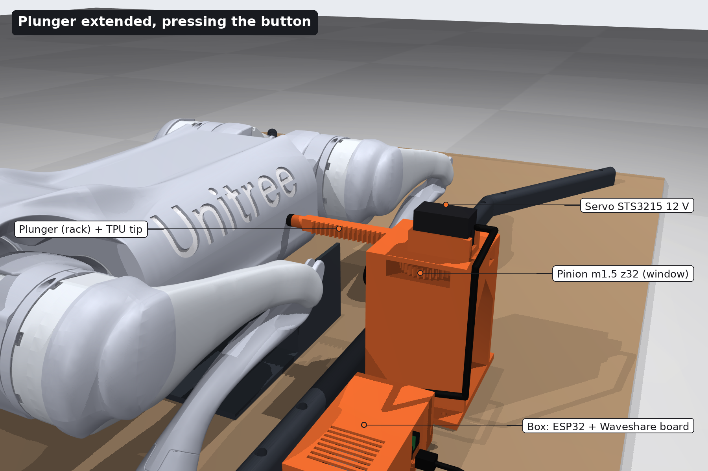
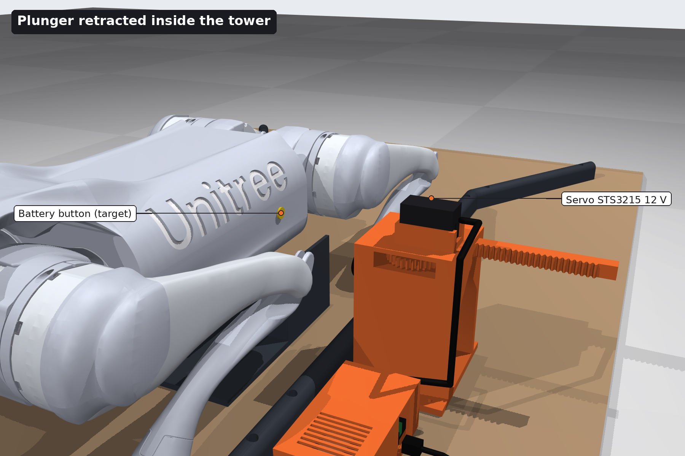
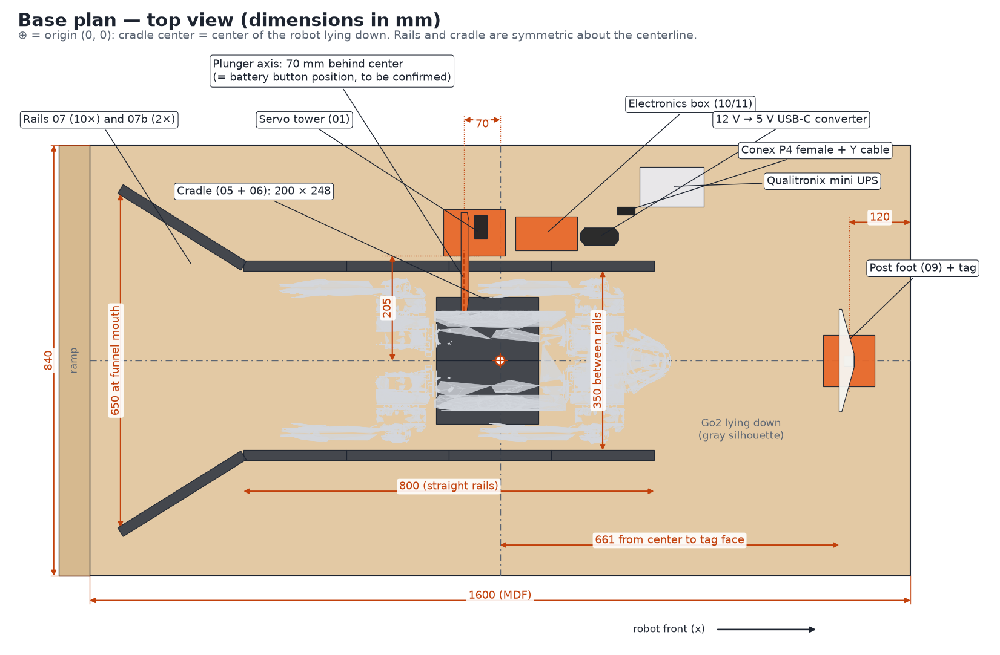
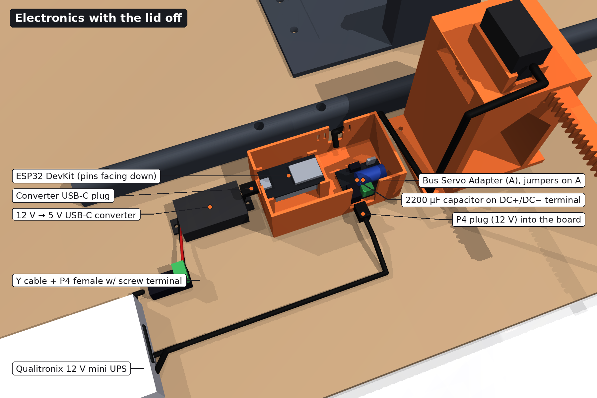
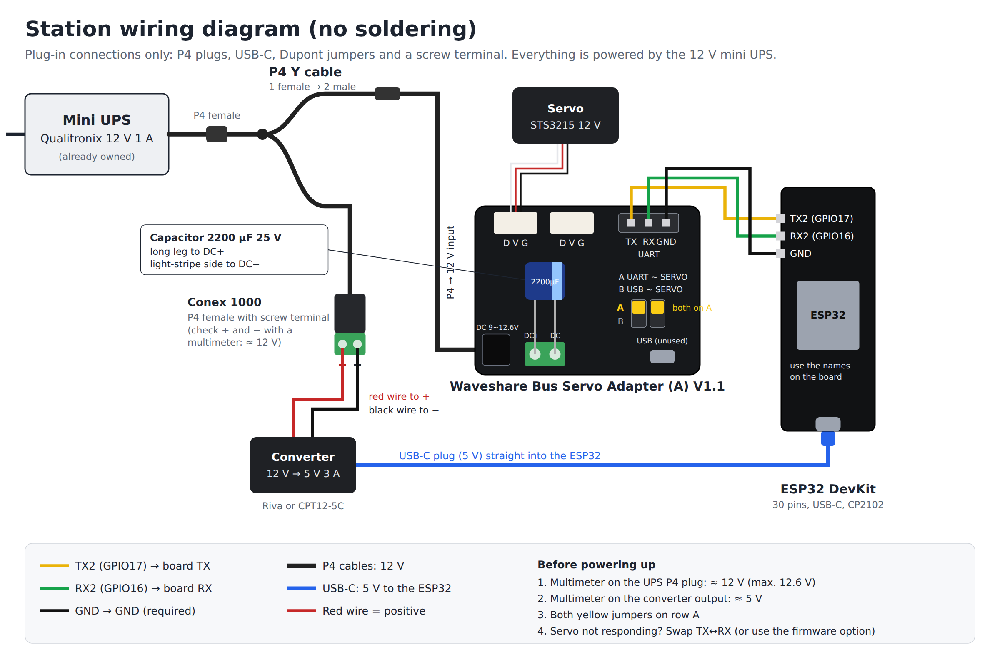

# Part 3 — Building the power on/off mechanism

A printed tower stands beside the robot. On top of it, the STS3215 servo turns a **pinion**, which pushes a **toothed plunger** (rack) horizontally up to the battery button. When retracted, the plunger is hidden inside the tower, and the robot can stand up and leave without hitting anything.

| Pressing the button | Retracted |
|---|---|
|  |  |

---

## 1. How it works

- Module 1.5 pinion with 32 teeth: the plunger travels **150.8 mm per servo revolution**.
- Total stroke of **121 mm** = about 289° of the servo. It fits within one revolution, in normal position mode.
- Plunger axis **125 mm** above the top of the MDF, **70 mm behind** the cradle center, on the robot's **left** side.
- Clearance between the retracted plunger and the standing robot: 53 mm.
- The firmware (Part 4) limits the servo torque and detects contact with the button through the **load** reported by the servo itself.

---

## 2. Confirm the button position BEFORE printing the tower

The design was measured on Unitree's official 3D model. Check it on your robot:

1. Lay the Go2 down on a flat floor (`StandDown`, or powered off in the transport position).
2. Find the battery button. The battery slides out from the side; the button is on the face that is visible from the outside.
3. Measure **from the floor to the center of the button**. The design assumes **125 mm**.
4. Measure the horizontal distance from the button to the **center of the robot**: the point midway between the front and rear hip motors on the same side. The design assumes **70 mm behind** the center.
5. Check **which side** the button is on. The design assumes the **left** (looking at the robot from behind).
6. Take a side photo with a ruler held against it.

If anything is different:
- **Opposite side:** mount the tower and the box mirrored, on the other side of the centerline. The parts are the same.
- **Further forward or backward:** move the tower on the MDF. The slots in the base still give ±12 mm of fine adjustment.
- **Height up to ~10 mm higher:** put MDF or PETG shims under the tower. Any other height difference, or lower: the `RZ` parameter in `../cad_source/parts.py` changes and the tower needs to be regenerated. Send me the measurement and I will redo the part.

---

## 3. Bill of materials for this part

### To buy

Prices are in Brazilian reais (BRL), from Mercado Livre on 2026-10-31.

| Item | Link | Price |
|---|---|---|
| ESP32 DevKit WROOM-32, USB-C, CP2102 (pin headers **soldered**) | [Mercado Livre](https://www.mercadolivre.com.br/esp32-devkit-modulo-microcontrolador-wroom32-memoria-placa/up/MLBU3867919063?pdp_filters=item_id:MLB6539552690) | R$ 43.89 |
| Riva 12 V → 5 V 3 A converter, USB-C plug | [Mercado Livre](https://www.mercadolivre.com.br/conversor-riva-12v-para-5v-3a-15w-usb-tipo-c-para-moto-e-carro/p/MLB29792316?pdp_filters=item_id:MLB7631137154) | R$ 78.99 |
| P4 Y cable (1 female, 2 male) | [Mercado Livre](https://www.mercadolivre.com.br/cabo-y-p4-macho-e-femea-1-femea-2-machos-alimentacao-energia/up/MLBU787797870?pdp_filters=item_id:MLB4632104828) | R$ 19.98 |
| Kit of 10 P4 female with screw terminal, Intelbras Conex 1000 | [Mercado Livre](https://www.mercadolivre.com.br/kit-10-conector-p-camera-conex-1000-p4-femea--intelbras/up/MLBU3384910543?pdp_filters=item_id%3AMLB4180196627) | R$ 8.94 |
| Kit of 10 female-female dupont jumpers, 20 cm | [Mercado Livre](https://www.mercadolivre.com.br/kit-jumper-femea-femea-20cm-10-unidades-para-protoboard-conector-dupont/p/MLB52686612?pdp_filters=item_id:MLB5851698888) | R$ 11.00 |
| Kit of 10 capacitors 2200 µF 25 V 105 °C | [Mercado Livre](https://www.mercadolivre.com.br/capacitor-eletrolitico-2200uf-x-25v-105-kit-com-10-pecas/p/MLB2107006497?pdp_filters=item_id:MLB1493902058) | R$ 24.00 |

### Already have

- Feetech STS3215 12 V servo, with the metal horn and the screws that came with it
- Waveshare Bus Servo Adapter (A) V1.1
- Qualitronix 12 V 1 A mini UPS (P4 output)
- USB-A to USB-C cable (only for flashing the firmware)

### Hardware and other items

| Item | Quantity |
|---|---|
| MDF 15–18 mm, 1600 × 840 mm | 1 sheet |
| Wood screws 4 × 20 mm, flat head | ~36 |
| M2.5 × 6 mm self-tapping screws | 4 (Waveshare board) |
| Double-sided foam tape | ESP32 on its supports, servo on the tower |
| 30 cm cable ties | 2 (servo on the tower) |
| Long, thin Phillips screwdriver (≥ 10 cm) | For the horn's center screw, through the hole at the bottom of the tower |
| PETG | ~840 g without the rails; +670 g with printed rails |
| TPU (optional) | Plunger tip |

---

## 4. Printed parts (`stl/` folder)

| File | Qty | Material | Size (mm) | Approx. mass | How to print |
|---|---|---|---|---|---|
| `01_servo_tower.stl` | 1 | PETG | 120 × 90 × 154 | 305 g | Upright, as it opens. 4 walls, 25% infill. Supports **only** in the pinion cavity (visible through the side window). The bottom recess has a 45° roof and needs no support |
| `02_rack_plunger.stl` | 1 | PETG | 187 × 15 × 12 | 38 g | Lying flat, as it opens. **100%** infill |
| `03_pinion_m1.5_z32.stl` | 1 | PETG | Ø51 × 8 | 16 g | Lying flat. 0.12–0.16 mm layer, **100%** infill |
| `04_plunger_tip_TPU.stl` | 1 | TPU (or PETG) | Ø12 × 15 | 1 g | Rounded tip, fits into the plunger's 5.2 mm hole |
| `04b_wide_tip_20mm.stl` | 1 | PETG | Ø20 × 13 | 3 g | Optional: gives more tolerance if the robot stops a few mm out of place |
| `05_cradle_left.stl` / `06_cradle_right.stl` | 1 + 1 | PETG | 200 × 124 × 85 | 189 g each | No supports |
| `07_guide_rail_200mm.stl` | 10 | PETG or PLA | 200 × 20 × 30 | 61 g each | Optional: can be replaced with wooden battens |
| `07b_funnel_rail_83mm.stl` | 2 | PETG or PLA | 83 × 20 × 30 | 28 g each | Completes each side of the funnel (200 + 83 mm) |
| `10_electronics_box.stl` | 1 | PETG | 120 × 66 × 44 | 80 g | No supports |
| `11_electronics_box_lid.stl` | 1 | PETG | 120 × 66 × 5 | 20 g | Smooth face down |

`stl/reference/` folder: the assembled set, only for viewing in the slicer. **Do not print.**

**PETG, starting point:** nozzle 235–245 °C, bed 75–80 °C, fan 30–50%, moderate speed. On a smooth PEI bed, apply glue stick (PETG sticks too well and can tear the bed's surface layer). The bed must be at least 220 × 220 mm.

---

## 5. Assembly

### 5.1 Base and cradle

1. Cut the MDF to 1600 × 840 mm. If you like, chamfer the entry edge as a ramp.
2. Draw the **centerline** along the length and mark the **cradle center** 800 mm from each end. All plan dimensions start from this point.
3. Cradle: the two halves side by side, one on each side of the centerline, covering x from −125 to +75 mm. Use 4 × 4 × 20 screws per half.
4. Straight rails: one on each side, with the inner face **175 mm** from the centerline (350 mm between them), from x = −500 to +300 mm. Funnel: from x = −500 to the mouth at x = −740 mm, opening to 325 mm from the centerline (200 + 83 mm of rail per side).

### 5.2 Tower, servo, pinion and plunger

**Assembly sequence**

1. **Position the tower** on the robot's left side: the face the plunger comes out of facing the centerline and **205 mm** from it; the plunger axis at x = **−70 mm**. Screw it down through the 4 slots in the base without fully tightening yet.
2. **Pinion on the horn.** Fix the servo's metal horn to the pinion (4 holes on a 16 mm circle). If your horn's hole pattern does not match, glue it with epoxy and let me know so I can adjust the part.
3. **Servo on top of the tower.** Seat the servo in the recess at the top, with the shaft (spline) pointing down through the hole. Secure it with double-sided foam tape and two cable ties.
4. **Put the servo in the "retracted" position.** With the Part 4 firmware flashed, use the command to bring the servo to step **400** (`move_to 400`). This keeps the whole stroke between steps 400 and ~3690, without crossing 0/4095.
5. **Plunger.** Insert the rack through the back face of the tower, teeth facing the pinion side, until the tip is ~10 mm inside the front face.
6. **Pinion.** Through the **side window**, slide the pinion + horn assembly under the servo shaft, meshing with the rack, and press it onto the spline. Through the **bottom hole** (inside the tower's recess, from the back), tighten the horn's center screw with the thin screwdriver.
7. **Tip.** Glue the TPU tip (04) or the wide tip (04b) into the hole at the front of the plunger.
8. Using the firmware, move the plunger slowly to the end and back. It should run freely, without rubbing.

### 5.3 Electronics box

1. Screw the box to the MDF next to the tower (2 screws in the bottom), at the position shown on the plan: the servo cable opening faces the robot side, near the tower.
2. **Waveshare board** on the 4 standoffs (M2.5 × 6 or double-sided tape). The P4 connector faces the rear opening.
3. **Both yellow jumpers on row A** (UART ~ SERVO).
4. **Capacitor** in the green screw terminal: long leg in **DC+**, the side with the light stripe in **DC−**. Bend the legs so it lies flat.
5. **ESP32** on the two tall supports, pins facing down and the USB-C facing the side opening. Secure it with double-sided tape at the ends of the board.
6. **Jumpers:** ESP32 TX2 (GPIO17) → board TX; RX2 (GPIO16) → RX; GND → GND. The names are printed on both boards.
7. **Servo cable:** exits through the box opening and runs up to the servo, on the D V G port.
8. **Lid:** snap it on top (the lid openings line up with the box openings).

### 5.4 Power (no soldering)

1. **Mini UPS → Y cable.** The mini UPS plug goes into the female end of the Y cable.
2. **Y output 1 → Waveshare board** (P4 input "DC 9~12.6V").
3. **Y output 2 → Conex P4 female with screw terminal.** Before fixing the wires, measure the two screws of the terminal with the multimeter: it must read ~12 V. Note which one is positive.
4. Switch off. **Converter wires into the terminal:** red to positive, black to negative. Screw the converter to the MDF by its mounting ears.
5. Switch back on and **measure the converter's USB output**: ~5 V.
6. **Plug the converter's USB-C into the ESP32.** The board's red LED should light up.

---

## 6. Tests before placing the robot

| Test | How | Expected |
|---|---|---|
| Mini UPS voltage | Multimeter on the P4 plug (red probe in the center hole) | 11.5–12.6 V |
| Converter voltage | Multimeter on the output | 4.9–5.2 V |
| Servo found | Firmware: `scan` | Shows the servo ID (SO-101: 1 to 6; factory default: 1) |
| Current | Firmware: `status` during movement | < 0.5 A in free movement |
| Stroke | Firmware: move from 400 to the end and back | No rubbing; tip ~3 mm past the robot's face |
| Contact | Hold a piece of cardboard in front of the plunger and run `touch` | Stops on contact and reports the position |

After that, place the Go2 **powered off and lying down** in the cradle by hand, run `touch` and check whether the tip lands on the button. Adjust the tower using the slots until it does. Only then test powering on and off for real.

## 7. Safety

- To **power off**, the robot must be **lying down**: if it is powered off while standing, it falls.
- Keep your fingers away from the plunger when the ESP32 is powered.
- Torque is limited in the firmware (~25%). Do not increase it unless necessary.
- The station does not charge the battery. Do not connect anything to the robot's charging contacts.
