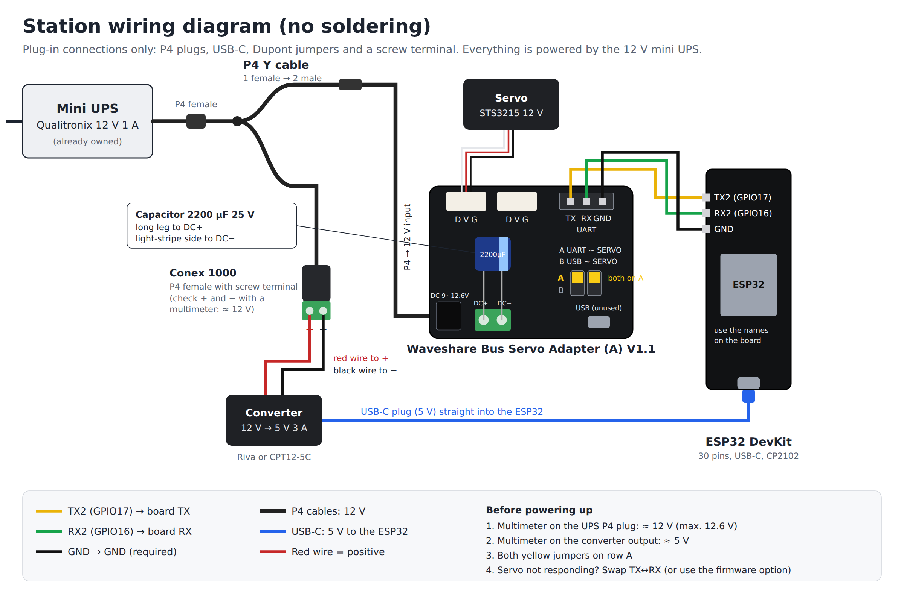

# Part 4 — Mechanism software (ESP32 firmware + PC program)

> **For Claude Code.** This document is the specification. Read all of it before writing code. The hardware is already defined and assembled **without soldering** (Part 3). Do not propose changes that require soldering. Ask the user the questions in section 10 before you start.



---

## 1. Context

A **Feetech STS3215 12 V** servo moves a plunger that presses the battery button of a **Unitree Go2**.

- The button works the same way to power on and to power off: **a short press followed right away by a long press (≥ 2 s)**, while the battery LEDs are lit.
- To **power off**, the robot must be lying down with the motors limp (`StandDown` and then `Damp`). Powered off while standing, it falls.
- After **powering on**, the robot takes ~2 minutes to boot and stands up by itself.

The ESP32 **does not know** whether the robot is on. The PC program is the one that decides and checks.

## 2. Hardware and wiring (fixed)

| Item | Detail |
|---|---|
| Microcontroller | ESP32 DevKit WROOM-32, 30 pins, USB-C, CP2102 USB bridge |
| Servo interface | Waveshare **Bus Servo Adapter (A) V1.1**, **both jumpers in position A** (UART ~ SERVO) |
| UART | ESP32 **GPIO17 (TX2) → board TX**; **GPIO16 (RX2) → board RX**; common GND. "TX to TX, RX to RX" wiring, as Waveshare requires. Use `Serial2` |
| Baud rate | 1,000,000 bps, 8N1 (STS3215 and SO-101 default) |
| Servo | 1 × STS3215 12 V. Unknown ID (factory default is 1; if it came from the SO-101, it may be 1 to 6) |
| Power | 12 V **1 A** mini UPS (board + servo); ESP32 through a 12 V → 5 V converter plugged into the USB-C. **The ESP32's USB-C is taken by the converter**, so updates after the first flash must be done **OTA (Wi-Fi)** |
| Network | 2.4 GHz Wi-Fi at home or in the lab; the PC is on the same network |

## 3. Mechanics (for unit conversion)

- 32-tooth pinion, module 1.5 → **150.8 mm per revolution** → **4096 steps = 150.8 mm** → **27.16 steps/mm**.
- Usable travel: 121 mm ≈ 3290 steps. The assembly puts "retracted" near **step 400** and "extended" near **3690**, without crossing 0/4095. **The direction** (whether advancing means increasing or decreasing steps) **is unknown**: find it during calibration and save it.
- Plunger tip when retracted: inside the tower. Distance to the battery face: ~118 mm (the firmware measures it, do not assume).

## 4. ESP32 firmware (requirements)

### 4.1 Platform

- **PlatformIO**, `framework = arduino`, `board = esp32dev`. If the user prefers the Arduino IDE, explain the alternative in the README.
- Servo protocol: use the Feetech/Waveshare **SCServo** library (class `SMS_STS`), available in the Waveshare wiki resources for the Bus Servo Adapter (A) and the ST3215. If it cannot be included cleanly, implement the protocol:
  - packet: `0xFF 0xFF ID LEN INSTR PARAMS… CHECKSUM`, with `CHECKSUM = ~(ID + LEN + INSTR + ΣPARAMS) & 0xFF`;
  - instructions: PING 0x01, READ 0x02, WRITE 0x03.
- Registers used (STS series addresses; **confirm in `SMS_STS.h`**):

| Register | Address |
|---|---|
| ID | 5 |
| Torque on/off | 40 |
| Acceleration | 41 |
| Goal position (2 bytes) | 42 |
| Goal speed (2 bytes) | 46 |
| Torque limit (RAM, 0–1000) | 48 |
| EEPROM lock | 55 |
| Present position | 56 |
| Present speed | 58 |
| Present load | 60 |
| Voltage (×0.1 V) | 62 |
| Temperature (°C) | 63 |
| Moving | 66 |
| Current | 69 |

### 4.2 Configuration (saved in NVS with `Preferences`)

| Parameter | Default | Note |
|---|---|---|
| `servo_id` | found by `scan` | — |
| `uart_swapped` | false | If true, uses RX = 17 and TX = 16. **Lets you fix swapped TX/RX without touching the wires** |
| `direction` | +1 | +1 if advancing = increasing step |
| `pos_retracted` | 400 | Calibrated |
| `pos_contact` | undefined | Calibrated by `touch` |
| `depth_mm` | 3.0 | How far to push beyond the contact point |
| `torque_limit` | 250 | = 25%, because of the 1 A mini UPS |
| `acceleration` | 50 | Servo units |
| `speed_fast` / `speed_slow` | 1500 / 300 | Steps per second |
| `load_threshold` | to be calibrated | Load that characterizes "touched" |
| `short_press_ms` | 300 | — |
| `gap_ms` | 400 | Between the short and the long press (the LEDs must stay lit) |
| `long_press_ms` | 3000 | ≥ 2 s per the manual |
| `min_voltage_v` | 10.5 | Below this, abort |
| `max_temp_c` | 60 | Above this, abort |
| `token` | set by the user | Required on routes that move the servo |

### 4.3 States and behavior

- **When the ESP32 boots: do not move anything.** Torque off, read the position and report it. If the position is far from `pos_retracted`, just warn in `status`.
- States: `IDLE` (torque off), `MOVING`, `SEQUENCE`, `CALIBRATING`, `ERROR`.
- One command at a time. Request during another command → HTTP 409.
- Watchdog: every movement has a maximum time. Exceeded → torque off and `ERROR`.

**`power_toggle` sequence** (the same for powering on and powering off):

1. Refuse if not calibrated (`pos_contact` undefined).
2. Torque on, with `torque_limit` and `acceleration`.
3. Fast advance to `pos_contact − 5 mm`.
4. Slow advance until contact is detected: load > `load_threshold`, or position stalled despite the target being ahead. No touch by `pos_contact + 8 mm` → retract, `ERROR: button not found`.
5. **Short press:** target = contact + `depth_mm`; hold `short_press_ms`; go back to contact − 2 mm.
6. Wait `gap_ms`.
7. **Long press:** target = contact + `depth_mm`; hold `long_press_ms`; go back.
8. Retract to `pos_retracted` and turn torque off (saves current; friction holds the plunger).
9. Throughout: voltage < `min_voltage_v` or temperature > `max_temp_c` → abort, retract, `ERROR`.
10. Write to the log: contact position, maximum load, maximum current, minimum voltage, duration.

**Other commands**

| Command | What it does |
|---|---|
| `touch` | Steps 2–4 without pressing; reports the contact position; retracts. Used to check alignment without powering the robot on |
| `move_to N` | Goes to step N slowly (used during assembly: N = 400) |
| `jog ±mm` | Moves in mm, slowly |
| `retract` | Goes back to `pos_retracted` |
| `stop` | Torque off immediately |
| `calibrate retracted` | Saves the current position as `pos_retracted` |
| `calibrate contact` | Runs `touch` 3 times, saves the average in `pos_contact` and measures `load_threshold` (free load + margin) |
| `calibrate direction` | Moves +2 mm and asks (via the response) whether the plunger advanced or retreated; saves it |
| `scan` | PINGs IDs 0–253; reports the ones found |
| `set_id N` | Changes the servo ID (unlocks and locks the EEPROM) |

### 4.4 HTTP interface (JSON)

- `mDNS`: `go2-station.local`, port 80.
- Routes that move the servo require the `X-Token` header.

| Method and route | Function |
|---|---|
| `GET /api/status` | state, position (steps and mm), load, current_mA, voltage_V, temperature_C, torque, calibration, last_error, Wi-Fi RSSI, version |
| `POST /api/sequence/power_toggle` | Runs the sequence and responds only at the end (~6 s), with the result and the measurements |
| `POST /api/touch` | — |
| `POST /api/retract` | — |
| `POST /api/move_to` | `{"step": 400}` |
| `POST /api/jog` | `{"mm": 2.0}` |
| `POST /api/stop` | — |
| `POST /api/calibrate/{retracted\|contact\|direction}` | — |
| `GET /api/scan` | — |
| `POST /api/config` | Changes parameters from 4.2 and saves them |
| `GET /api/log` | Last 50 events |

### 4.5 Serial console (115200 bps, over USB)

The same commands as text (`status`, `scan`, `touch`, `move_to 400`…), for bench testing **before** configuring Wi-Fi and before the converter takes over the USB-C.

### 4.6 Wi-Fi and updates

- Credentials in `include/secrets.h` (kept out of git, with a `secrets.example.h` example), or a configuration portal (WiFiManager). Explain both options and use the one the user chooses.
- Automatic reconnection.
- **Password-protected ArduinoOTA:** after the first flash over USB, the following ones go over the network (`pio run -t upload --upload-port go2-station.local`).

## 5. PC program

Python 3, a single file `go2_station.py`, configured through `config.yaml`.

```
python go2_station.py status
python go2_station.py touch
python go2_station.py power_on
python go2_station.py power_off
python go2_station.py calibrate contact
```

**Detecting whether the robot is on/off** (configurable):
- ping the Go2's IP (cable: 192.168.123.161; Wi-Fi: the IP the user provides); and/or
- presence of the DDS topic `rt/lowstate` via `unitree_sdk2py`, when available.

**`power_on`**
1. Confirm the robot is **off**: no response for 5 s.
2. Call `/api/sequence/power_toggle`.
3. Wait for the robot to show up on the network or on DDS: up to 180 s.
4. Report success or failure. **Never repeat the press on its own within those 180 s**: a second press during boot can power the robot off.

**`power_off`**
1. Confirm the robot is **on and parked**: through the Part 2 service, if it exists, or with `--i-can-see-the-robot-lying-down` for manual use.
2. Via `SportClient`: `StandDown` (1005), wait 2 s, `Damp` (1001), wait 1 s. Check the state (motion mode / body height) when the SDK allows it.
3. Call `/api/sequence/power_toggle`.
4. Wait for the robot to disappear: up to 60 s.

**Optional: ROS 2 node `go2_power_station`.** Services `/station/power_on` and `/station/power_off` (`std_srvs/Trigger`) and topic `/station/status`, reusing the same logic. Part 2 calls these services after parking and before leaving.

## 6. Safety (mandatory)

- Never move the servo on boot.
- Torque limited; torque off at rest.
- `power_off` only with the robot lying down and in `Damp`.
- Stop button: `POST /api/stop` and the `stop` console command.
- Token for any route that moves the servo.
- Every failure retracts the plunger before stopping (except `stop`, which only turns the torque off).

## 7. Tests

1. **Unit (PC, no hardware):** packet building and checksum, mm ↔ steps conversion, state machine with a simulated servo (including the no-contact, low-voltage and timeout cases).
2. **Bench, no robot** (the user holds a piece of cardboard in front of the plunger):
   - `scan` finds the servo;
   - `move_to 400`;
   - `calibrate direction`;
   - `jog` through the whole travel without rubbing;
   - `touch` on the cardboard stops and reports the position;
   - current during free movement < 0.5 A.
3. **With the robot off and lying in the cradle:**
   - `calibrate contact`;
   - `touch` 5 times: the contact varies less than ±1 mm;
   - `power_on`: the robot powers on and stands up within 180 s.
4. **With the robot on and lying down:** `power_off` powers it off within 60 s.
5. **Robustness:** 10 power-on/power-off cycles without errors.

## 8. Deliverables

```
station_firmware/          # PlatformIO
  platformio.ini
  include/secrets.example.h
  src/…                    # main, servo, sequence, http, ota, config
  test/…
pc_client/
  go2_station.py
  config.example.yaml
  requirements.txt
  tests/…
ros2/go2_power_station/    # optional, if the user wants it
README.md                  # flashing over USB on Linux (dialout group, /dev/ttyUSB0),
                           # Wi-Fi setup, calibration, usage, OTA
```

**First flash (include in the README).** On Linux, connect the ESP32 to the PC with the USB-A → USB-C cable, with the converter unplugged. Check with `ls /dev/ttyUSB*` (`/dev/ttyUSB0` should appear; if it does not, the cable is charge-only). Flash with `pio run -t upload`. Then plug the converter back in.

## 9. What NOT to do

- Do not power the ESP32 through the 5V pin and the USB-C at the same time.
- Do not change the servo baud rate (the same model is used in the SO-101) without asking.
- Do not trigger the sequence automatically when the ESP32 boots or when Wi-Fi reconnects.

## 10. Questions for the user

1. Wi-Fi name and password (or do you prefer the configuration portal)?
2. Did the servo come from the SO-101? What ID did it have?
3. How does the PC talk to the Go2 (cable/DDS or Wi-Fi/WebRTC), and what is the robot's IP?
4. PC operating system (from the screenshot, probably Ubuntu).
5. Do you want the optional ROS 2 node or just the command-line program?
