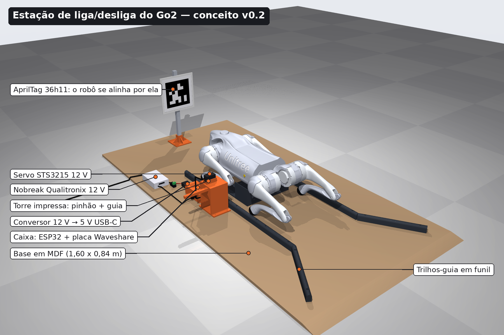
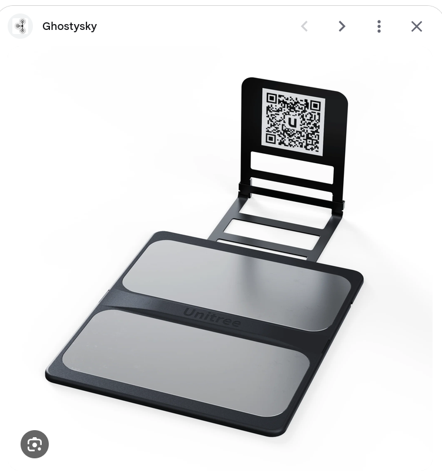
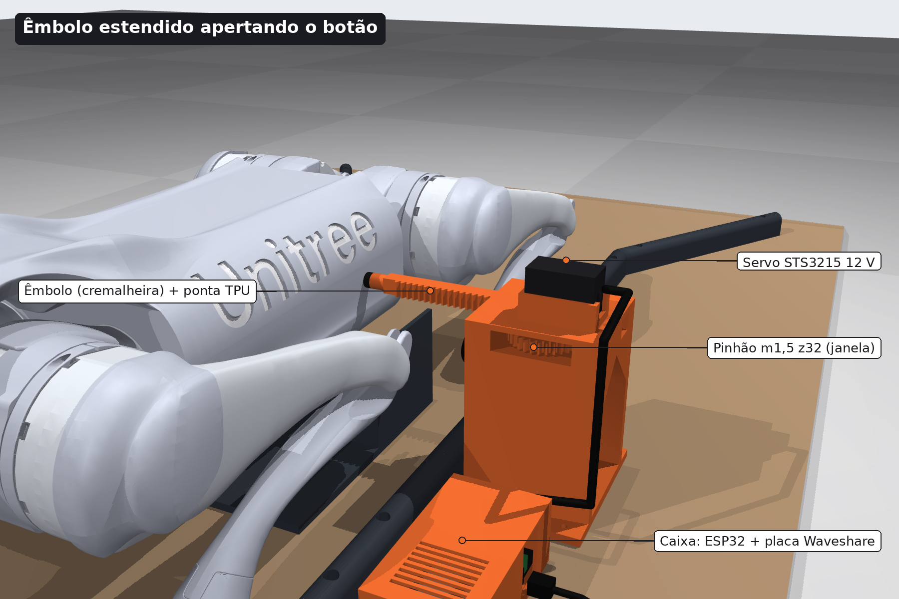
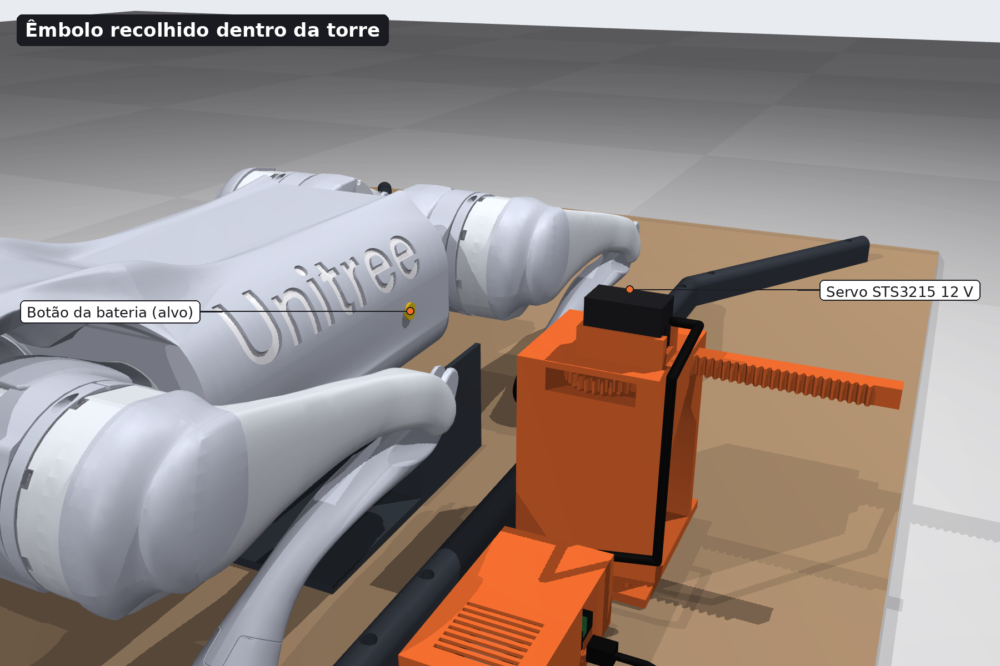
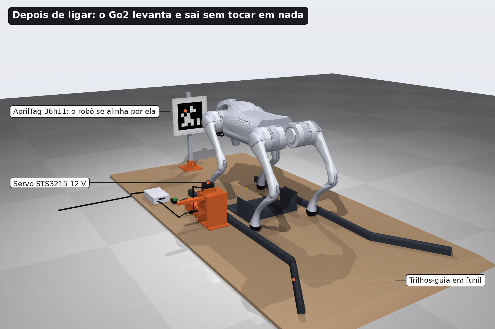
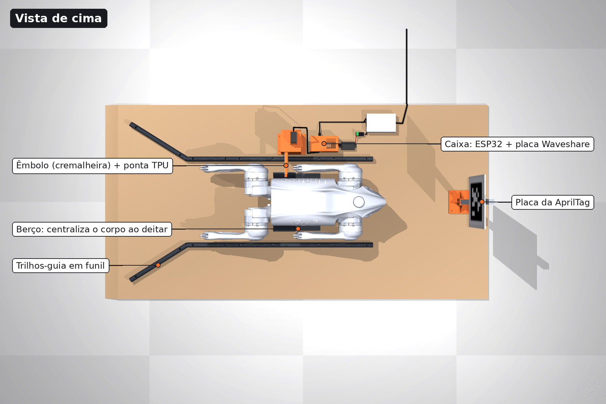
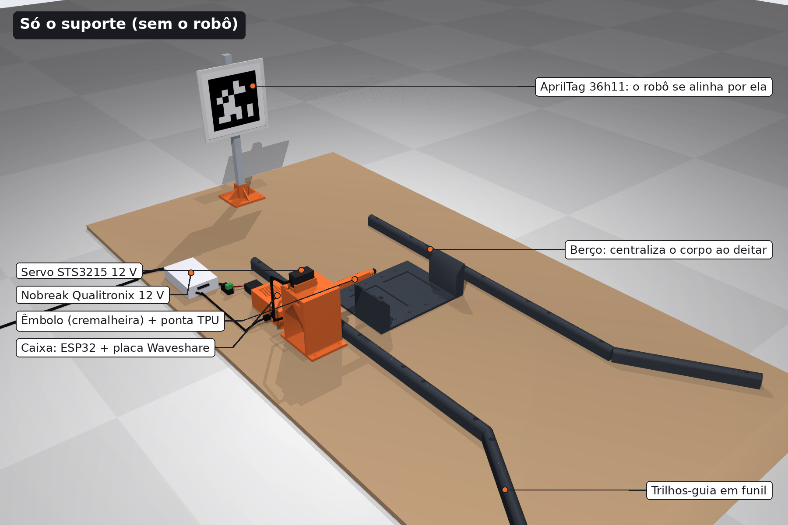
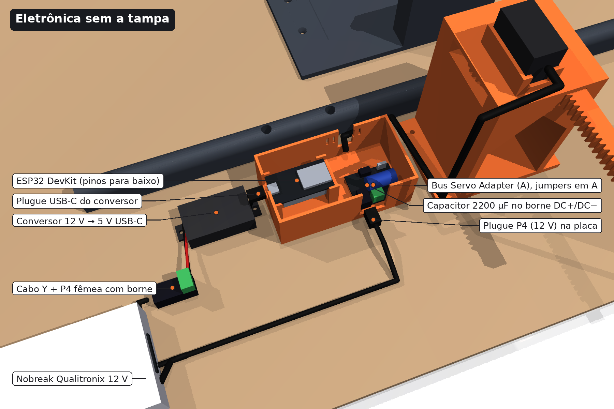
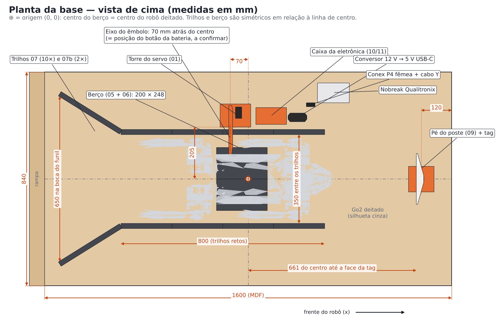

# Estação de liga/desliga do Unitree Go2

Versão 0.2 · 31/10/2026

O robô entra na estação andando, guiado por uma AprilTag. Ele se deita num berço impresso em 3D. Um servo STS3215 empurra um êmbolo que aperta o botão da bateria para **ligar** ou **desligar** o Go2. O comando vem do seu PC pela rede Wi-Fi. A estação **não carrega** o robô.

O dock oficial da Unitree (abaixo) carrega a bateria. Desta estação aproveitamos só a ideia do marcador num poste à frente do robô.

---

## Como o pacote está organizado

| Parte | Pasta | O que tem | Quem usa |
|---|---|---|---|
| 1. Construção da AprilTag | `parte1_construcao_apriltag/` | Medidas do poste e da placa, opções de material, PDF da tag, STLs 08 e 09 | Você (oficina) |
| 2. Software da AprilTag | `parte2_software_apriltag/` | Especificação do estacionamento autônomo | Claude Code |
| 3. Construção do mecanismo | `parte3_construcao_mecanismo/` | STLs, montagem, ligação elétrica, testes | Você (oficina) |
| 4. Software do mecanismo | `parte4_software_mecanismo/` | Especificação do firmware do ESP32 e do programa do PC | Claude Code |
| — | `imagens/` | Renders, planta com medidas, esquema elétrico | Todos |
| — | `fonte_cad/` | Código Python que gera as peças, os renders e os desenhos | Para alterar medidas |

### Ordem sugerida

1. **Parte 3 e Parte 4 primeiro.** Monte o mecanismo, grave o firmware e teste ligar e desligar com o robô **colocado à mão** no berço. Isso valida a posição do botão antes de tudo.
2. **Depois as Partes 1 e 2.** Monte o poste da tag e faça o robô estacionar sozinho.
3. Por último, ligue as duas coisas: estacionar → deitar → desligar, e ligar → levantar → sair.

---

## Lista de materiais completa

Preços consultados no Mercado Livre em 31/10/2026. Podem mudar.

### Comprar

| Item | Para quê | Link | Preço |
|---|---|---|---|
| ESP32 DevKit WROOM-32, USB-C, CP2102, 30 pinos | Recebe o comando pelo Wi-Fi e move o servo | [Mercado Livre](https://www.mercadolivre.com.br/esp32-devkit-modulo-microcontrolador-wroom32-memoria-placa/up/MLBU3867919063?pdp_filters=item_id:MLB6539552690) | R$ 43,89 |
| Conversor Riva 12 V → 5 V 3 A, plugue USB-C | Alimenta o ESP32 a partir do nobreak | [Mercado Livre](https://www.mercadolivre.com.br/conversor-riva-12v-para-5v-3a-15w-usb-tipo-c-para-moto-e-carro/p/MLB29792316?pdp_filters=item_id:MLB7631137154) | R$ 78,99 |
| Cabo Y P4 (1 fêmea, 2 machos) | Divide os 12 V do nobreak entre a placa e o conversor | [Mercado Livre](https://www.mercadolivre.com.br/cabo-y-p4-macho-e-femea-1-femea-2-machos-alimentacao-energia/up/MLBU787797870?pdp_filters=item_id:MLB4632104828) | R$ 19,98 |
| Kit 10 conectores P4 fêmea com borne, Intelbras Conex 1000 | Liga os fios do conversor no cabo Y sem solda | [Mercado Livre](https://www.mercadolivre.com.br/kit-10-conector-p-camera-conex-1000-p4-femea--intelbras/up/MLBU3384910543?pdp_filters=item_id%3AMLB4180196627) | R$ 8,94 |
| Kit 10 jumpers dupont fêmea-fêmea 20 cm | TX, RX e GND entre o ESP32 e a placa da Waveshare | [Mercado Livre](https://www.mercadolivre.com.br/kit-jumper-femea-femea-20cm-10-unidades-para-protoboard-conector-dupont/p/MLB52686612?pdp_filters=item_id:MLB5851698888) | R$ 11,00 |
| Kit 10 capacitores eletrolíticos 2200 µF 25 V 105 °C | Segura os picos de corrente do servo | [Mercado Livre](https://www.mercadolivre.com.br/capacitor-eletrolitico-2200uf-x-25v-105-kit-com-10-pecas/p/MLB2107006497?pdp_filters=item_id:MLB1493902058) | R$ 24,00 |
| | | **Total** | **R$ 186,80** |

Antes de comprar o ESP32, pergunte ao vendedor se a placa vem **com os pinos já soldados**. O projeto não pode ter solda.

### Já tem

| Item | Observação |
|---|---|
| Servo Feetech STS3215 12 V (o do SO-101) | Um só |
| Waveshare Bus Servo Adapter (A) V1.1 | Mude **os dois** jumpers amarelos para a fileira **A** |
| Mini nobreak Qualitronix 12 V 1 A | Saída P4. Meça: tem que dar perto de 12 V (máximo 12,6 V) |
| Cabo curto USB-A para USB-C | Só para gravar o firmware. Teste se transmite dados (veja a Parte 4) |
| Impressora 3D e multímetro | — |

### Materiais de construção

| Item | Quantidade | Usado em |
|---|---|---|
| PETG 1,75 mm | ~1,1 kg sem os trilhos impressos, ~1,8 kg com eles (2 rolos) | Partes 1 e 3 |
| TPU (opcional) | Poucos gramas | Ponta do dedo (ou use um pezinho de borracha) |
| MDF 15–18 mm, 1600 × 840 mm | 1 chapa | Base de tudo |
| Sarrafo 2 × 2 cm × 42 cm, ou perfil de alumínio 20 × 20 | 1 | Poste da tag |
| Placa lisa de 200 × 200 mm (MDF 6 mm ou a peça 08 impressa) | 1 | Fundo da tag |
| Parafusos para madeira 4 × 20 mm (cabeça chata) | ~40 | Fixar as peças no MDF |
| Parafusos M4 × 30 (+ porcas martelo, se usar perfil V-slot) | 2 | Prender a placa da tag no poste |
| Parafusos autoatarraxantes M2,5 × 6 mm | 4 | Placa da Waveshare na caixa (ou fita dupla face) |
| Fita dupla face de espuma | 1 rolo pequeno | ESP32 nos apoios, servo na torre |
| Abraçadeiras (enforca-gato) de 30 cm | 2 | Prender o servo na torre |
| Cola spray ou fita dupla face fina | — | Colar a tag no fundo |

---

## Premissas que você precisa confirmar

1. **Posição do botão da bateria.** O projeto supõe o botão do **lado esquerdo** do robô, a **125 mm** de altura do chão com o robô deitado e **70 mm atrás do centro** do robô. Isso foi medido no modelo 3D oficial da Unitree. Confirme no seu Go2 antes de imprimir a torre (veja a Parte 3, seção 2).
2. **Medidas das placas.** A caixa foi desenhada com folga para um ESP32 DevKit de 50–56 mm de comprimento e para a placa da Waveshare de 42 × 33 mm (dado do fabricante). Confira com uma régua quando as placas chegarem.
3. **Furos do horn do servo.** O pinhão tem 4 furos num círculo de 16 mm, mais o furo central. Confira no horn metálico do seu STS3215.

## Riscos conhecidos

- **Precisão para frente e para trás.** O berço centraliza o robô para os lados, mas não na direção da frente. A ponta do dedo precisa cair sobre o botão. A Parte 2 grava uma posição de referência e confere a posição depois que o robô deita. A peça 04b (ponta larga de 20 mm) dá mais tolerância.
- **Nobreak de 1 A.** Funciona com o torque do servo limitado a ~25% e com o capacitor. Meça a corrente no primeiro teste.

## Imagens

| | |
|---|---|
|  |  |
|  |  |
|  |  |

## Créditos e fontes

- Modelo 3D do Go2: [MuJoCo Menagerie](https://github.com/google-deepmind/mujoco_menagerie/tree/main/unitree_go2), derivado do [URDF oficial da Unitree](https://github.com/unitreerobotics/unitree_ros/tree/master/robots/go2_description) (licença BSD-3, Unitree Robotics).
- Imagem da AprilTag: [AprilRobotics/apriltag-imgs](https://github.com/AprilRobotics/apriltag-imgs), família tag36h11, ID 0.
- Waveshare Bus Servo Adapter (A): [wiki](https://www.waveshare.com/wiki/Bus_Servo_Adapter_(A)) e [página do produto](https://www.waveshare.com/bus-servo-adapter-a.htm) (42 × 33 mm, furos de 2,5 mm a 37 × 28 mm).
- Servo ST3215: [wiki da Waveshare](https://www.waveshare.com/wiki/ST3215_Servo) (entrada de 6 a 12,6 V).
- Manual do Go2: ligar e desligar com toque curto e depois toque longo de 2 s ou mais, sempre com o robô deitado para desligar.
