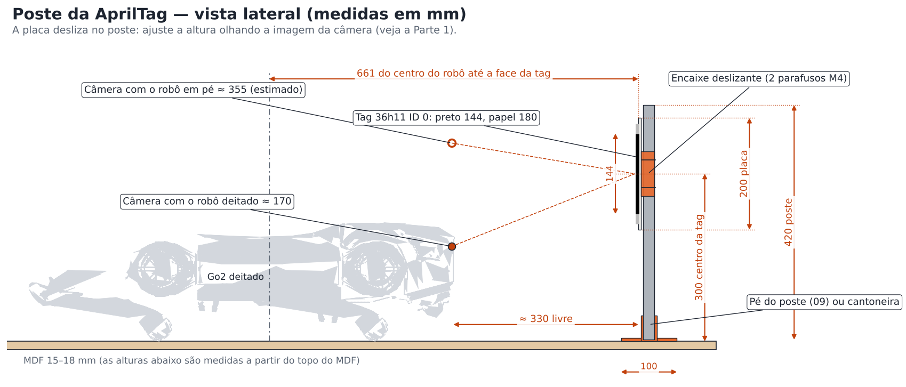
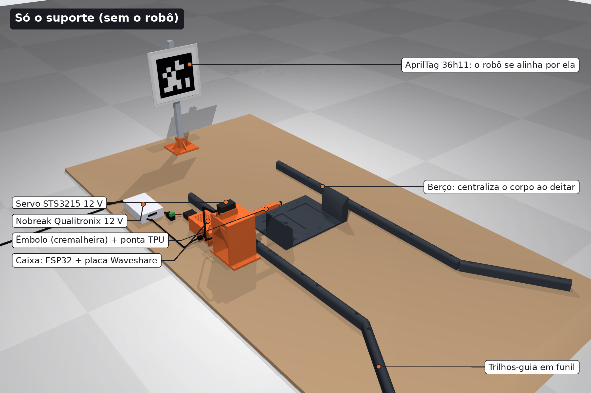

# Parte 1 — Construção do poste da AprilTag

A AprilTag fica num poste **à frente do robô**, no eixo central da estação, como no dock oficial da Unitree. O robô entra andando de frente, vê a tag com a câmera frontal e usa a posição dela para parar no lugar certo.

---

## 1. Medidas principais

Todas as alturas são medidas a partir do **topo do MDF**, que é onde o robô pisa.

| O quê | Medida | Por quê |
|---|---|---|
| Família e ID da tag | tag36h11, ID 0 | Família padrão, resistente a erro de leitura |
| Quadrado preto da tag | **144 mm** de lado | É esse número que vai no software (`tag_size = 0.144`) |
| Papel impresso (com a borda branca) | 180 × 180 mm | A borda branca faz parte da tag; não corte |
| Placa de fundo (o "quadrado") | **200 × 200 mm** | 10 mm de sobra em volta do papel |
| Altura do **centro** da tag | **300 mm** | Ver explicação abaixo |
| Borda de baixo e de cima da placa | 200 mm e 400 mm | — |
| Poste (haste vertical) | **420 mm** de comprimento, seção 20 × 20 mm | Deixa 20 mm acima da placa e permite ajustar a altura |
| Posição do poste | No eixo central, centro do poste a **680 mm** do centro do berço (120 mm da borda da frente do MDF) | — |
| Face da tag até o centro do berço | **661 mm** | Vai para o software |
| Espaço livre entre o nariz do robô e a tag | ≈ 330 mm | O robô não encosta na placa |

### Por que o centro fica a 300 mm

Medi a câmera frontal no modelo 3D oficial. Com o robô **em pé**, a câmera fica a uns **355 mm** do chão (estimado: o Go2 tem 40 cm de altura total em pé). Com o robô **deitado**, ela fica a uns **170 mm**.

- Em pé, chegando de 1,5 m de distância, a tag fica praticamente na altura da câmera.
- Em pé, já na posição final (a ~33 cm da tag), a tag fica um pouco abaixo do centro da imagem.
- Deitado, a tag fica acima do centro da imagem, mas ainda inteira. Isso permite conferir a posição depois que o robô deita.

300 mm é o meio-termo. A placa **desliza no poste**, então você ajusta olhando a imagem da câmera (passo 7 da montagem).

---

## 2. Lista de materiais desta parte

### Tag impressa

| Item | Recomendação |
|---|---|
| Arquivo | `apriltag_36h11_id0_A4.pdf` (nesta pasta). Também tem `apriltag_36h11_id0_2000px.png`, se precisar |
| Impressão | Folha A4, escala **100%** (desmarque "ajustar à página"). Impressora laser de preferência: o preto fica mais uniforme |
| Papel | Fosco: sulfite comum 90 g ou papel fotográfico **fosco**. Não use papel brilhante nem plastificação com brilho, porque o reflexo atrapalha a detecção |
| Conferência | Meça o quadrado preto com régua: tem que dar **144 mm**. Se der 143 ou 145, tudo bem, mas anote o valor medido e use no software |

### Placa de fundo (o quadrado onde o papel é colado)

Ela precisa ser **rígida e perfeitamente plana**. Qualquer curvatura distorce a tag e o robô calcula a posição errada.

| Material | Serve? | Observação |
|---|---|---|
| **MDF 6 mm, 200 × 200** | **Recomendado** | Barato, plano, fácil de cortar. Prenda no poste com 2 parafusos |
| **Peça 08 impressa (`stl/08_placa_apriltag.stl`)** | **Recomendado** | Já vem com o encaixe deslizante para poste 20 × 20. Imprima com a face lisa para baixo na mesa |
| PVC expandido ou foam board (papel pluma) 5 mm | Serve | Leve e plano. Cole numa ripa para prender no poste |
| Acrílico 3 mm | Serve | Cuidado com reflexo; use papel fosco por cima |
| Papelão | Só para teste rápido | Empena com umidade e com o tempo. Se usar, cole papelão duplo e troque por MDF depois |

### Haste vertical (poste)

| Opção | Comprimento | Como prender a placa |
|---|---|---|
| **Sarrafo de pinus 2 × 2 cm** | 420 mm | Parafuso de madeira direto no sarrafo, em qualquer altura. Se usar o pé impresso, lixe o sarrafo até entrar no encaixe de 20,4 mm |
| **Perfil de alumínio 20 × 20 (V-slot)** | 420 mm | 2 parafusos M4 + 2 porcas martelo no canal; desliza para ajustar a altura |
| Cabo de vassoura (redondo) | 420 mm | Não entra no pé impresso. Use cantoneira e prenda a placa com abraçadeiras |

### Base do poste

| Opção | Como |
|---|---|
| **Peça 09 impressa (`stl/09_pe_poste_tag.stl`)** | 100 × 100 mm, 4 parafusos 4 × 20 no MDF. O poste entra no encaixe quadrado |
| Cantoneira metálica em L de 50 mm (ou mão-francesa) | 2 parafusos no MDF + 2 no poste |
| Bloco de madeira | Parafuse o bloco no MDF por baixo e o poste no bloco |

### Parafusos e colagem

- 4 parafusos para madeira 4 × 20 mm (pé no MDF)
- 2 parafusos M4 × 30 (ou para madeira 4 × 30) para a placa no poste
- Cola spray para papel, ou fita dupla face fina cobrindo toda a área do papel

---

## 3. Montagem passo a passo

1. **Risque a linha de centro no MDF**, no sentido do comprimento (1600 mm), e marque o centro do berço. Veja a planta em `../imagens/planta_base_cotas.png`.
2. **Marque o centro do poste** sobre a linha de centro, a **680 mm** do centro do berço, na direção para onde o robô olha (120 mm da borda da frente).
3. **Fixe o pé** (peça 09 ou cantoneira) com o centro do encaixe nessa marca.
4. **Coloque o poste** e confira com um esquadro que ele está a 90° do MDF nas duas direções.
5. **Cole a tag na placa.** Recorte o papel nas marcas cinzas (180 × 180 mm), centralize na placa e passe a mão do centro para fora para tirar bolhas. Escreva "TOPO" atrás da placa, do lado de cima da tag: girar a tag muda o referencial calculado pelo software.
6. **Prenda a placa no poste** com a tag **virada para o robô** (para o lado do berço), com o centro da tag a **300 mm** do topo do MDF. Use um esquadro apoiado na linha de centro do MDF para deixar a placa a 90° da linha.
7. **Ajuste fino com a câmera** (depois que o software da Parte 2 estiver mostrando a imagem):
   - Coloque o robô em pé na posição final (centro sobre o centro do berço).
   - A tag deve aparecer inteira e um pouco abaixo do centro da imagem.
   - Mande o robô deitar: a tag deve continuar inteira na imagem.
   - Se cortar em alguma das duas situações, suba ou desça a placa 1–2 cm e repita.

---

## 4. Anote estes valores para a Parte 2

Meça a sua montagem real e entregue estes números ao Claude Code junto com a especificação da Parte 2.

| Valor | Projeto | Medido na sua montagem |
|---|---|---|
| Lado do quadrado preto (`tag_size`) | 0,144 m | |
| Distância da face da tag até o centro do berço | 0,661 m | |
| Altura do centro da tag acima do topo do MDF | 0,300 m | |
| Espessura do MDF | 15–18 mm | |
| A tag está na linha de centro? (desvio lateral) | 0 mm | |

## 5. Checklist

- [ ] Tag impressa a 100% e quadrado preto medido
- [ ] Placa plana, papel sem bolhas, "TOPO" marcado atrás
- [ ] Poste no prumo, a 680 mm do centro, na linha de centro
- [ ] Placa a 90° da linha de centro, centro da tag a 300 mm
- [ ] Valores medidos anotados para a Parte 2
