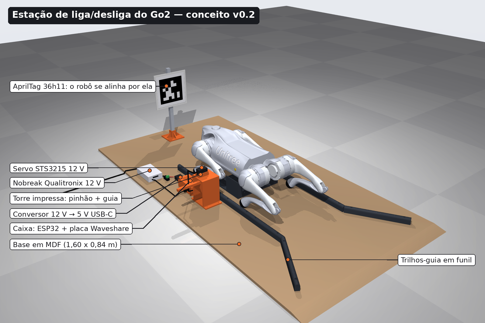
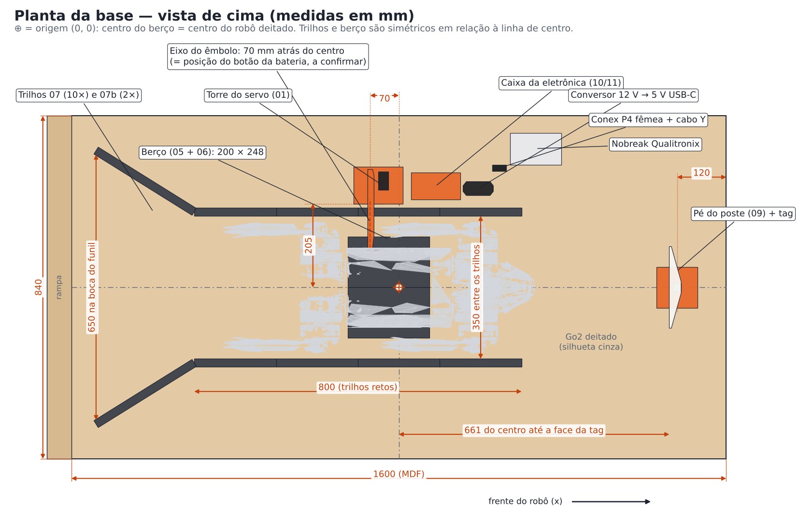

# Parte 2 — Software de estacionamento com AprilTag

> **Para o Claude Code.** Este documento é a especificação. Leia inteiro antes de escrever código. Antes de começar, inspecione o repositório do usuário para descobrir a stack de navegação que já existe. Faça ao usuário as perguntas da seção 11 que o repositório não responder.



---

## 1. Contexto

- **Robô:** Unitree Go2 (quadrúpede). Confirmar com o usuário: Air, Pro ou EDU; acesso via `unitree_sdk2` (DDS, cabo) ou via WebRTC (`go2_ros2_sdk`).
- **O que já existe:** uma stack de navegação funcionando (provavelmente ROS 2 + Nav2, com mapa e localização). Ela leva o robô até perto da estação.
- **O que falta (sua tarefa):** fazer o robô **estacionar com precisão** numa estação física, **deitar**, e depois **sair** dela.
- **Hardware da estação** (já construído pelo usuário, Partes 1 e 3):
  - base de MDF com um berço impresso que centraliza o corpo para os lados quando o robô deita;
  - trilhos em funil na entrada;
  - uma **AprilTag tag36h11, ID 0, quadrado preto de 0,144 m**, num poste à frente do robô;
  - um mecanismo com servo que aperta o botão da bateria (software na Parte 4).
- **Restrição:** o usuário não solda. Não proponha mudanças de hardware que exijam solda.

## 2. Geometria da estação

Use estes valores como padrão num arquivo YAML de parâmetros. O usuário mede a montagem real na Parte 1 (seção 4) e pode passar valores diferentes.

Defina o frame **`dock`**:
- origem no topo do MDF, exatamente sob o centro do berço;
- **x** aponta para a tag (direção "para frente" do robô estacionado);
- **y** para a esquerda do robô;
- **z** para cima.

| Elemento | Posição no frame `dock` |
|---|---|
| Centro do robô estacionado (projeção de `base_link` no chão) | (0, 0, 0), yaw = 0 |
| Centro da tag | (0,661; 0; 0,300) m, face virada para −x (para o robô) |
| Tag: lado do quadrado preto | 0,144 m |
| Pose de preparação (*staging*) | (−1,10; 0; 0), yaw = 0. O robô fica 1,1 m atrás, de frente para a tag |
| Boca do funil | x = −0,74 m; largura útil 0,65 m |
| Corredor reto entre os trilhos | x de −0,50 a +0,30 m; largura útil 0,35 m |
| Eixo do êmbolo (botão da bateria) | x = −0,070 m, lado esquerdo do robô |



**Convenção de eixos da tag.** Detectores diferem: no `apriltag` (C) o z da tag aponta para dentro da tag; em outros pacotes, para fora. Não presuma. Com o detector rodando, coloque a câmera de frente para a tag, olhe os eixos no RViz e só então escreva a transformação fixa `tag → dock`.

**Câmera do Go2 (valores aproximados, só para começar).** Lente na frente da cabeça, cerca de 0,32 m à frente do centro do corpo e 0,044 m acima dele. Com o robô em pé, isso dá ~0,355 m do chão; deitado, ~0,17 m. A inclinação é desconhecida. Prefira o método de **referência gravada** da seção 5, que não depende desses valores.

## 3. Objetivo e critérios de sucesso

1. A partir da pose de preparação, o robô entra andando de frente e para com o centro sobre o centro do berço.
2. **Precisão exigida no ponto final, ainda em pé:** lateral ≤ 10 mm (o berço corrige até ~±20 mm); yaw ≤ 2°; **longitudinal ≤ 5 mm**. Este é o eixo crítico: nada mecânico corrige o x, e a ponta do êmbolo precisa cair sobre o botão.
3. O robô **deita** (`StandDown`) e o software **confere a posição deitado** pela tag. Fora da tolerância: levanta, recua e tenta de novo (no máximo 2 novas tentativas).
4. **Sair:** depois que o robô liga e levanta sozinho, ele anda de ré até a pose de preparação e devolve o controle para a navegação.
5. 18 de 20 estacionamentos seguidos dentro da tolerância (seção 9).

## 4. Arquitetura proposta

Crie um pacote ROS 2 `go2_dock`. Adapte os nomes à stack existente.

```
câmera frontal ──► calibração (camera_info) ──► detector AprilTag ──► pose da tag
                                                                       │
Nav2 (já existe) ──► leva à pose de preparação                         ▼
                                     dock_controller (máquina de estados, controle holonômico)
                                                    │  cmd_vel ou SportClient.Move(vx, vy, vyaw)
                                                    │  StandDown / StandUp / RecoveryStand
                                                    ▼
                                                  Go2
```

Componentes:

1. **Fonte de imagem.** Use o que existir:
   - `go2_ros2_sdk` (WebRTC) publicando `/camera/image_raw`;
   - `unitree_sdk2` / `unitree_sdk2_python` com `VideoClient` (DDS, modelos EDU);
   - uma câmera USB extra, se o usuário preferir.
2. **Calibração intrínseca.** `camera_calibration` (`cameracalibrator`) com tabuleiro de xadrez. A câmera do Go2 é grande-angular: avalie se o modelo `plumb_bob` basta ou se precisa de modelo olho-de-peixe. Salve um YAML de `camera_info` e publique junto com a imagem.
3. **Detector.** `apriltag_ros` para ROS 2 (christianrauch) ou equivalente: família `36h11`, `size: 0.144`, `ids: [0]`, frame `dock_tag`. Saída: detecções e TF câmera → tag.
4. **`dock_controller`.** Seu nó principal (seções 5 a 7).
5. **Interfaces.** Uma action ou serviço `dock` e outro `undock`, para chamar da árvore de comportamento ou da missão. Se a stack usa o Docking Server do Nav2 (`opennav_docking`), avalie expor interfaces compatíveis com `DockRobot` / `UndockRobot`. O controlador de aproximação do Nav2 foi feito para robôs diferenciais. Para o Go2, que anda de lado, um controlador holonômico próprio é mais simples e mais preciso; justifique a escolha no README.

## 5. Precisão: referência gravada (*teach and repeat*)

A posição final é definida pela **pose da tag vista pela câmera**, não por geometria calculada. Isso elimina erros de calibração externa (posição e inclinação da câmera).

1. **Modo de ensino** (`ros2 run go2_dock teach`):
   - o usuário posiciona o robô à mão (ou pelo controle) no berço, em pé, com o êmbolo alinhado ao botão. Para conferir, use o comando `encostar` da Parte 4: o êmbolo avança devagar até tocar e mostra onde tocou;
   - grave a pose da tag no frame da câmera, em pé: **REF_EM_PE** (média de 2 s de detecções);
   - mande deitar (`StandDown`), espere estabilizar e grave **REF_DEITADO**;
   - salve as duas num YAML, junto com o desvio-padrão medido.
2. **No estacionamento,** o controlador leva o erro entre a pose atual da tag e REF_EM_PE a zero.
3. **Depois de deitar,** compare a pose atual com REF_DEITADO. A diferença em x (no frame do corpo) é o erro do êmbolo em relação ao botão.

## 6. Máquina de estados do `dock_controller`

| Estado | O que faz | Sai quando |
|---|---|---|
| `IR_PARA_PREPARACAO` | `NavigateToPose` do Nav2 até a pose de preparação (frame `map`; a pose da estação no mapa fica salva em parâmetro) | Chegou → `PROCURAR_TAG` |
| `PROCURAR_TAG` | Parado; espera a tag ID 0 em ≥ 5 quadros seguidos | Viu → `APROXIMAR`; 5 s sem ver → girar ±15° e tentar; falhou → `ERRO` |
| `APROXIMAR` | Controle holonômico até REF_EM_PE (seção 7). **Desligue o desvio de obstáculos nativo do Go2** nesta fase (o poste e os trilhos estão perto) e religue depois | Erro dentro da tolerância por 1 s → `ASSENTAR`; tag perdida > 1 s → `RECUAR` |
| `ASSENTAR` | Velocidade zero por 1 s; confere o erro de novo | Ok → `DEITAR`; fora → `APROXIMAR` |
| `DEITAR` | `StandDown` (API 1005); espera ~2 s | → `CONFERIR_DEITADO` |
| `CONFERIR_DEITADO` | Compara com REF_DEITADO | Ok → `ESTACIONADO`; fora → `LEVANTAR_E_REPETIR` |
| `LEVANTAR_E_REPETIR` | `StandUp` (1004) ou `RecoveryStand` (1006); recua 0,30 m | → `APROXIMAR` (até 2 vezes) → `ERRO` |
| `RECUAR` | Ré lenta até ver a tag de novo, no máximo até a pose de preparação | → `PROCURAR_TAG` |
| `ESTACIONADO` | Publica estado; pode chamar `/estacao/desligar` (Parte 4), se configurado | — |
| `SAIR` (action `undock`) | Robô em pé (ele levanta sozinho depois de ligar); ré a 0,10 m/s até a pose de preparação, corrigindo y e yaw pela tag enquanto ela estiver visível | → devolve o controle |
| `ERRO` | Para, publica o motivo, não chama `Damp` | Intervenção do usuário |

`Damp` (API 1001, motores soltos) só deve ser chamado pela Parte 4, imediatamente antes de desligar a bateria, e só com o robô deitado no berço.

## 7. Controlador de aproximação

- Erro no frame do corpo: (ex, ey, eyaw), entre a pose atual da tag e REF_EM_PE, já convertido para movimento do corpo.
- Comandos: `vx = kx·ex`, `vy = ky·ey`, `vyaw = kyaw·eyaw`. Comece com kx = ky = 0,8 1/s e kyaw = 1,0 1/s.
- Saturação: |vx| ≤ 0,15 m/s (≤ 0,05 m/s nos últimos 10 cm), |vy| ≤ 0,08 m/s, |vyaw| ≤ 0,3 rad/s.
- **Zona morta do Go2:** velocidades muito pequenas podem não gerar passo nenhum. Meça a menor velocidade que move o robô e, perto do alvo, use pulsos curtos (mover 0,3 s, parar 0,5 s, medir de novo).
- **Filtro:** mediana das últimas 5 detecções + passa-baixa (α ≈ 0,3). Descarte detecções com erro de decodificação alto ou com a tag muito inclinada.
- Taxa de controle: 10–20 Hz. Timeout de comando: sem detecção nova por 0,3 s → velocidade zero.

## 8. Segurança

- Botão de parada (tópico ou serviço) que zera velocidades e cancela a action.
- Limites de velocidade sempre ativos. Timeout geral de 90 s para o estacionamento inteiro.
- Nunca mande `Damp` fora do estado de desligamento da Parte 4.
- Se a tag sumir durante o `APROXIMAR`, pare antes de recuar. Nada de andar às cegas para frente.
- Registre (log) cada tentativa com os erros finais em pé e deitado: isso alimenta o teste da seção 9.

## 9. Testes de aceitação

1. **Detector:** com o robô parado a 1,0 m, o desvio-padrão da pose da tag em 10 s deve ficar ≤ 2 mm e ≤ 0,5°.
2. **Repetibilidade:** 20 estacionamentos seguidos, começando de poses aleatórias a 1–2 m da pose de preparação. Anote os erros em pé e deitado. Meta: ≥ 18/20 com x ≤ 5 mm, y ≤ 10 mm, yaw ≤ 2°.
3. **Verificação física:** em 5 das 20 tentativas, rode `encostar` (Parte 4) e confirme que a ponta toca o botão.
4. **Sair:** 10 saídas sem tocar nos trilhos.
5. **Falhas:** cubra a tag no meio da aproximação; o robô deve parar e recuar.

Se o critério 2 falhar no eixo x, relate os números ao usuário. Opções mecânicas: ponta larga (peça 04b) ou indexação pelos joelhos no berço. Não invente correções sem dados.

## 10. Entregáveis

- Pacote `go2_dock` com: `dock_controller`, ferramenta `teach`, arquivos launch, `params.yaml` (geometria da seção 2, ganhos, tolerâncias, pose da estação no mapa), configuração do RViz.
- Arquivos de calibração: `camera_info` e referências gravadas.
- Testes unitários do controlador e das transformações, rodando sobre dados gravados (rosbag).
- `README.md` do pacote com: como calibrar, como gravar a referência, como chamar `dock` e `undock`, como integrar à missão.

## 11. Perguntas para o usuário (faça antes de codar)

1. Qual Go2: Air, Pro ou EDU? Como o PC fala com o robô: cabo (DDS) ou Wi-Fi (WebRTC)?
2. Qual distribuição do ROS 2 e onde roda a stack: no Jetson do robô ou num PC?
3. Como a navegação manda velocidade hoje: `cmd_vel` para qual ponte?
4. Já existe imagem da câmera frontal num tópico? Qual resolução?
5. Onde fica a estação no mapa (pose aproximada no frame `map`)?
6. Valores medidos da Parte 1 (seção 4) e o desvio lateral do poste.
