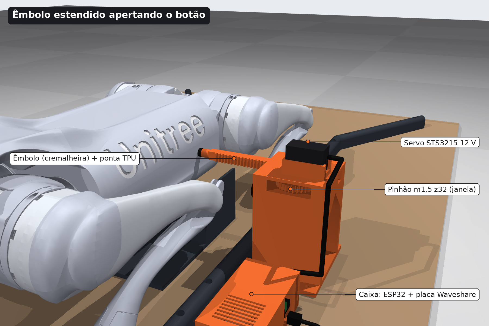
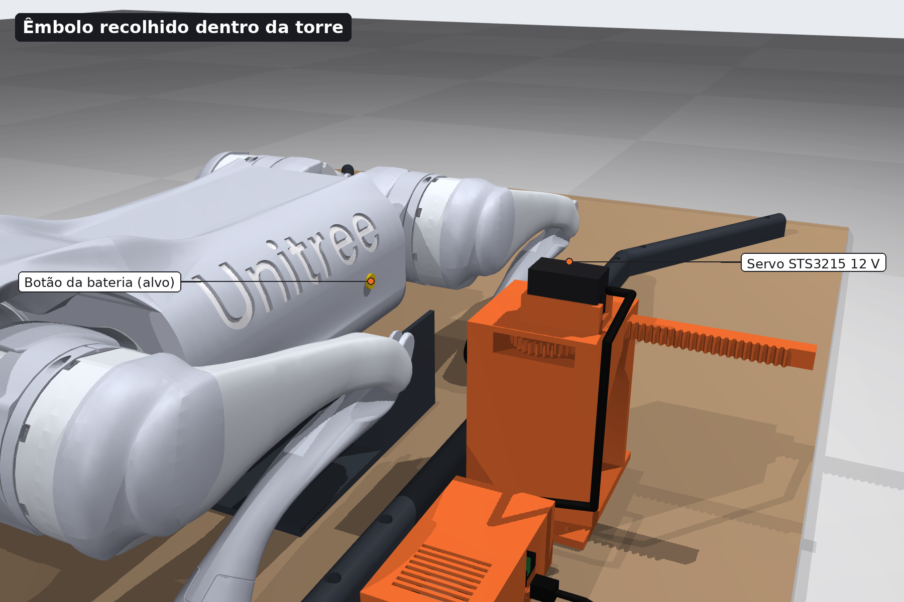
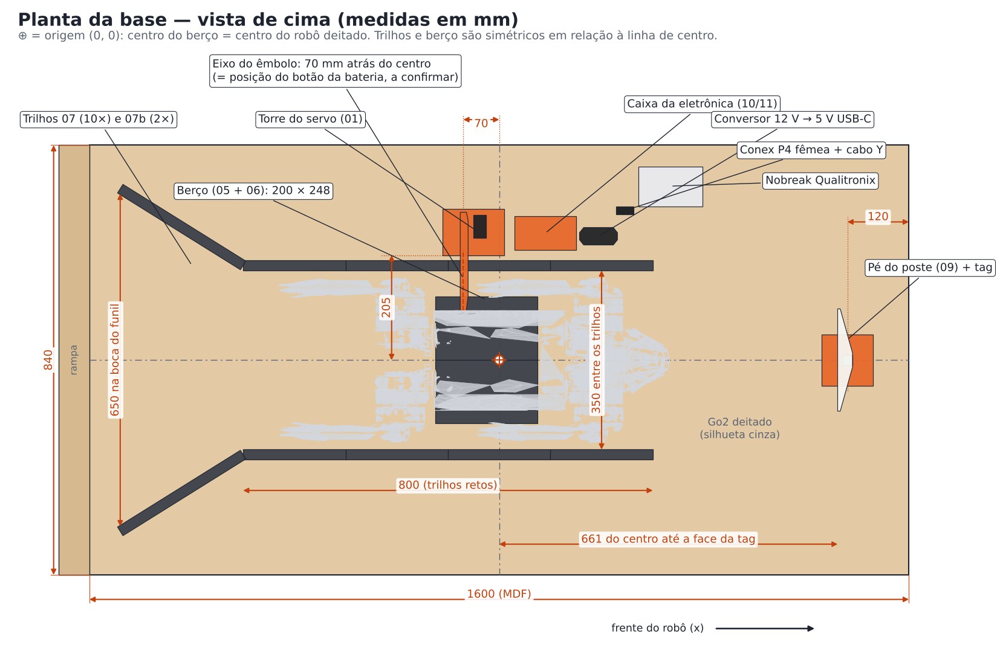
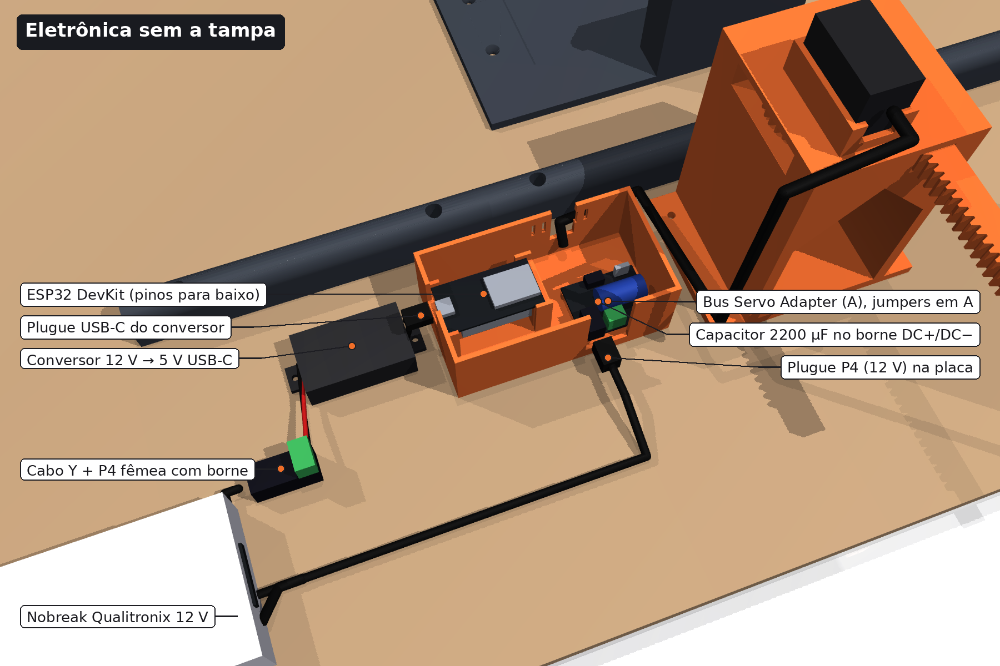
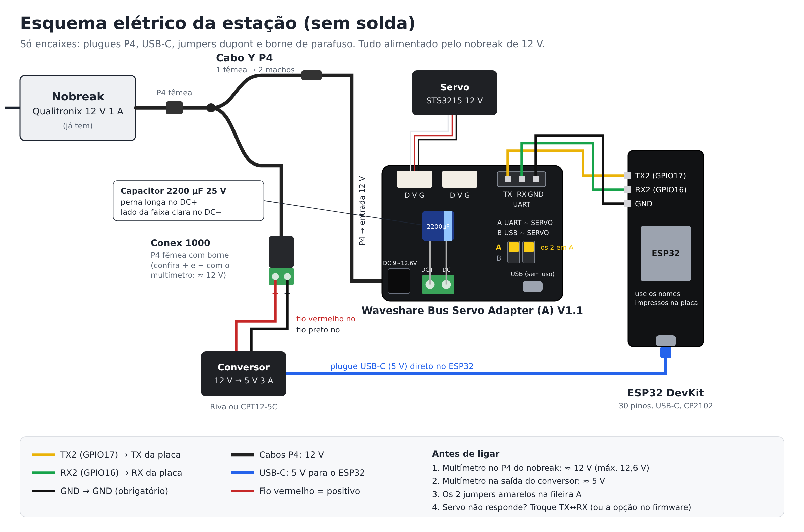

# Parte 3 — Construção do mecanismo de liga/desliga

Uma torre impressa fica ao lado do robô. Em cima dela, o servo STS3215 gira um **pinhão**, que empurra um **êmbolo dentado** (cremalheira) na horizontal até o botão da bateria. Recolhido, o êmbolo fica escondido dentro da torre, e o robô pode levantar e sair sem bater em nada.

| Apertando o botão | Recolhido |
|---|---|
|  |  |

---

## 1. Como funciona

- Pinhão de módulo 1,5 com 32 dentes: o êmbolo anda **150,8 mm por volta** do servo.
- Curso total de **121 mm** = cerca de 289° do servo. Cabe numa volta, no modo posição normal.
- Eixo do êmbolo a **125 mm** do topo do MDF, **70 mm atrás** do centro do berço, no lado **esquerdo** do robô.
- Folga entre o êmbolo recolhido e o robô em pé: 53 mm.
- O firmware (Parte 4) limita o torque do servo e detecta o toque no botão pela **carga** que o próprio servo informa.

---

## 2. Confirme a posição do botão ANTES de imprimir a torre

O projeto foi medido no modelo 3D oficial da Unitree. Confira no seu robô:

1. Deite o Go2 no chão plano (`StandDown`, ou desligado na posição de transporte).
2. Ache o botão da bateria. A bateria sai pela lateral; o botão fica na face que aparece por fora.
3. Meça **do chão até o centro do botão**. O projeto supõe **125 mm**.
4. Meça a distância horizontal do botão até o **centro do robô**: o ponto no meio, entre o motor do quadril dianteiro e o traseiro, do mesmo lado. O projeto supõe **70 mm atrás** do centro.
5. Veja **de que lado** o botão fica. O projeto supõe o **esquerdo** (olhando o robô por trás).
6. Tire uma foto de lado, com uma régua encostada.

Se algo for diferente:
- **Lado oposto:** monte a torre e a caixa espelhadas, do outro lado da linha de centro. As peças são as mesmas.
- **Posição para frente ou para trás:** mude a torre de lugar no MDF. Os rasgos da base ainda dão ±12 mm de ajuste fino.
- **Altura até ~10 mm acima:** coloque calços de MDF ou PETG embaixo da torre. Altura diferente disso, ou abaixo: o parâmetro `RZ` em `../fonte_cad/parts.py` muda e a torre precisa ser gerada de novo. Mande a medida que eu refaço a peça.

---

## 3. Lista de materiais desta parte

### Comprar

| Item | Link | Preço |
|---|---|---|
| ESP32 DevKit WROOM-32, USB-C, CP2102 (pinos **soldados**) | [Mercado Livre](https://www.mercadolivre.com.br/esp32-devkit-modulo-microcontrolador-wroom32-memoria-placa/up/MLBU3867919063?pdp_filters=item_id:MLB6539552690) | R$ 43,89 |
| Conversor Riva 12 V → 5 V 3 A, plugue USB-C | [Mercado Livre](https://www.mercadolivre.com.br/conversor-riva-12v-para-5v-3a-15w-usb-tipo-c-para-moto-e-carro/p/MLB29792316?pdp_filters=item_id:MLB7631137154) | R$ 78,99 |
| Cabo Y P4 (1 fêmea, 2 machos) | [Mercado Livre](https://www.mercadolivre.com.br/cabo-y-p4-macho-e-femea-1-femea-2-machos-alimentacao-energia/up/MLBU787797870?pdp_filters=item_id:MLB4632104828) | R$ 19,98 |
| Kit 10 P4 fêmea com borne, Intelbras Conex 1000 | [Mercado Livre](https://www.mercadolivre.com.br/kit-10-conector-p-camera-conex-1000-p4-femea--intelbras/up/MLBU3384910543?pdp_filters=item_id%3AMLB4180196627) | R$ 8,94 |
| Kit 10 jumpers dupont fêmea-fêmea 20 cm | [Mercado Livre](https://www.mercadolivre.com.br/kit-jumper-femea-femea-20cm-10-unidades-para-protoboard-conector-dupont/p/MLB52686612?pdp_filters=item_id:MLB5851698888) | R$ 11,00 |
| Kit 10 capacitores 2200 µF 25 V 105 °C | [Mercado Livre](https://www.mercadolivre.com.br/capacitor-eletrolitico-2200uf-x-25v-105-kit-com-10-pecas/p/MLB2107006497?pdp_filters=item_id:MLB1493902058) | R$ 24,00 |

### Já tem

- Servo Feetech STS3215 12 V, com o horn metálico e os parafusos que vieram com ele
- Waveshare Bus Servo Adapter (A) V1.1
- Nobreak Qualitronix 12 V 1 A (saída P4)
- Cabo USB-A para USB-C (só para gravar o firmware)

### Ferragens e outros

| Item | Quantidade |
|---|---|
| MDF 15–18 mm, 1600 × 840 mm | 1 chapa |
| Parafusos para madeira 4 × 20 mm, cabeça chata | ~36 |
| Parafusos autoatarraxantes M2,5 × 6 mm | 4 (placa da Waveshare) |
| Fita dupla face de espuma | ESP32 nos apoios, servo na torre |
| Abraçadeiras de 30 cm | 2 (servo na torre) |
| Chave Phillips fina e comprida (≥ 10 cm) | Para o parafuso central do horn, pelo furo de baixo da torre |
| PETG | ~840 g sem os trilhos; +670 g com os trilhos impressos |
| TPU (opcional) | Ponta do dedo |

---

## 4. Peças impressas (pasta `stl/`)

| Arquivo | Qtd | Material | Tamanho (mm) | Massa aprox. | Como imprimir |
|---|---|---|---|---|---|
| `01_torre_servo.stl` | 1 | PETG | 120 × 90 × 154 | 305 g | Em pé, como abre. 4 paredes, 25% de preenchimento. Suporte **só** na cavidade do pinhão (aparece pela janela lateral). O vão de baixo tem teto em 45° e dispensa suporte |
| `02_cremalheira_dedo.stl` | 1 | PETG | 187 × 15 × 12 | 38 g | Deitada, como abre. **100%** de preenchimento |
| `03_pinhao_m1.5_z32.stl` | 1 | PETG | Ø51 × 8 | 16 g | Deitado. Camada 0,12–0,16 mm, **100%** de preenchimento |
| `04_ponta_dedo_TPU.stl` | 1 | TPU (ou PETG) | Ø12 × 15 | 1 g | Ponta arredondada, encaixa no furo de 5,2 mm do êmbolo |
| `04b_ponta_larga_20mm.stl` | 1 | PETG | Ø20 × 13 | 3 g | Opcional: dá mais tolerância se o robô parar alguns mm fora do lugar |
| `05_berco_esquerdo.stl` / `06_berco_direito.stl` | 1 + 1 | PETG | 200 × 124 × 85 | 189 g cada | Sem suporte |
| `07_trilho_guia_200mm.stl` | 10 | PETG ou PLA | 200 × 20 × 30 | 61 g cada | Opcional: dá para trocar por sarrafo de madeira |
| `07b_trilho_funil_83mm.stl` | 2 | PETG ou PLA | 83 × 20 × 30 | 28 g cada | Completa cada lado do funil (200 + 83 mm) |
| `10_caixa_eletronica.stl` | 1 | PETG | 120 × 66 × 44 | 80 g | Sem suporte |
| `11_tampa_caixa_eletronica.stl` | 1 | PETG | 120 × 66 × 5 | 20 g | Com a face lisa para baixo |

Pasta `stl/referencia/`: o conjunto montado, só para visualizar no fatiador. **Não imprima.**

**PETG, ponto de partida:** bico 235–245 °C, mesa 75–80 °C, ventoinha 30–50%, velocidade moderada. Em mesa de PEI liso, passe cola bastão (o PETG gruda demais e pode arrancar a camada da mesa). A mesa precisa ter pelo menos 220 × 220 mm.

---

## 5. Montagem

### 5.1 Base e berço

1. Corte o MDF em 1600 × 840 mm. Se quiser, chanfre a borda de entrada como rampa.
2. Risque a **linha de centro** no comprimento e marque o **centro do berço** a 800 mm de cada ponta. Todas as medidas da planta partem desse ponto.
3. Berço: as duas metades lado a lado, uma de cada lado da linha de centro, cobrindo x de −125 a +75 mm. Use 4 parafusos 4 × 20 por metade.
4. Trilhos retos: um de cada lado, com a face interna a **175 mm** da linha de centro (350 mm entre eles), de x = −500 a +300 mm. Funil: de x = −500 até a boca em x = −740 mm, abrindo até 325 mm da linha de centro (200 + 83 mm de trilho por lado).

### 5.2 Torre, servo, pinhão e êmbolo

**Sequência de montagem**

1. **Posicione a torre** no lado esquerdo do robô: a face de onde sai o êmbolo virada para a linha de centro e a **205 mm** dela; o eixo do êmbolo em x = **−70 mm**. Parafuse pelos 4 rasgos da base sem apertar tudo ainda.
2. **Pinhão no horn.** Prenda o horn metálico do servo no pinhão (4 furos num círculo de 16 mm). Se a furação do seu horn não bater, cole com epóxi e me avise para ajustar a peça.
3. **Servo em cima da torre.** Encaixe o servo no rebaixo do topo, com o eixo (spline) para baixo, passando pelo furo. Prenda com fita dupla face de espuma e duas abraçadeiras.
4. **Coloque o servo na posição "recolhido".** Com o firmware da Parte 4 gravado, use o comando para levar o servo ao passo **400** (`posicionar 400`). Assim o curso inteiro fica entre os passos 400 e ~3690, sem passar pelo 0/4095.
5. **Êmbolo.** Entre com a cremalheira pela face de trás da torre, dentes virados para o lado do pinhão, até a ponta ficar ~10 mm para dentro da face da frente.
6. **Pinhão.** Pela **janela lateral**, deslize o conjunto pinhão + horn para baixo do eixo do servo, engrenando na cremalheira, e encaixe no spline. Pelo **furo de baixo** (dentro do vão da torre, pela parte de trás), aperte o parafuso central do horn com a chave fina.
7. **Ponta.** Cole a ponta de TPU (04) ou a ponta larga (04b) no furo da frente do êmbolo.
8. Com o firmware, mova o êmbolo devagar até o fim e de volta. Ele deve correr livre, sem raspar.

### 5.3 Caixa da eletrônica

1. Parafuse a caixa no MDF ao lado da torre (2 parafusos no fundo), na posição da planta: a abertura do cabo do servo fica virada para o lado do robô, perto da torre.
2. **Placa da Waveshare** sobre os 4 pinos de apoio (M2,5 × 6 ou fita dupla face). O conector P4 fica virado para a abertura de trás.
3. **Os dois jumpers amarelos na fileira A** (UART ~ SERVO).
4. **Capacitor** no borne verde: perna longa no **DC+**, lado da faixa clara no **DC−**. Dobre as pernas para ele ficar deitado.
5. **ESP32** sobre os dois apoios altos, com os pinos para baixo e o USB-C virado para a abertura lateral. Prenda com fita dupla face nas pontas da placa.
6. **Jumpers:** TX2 (GPIO17) do ESP32 → TX da placa; RX2 (GPIO16) → RX; GND → GND. Os nomes estão impressos nas duas placas.
7. **Cabo do servo:** sai pela abertura da caixa e sobe até o servo, na porta D V G.
8. **Tampa:** encaixe por cima (as aberturas da tampa coincidem com as da caixa).

### 5.4 Alimentação (sem solda)

1. **Nobreak → cabo Y.** O plugue do nobreak entra na fêmea do cabo Y.
2. **Saída 1 do Y → placa da Waveshare** (entrada P4 "DC 9~12.6V").
3. **Saída 2 do Y → Conex P4 fêmea com borne.** Antes de prender os fios, meça os dois parafusos do borne com o multímetro: tem que dar ~12 V. Anote qual é o positivo.
4. Desligue. **Fios do conversor no borne:** vermelho no positivo, preto no negativo. Parafuse o conversor no MDF pelas orelhas.
5. Religue e **meça a saída USB do conversor**: ~5 V.
6. **Plugue USB-C do conversor no ESP32.** O LED vermelho da placa deve acender.

---

## 6. Testes antes de colocar o robô

| Teste | Como | Esperado |
|---|---|---|
| Tensão do nobreak | Multímetro no plugue P4 (vermelho no furo central) | 11,5–12,6 V |
| Tensão do conversor | Multímetro na saída | 4,9–5,2 V |
| Servo encontrado | Firmware: `scan` | Mostra o ID do servo (SO-101: 1 a 6; de fábrica: 1) |
| Corrente | Firmware: `status` durante o movimento | < 0,5 A em movimento livre |
| Curso | Firmware: mover de 400 até o fim e voltar | Sem raspar; ponta ~3 mm além da face do robô |
| Toque | Segure um pedaço de papelão na frente do êmbolo e rode `encostar` | Para ao tocar e mostra a posição |

Depois disso, coloque o Go2 **desligado e deitado** à mão no berço, rode `encostar` e veja se a ponta cai no botão. Ajuste a torre pelos rasgos até acertar. Só então teste ligar e desligar de verdade.

## 7. Segurança

- Para **desligar**, o robô tem que estar **deitado**: desligado em pé, ele cai.
- Mantenha os dedos longe do êmbolo quando o ESP32 estiver ligado.
- O torque fica limitado no firmware (~25%). Não aumente sem necessidade.
- A estação não carrega a bateria. Não ligue nada aos contatos de carga do robô.
