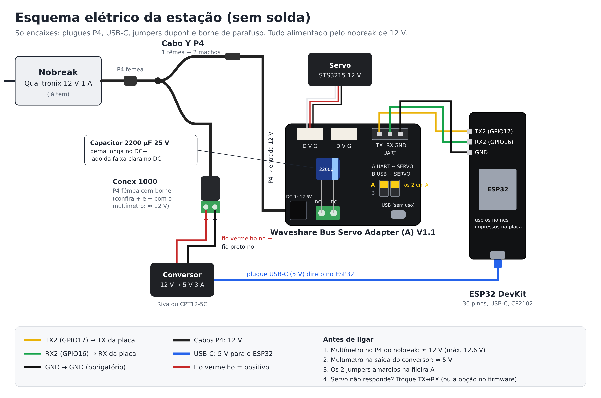

# Parte 4 — Software do mecanismo (firmware do ESP32 + programa do PC)

> **Para o Claude Code.** Este documento é a especificação. Leia inteiro antes de escrever código. O hardware já está definido e montado **sem solda** (Parte 3). Não proponha mudanças que exijam solda. Faça ao usuário as perguntas da seção 10 antes de começar.



---

## 1. Contexto

Um servo **Feetech STS3215 12 V** move um êmbolo que aperta o botão da bateria de um **Unitree Go2**.

- O botão funciona igual para ligar e para desligar: **toque curto e, logo em seguida, toque longo (≥ 2 s)**, enquanto os LEDs da bateria estão acesos.
- Para **desligar**, o robô precisa estar deitado e com os motores soltos (`StandDown` e depois `Damp`). Desligado em pé, ele cai.
- Depois de **ligar**, o robô leva ~2 minutos para inicializar e levanta sozinho.

O ESP32 **não sabe** se o robô está ligado. Quem decide e confere é o programa do PC.

## 2. Hardware e ligações (fixos)

| Item | Detalhe |
|---|---|
| Microcontrolador | ESP32 DevKit WROOM-32, 30 pinos, USB-C, ponte USB CP2102 |
| Interface do servo | Waveshare **Bus Servo Adapter (A) V1.1**, **os dois jumpers na posição A** (UART ~ SERVO) |
| UART | ESP32 **GPIO17 (TX2) → TX** da placa; **GPIO16 (RX2) → RX** da placa; GND comum. Ligação "TX com TX, RX com RX", como pede a Waveshare. Use `Serial2` |
| Velocidade | 1 000 000 bps, 8N1 (padrão do STS3215 e do SO-101) |
| Servo | 1 × STS3215 12 V. ID desconhecido (de fábrica é 1; se veio do SO-101, pode ser de 1 a 6) |
| Alimentação | Nobreak de 12 V **1 A** (placa + servo); ESP32 por conversor 12 V → 5 V ligado na USB-C. **A USB-C do ESP32 fica ocupada pelo conversor**, então atualizações depois da primeira gravação precisam ser por **OTA (Wi-Fi)** |
| Rede | Wi-Fi 2,4 GHz da casa ou do laboratório; o PC está na mesma rede |

## 3. Mecânica (para converter unidades)

- Pinhão de 32 dentes, módulo 1,5 → **150,8 mm por volta** → **4096 passos = 150,8 mm** → **27,16 passos/mm**.
- Curso útil: 121 mm ≈ 3290 passos. A montagem põe o "recolhido" perto do **passo 400** e o "estendido" perto do **3690**, sem cruzar o 0/4095. **O sentido** (se avançar é passo crescente ou decrescente) **é desconhecido**: descubra na calibração e salve.
- Ponta do êmbolo recolhida: dentro da torre. Distância até a face da bateria: ~118 mm (o firmware mede, não presuma).

## 4. Firmware do ESP32 (requisitos)

### 4.1 Plataforma

- **PlatformIO**, `framework = arduino`, `board = esp32dev`. Se o usuário preferir a Arduino IDE, explique a alternativa no README.
- Protocolo do servo: use a biblioteca **SCServo** da Feetech/Waveshare (classe `SMS_STS`), disponível nos recursos da wiki da Waveshare para o Bus Servo Adapter (A) e para o ST3215. Se não der para incluir de forma limpa, implemente o protocolo:
  - pacote: `0xFF 0xFF ID LEN INSTR PARAMS… CHECKSUM`, com `CHECKSUM = ~(ID + LEN + INSTR + ΣPARAMS) & 0xFF`;
  - instruções: PING 0x01, READ 0x02, WRITE 0x03.
- Registradores usados (endereços da série STS; **confirme no `SMS_STS.h`**):

| Registrador | Endereço |
|---|---|
| ID | 5 |
| Torque on/off | 40 |
| Aceleração | 41 |
| Posição alvo (2 bytes) | 42 |
| Velocidade alvo (2 bytes) | 46 |
| Limite de torque (RAM, 0–1000) | 48 |
| Trava da EEPROM | 55 |
| Posição atual | 56 |
| Velocidade atual | 58 |
| Carga atual | 60 |
| Tensão (×0,1 V) | 62 |
| Temperatura (°C) | 63 |
| Em movimento | 66 |
| Corrente | 69 |

### 4.2 Configuração (salva em NVS com `Preferences`)

| Parâmetro | Padrão | Observação |
|---|---|---|
| `servo_id` | descoberto pelo `scan` | — |
| `uart_trocado` | falso | Se verdadeiro, usa RX = 17 e TX = 16. **Permite corrigir TX/RX invertidos sem mexer nos fios** |
| `sentido` | +1 | +1 se avançar = passo crescente |
| `pos_recolhido` | 400 | Calibrado |
| `pos_contato` | indefinido | Calibrado pelo `encostar` |
| `profundidade_mm` | 3,0 | Quanto empurrar além do ponto de contato |
| `limite_torque` | 250 | = 25%, por causa do nobreak de 1 A |
| `aceleracao` | 50 | Unidade do servo |
| `vel_rapida` / `vel_lenta` | 1500 / 300 | Passos por segundo |
| `limiar_carga` | a calibrar | Carga que caracteriza "encostou" |
| `toque_curto_ms` | 300 | — |
| `intervalo_ms` | 400 | Entre o toque curto e o longo (os LEDs precisam continuar acesos) |
| `toque_longo_ms` | 3000 | ≥ 2 s pelo manual |
| `tensao_minima_v` | 10,5 | Abaixo disso, aborta |
| `temp_maxima_c` | 60 | Acima disso, aborta |
| `token` | definido pelo usuário | Exigido nas rotas que movem o servo |

### 4.3 Estados e comportamento

- **Ao ligar o ESP32: não mover nada.** Torque desligado, lê a posição e informa. Se a posição estiver longe de `pos_recolhido`, só avisa no `status`.
- Estados: `PARADO` (torque off), `MOVENDO`, `SEQUENCIA`, `CALIBRANDO`, `ERRO`.
- Um comando por vez. Pedido durante outro comando → HTTP 409.
- Watchdog: qualquer movimento tem tempo máximo. Estourou → torque off e `ERRO`.

**Sequência `liga_desliga`** (a mesma para ligar e para desligar):

1. Recusa se não estiver calibrado (`pos_contato` indefinido).
2. Torque on, com `limite_torque` e `aceleracao`.
3. Avanço rápido até `pos_contato − 5 mm`.
4. Avanço lento até detectar contato: carga > `limiar_carga`, ou posição parada apesar do alvo à frente. Não encostou até `pos_contato + 8 mm` → recolhe, `ERRO: não encontrou o botão`.
5. **Toque curto:** alvo = contato + `profundidade_mm`; segura `toque_curto_ms`; volta para contato − 2 mm.
6. Espera `intervalo_ms`.
7. **Toque longo:** alvo = contato + `profundidade_mm`; segura `toque_longo_ms`; volta.
8. Recolhe até `pos_recolhido` e desliga o torque (economiza corrente; o atrito segura o êmbolo).
9. Durante tudo: tensão < `tensao_minima_v` ou temperatura > `temp_maxima_c` → aborta, recolhe, `ERRO`.
10. Grava no log: posição do contato, carga máxima, corrente máxima, tensão mínima, duração.

**Outros comandos**

| Comando | O que faz |
|---|---|
| `encostar` | Passos 2–4 sem apertar; informa a posição do contato; recolhe. Serve para conferir o alinhamento sem ligar o robô |
| `posicionar N` | Vai ao passo N devagar (usado na montagem: N = 400) |
| `jog ±mm` | Move em mm, devagar |
| `recolher` | Volta a `pos_recolhido` |
| `parar` | Torque off imediatamente |
| `calibrar recolhido` | Salva a posição atual como `pos_recolhido` |
| `calibrar contato` | Roda `encostar` 3 vezes, salva a média em `pos_contato` e mede o `limiar_carga` (carga livre + margem) |
| `calibrar sentido` | Move +2 mm e pergunta (via resposta) se o êmbolo avançou ou recuou; salva |
| `scan` | Faz PING nos IDs 0–253; informa os encontrados |
| `definir_id N` | Muda o ID do servo (destrava e trava a EEPROM) |

### 4.4 Interface HTTP (JSON)

- `mDNS`: `estacao-go2.local`, porta 80.
- Rotas que movem o servo exigem o cabeçalho `X-Token`.

| Método e rota | Função |
|---|---|
| `GET /api/status` | estado, posição (passos e mm), carga, corrente_mA, tensão_V, temperatura_C, torque, calibração, último_erro, RSSI do Wi-Fi, versão |
| `POST /api/sequencia/liga_desliga` | Executa a sequência e responde só no fim (~6 s), com o resultado e as medições |
| `POST /api/encostar` | — |
| `POST /api/recolher` | — |
| `POST /api/posicionar` | `{"passo": 400}` |
| `POST /api/jog` | `{"mm": 2.0}` |
| `POST /api/parar` | — |
| `POST /api/calibrar/{recolhido\|contato\|sentido}` | — |
| `GET /api/scan` | — |
| `POST /api/config` | Altera parâmetros da 4.2 e salva |
| `GET /api/log` | Últimos 50 eventos |

### 4.5 Console serial (115200 bps, pela USB)

Os mesmos comandos em texto (`status`, `scan`, `encostar`, `posicionar 400`…), para testar na bancada **antes** de configurar o Wi-Fi e antes de o conversor ocupar a USB-C.

### 4.6 Wi-Fi e atualização

- Credenciais em `include/secrets.h` (fora do git, com `secrets.example.h` de exemplo), ou portal de configuração (WiFiManager). Explique as duas opções e use a que o usuário escolher.
- Reconexão automática.
- **ArduinoOTA com senha:** depois da primeira gravação pela USB, as próximas são pela rede (`pio run -t upload --upload-port estacao-go2.local`).

## 5. Programa do PC

Python 3, um arquivo `estacao_go2.py`, com configuração em `config.yaml`.

```
python estacao_go2.py status
python estacao_go2.py encostar
python estacao_go2.py ligar
python estacao_go2.py desligar
python estacao_go2.py calibrar contato
```

**Detecção do robô ligado/desligado** (configurável):
- ping no IP do Go2 (cabo: 192.168.123.161; Wi-Fi: o IP que o usuário informar); e/ou
- presença do tópico DDS `rt/lowstate` via `unitree_sdk2py`, quando disponível.

**`ligar`**
1. Confirma que o robô está **desligado**: sem resposta por 5 s.
2. Chama `/api/sequencia/liga_desliga`.
3. Espera o robô aparecer na rede ou no DDS: até 180 s.
4. Informa sucesso ou falha. **Nunca repete o aperto sozinho dentro desses 180 s**: um segundo aperto durante a inicialização pode desligar o robô.

**`desligar`**
1. Confirma que o robô está **ligado e estacionado**: pelo serviço da Parte 2, se existir, ou com `--estou-vendo-o-robo-deitado` para uso manual.
2. Via `SportClient`: `StandDown` (1005), espera 2 s, `Damp` (1001), espera 1 s. Confere o estado (modo de movimento / altura do corpo) quando o SDK permitir.
3. Chama `/api/sequencia/liga_desliga`.
4. Espera o robô sumir: até 60 s.

**Opcional: nó ROS 2 `go2_power_station`.** Serviços `/estacao/ligar` e `/estacao/desligar` (`std_srvs/Trigger`) e tópico `/estacao/status`, reaproveitando a mesma lógica. A Parte 2 chama esses serviços depois de estacionar e antes de sair.

## 6. Segurança (obrigatório)

- Nunca mover o servo ao inicializar.
- Torque limitado; torque desligado em repouso.
- `desligar` só com o robô deitado e em `Damp`.
- Botão de parada: `POST /api/parar` e comando `parar` no console.
- Token para qualquer rota que mova o servo.
- Toda falha recolhe o êmbolo antes de parar (exceto `parar`, que só desliga o torque).

## 7. Testes

1. **Unitários (PC, sem hardware):** montagem e checksum dos pacotes, conversão mm ↔ passos, máquina de estados com um servo simulado (incluindo os casos sem contato, tensão baixa e timeout).
2. **Bancada sem robô** (o usuário segura um papelão na frente do êmbolo):
   - `scan` encontra o servo;
   - `posicionar 400`;
   - `calibrar sentido`;
   - `jog` pelo curso inteiro sem raspar;
   - `encostar` no papelão para e informa a posição;
   - corrente em movimento livre < 0,5 A.
3. **Com o robô desligado e deitado no berço:**
   - `calibrar contato`;
   - `encostar` 5 vezes: o contato varia menos de ±1 mm;
   - `ligar`: o robô liga e levanta em até 180 s.
4. **Com o robô ligado e deitado:** `desligar` desliga em até 60 s.
5. **Robustez:** 10 ciclos ligar/desligar sem erro.

## 8. Entregáveis

```
firmware_estacao/          # PlatformIO
  platformio.ini
  include/secrets.example.h
  src/…                    # main, servo, sequência, http, ota, config
  test/…
cliente_pc/
  estacao_go2.py
  config.example.yaml
  requirements.txt
  tests/…
ros2/go2_power_station/    # opcional, se o usuário quiser
README.md                  # gravar pela USB no Linux (grupo dialout, /dev/ttyUSB0),
                           # configurar Wi-Fi, calibrar, usar, OTA
```

**Primeira gravação (incluir no README).** No Linux, conecte o ESP32 ao PC pelo cabo USB-A → USB-C com o conversor desconectado. Confira com `ls /dev/ttyUSB*` (deve aparecer `/dev/ttyUSB0`; se não aparecer, o cabo é só de carga). Grave com `pio run -t upload`. Depois devolva o plugue do conversor.

## 9. O que NÃO fazer

- Não alimentar o ESP32 pelo pino 5V e pela USB-C ao mesmo tempo.
- Não mudar a velocidade do servo (o mesmo modelo é usado no SO-101) sem perguntar.
- Não acionar a sequência automaticamente ao ligar o ESP32 ou ao reconectar o Wi-Fi.

## 10. Perguntas para o usuário

1. Nome e senha do Wi-Fi (ou prefere o portal de configuração)?
2. O servo veio do SO-101? Qual ID ele tinha?
3. Como o PC fala com o Go2 (cabo/DDS ou Wi-Fi/WebRTC) e qual o IP do robô?
4. Sistema do PC (pela foto da tela, provavelmente Ubuntu).
5. Quer o nó ROS 2 opcional ou só o programa de linha de comando?
