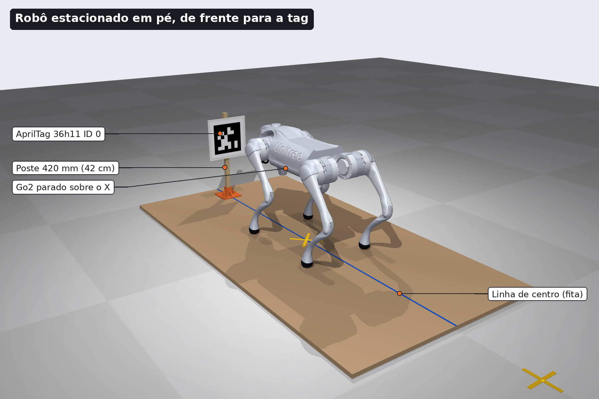
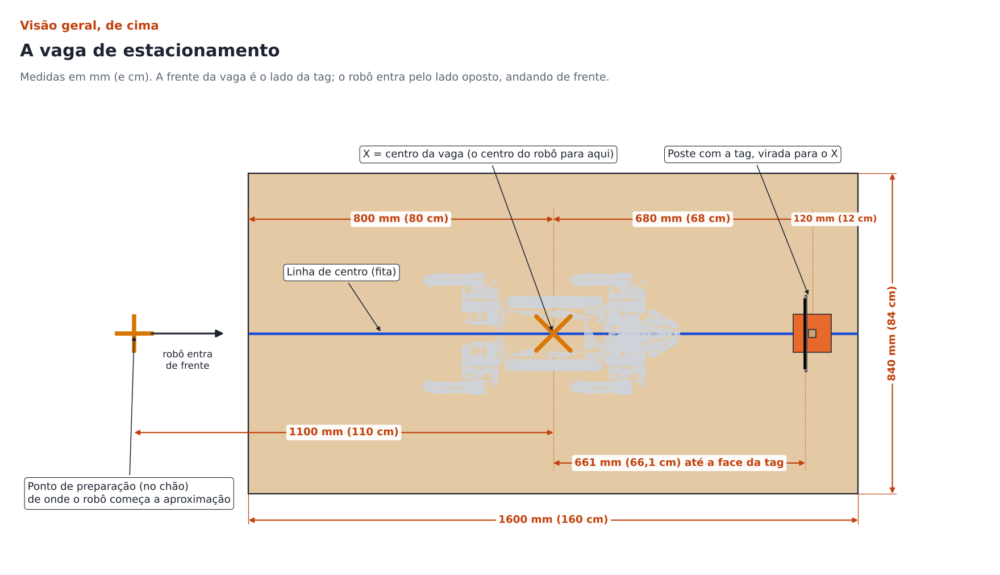
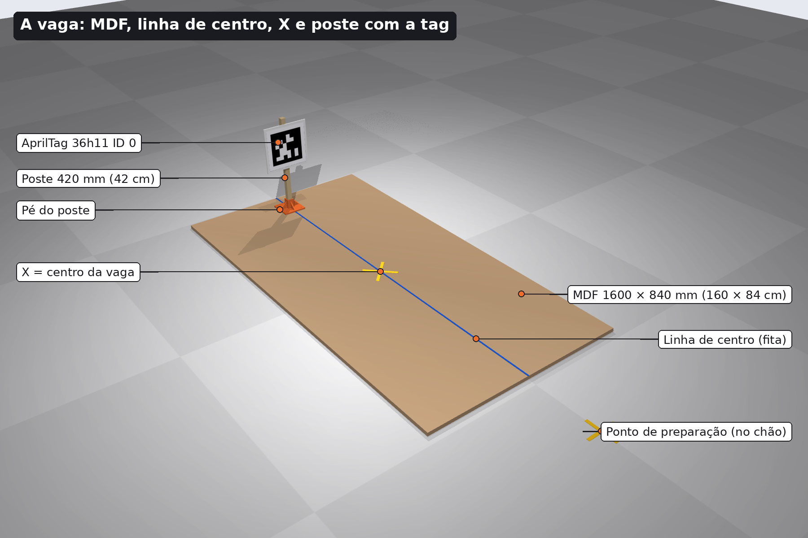
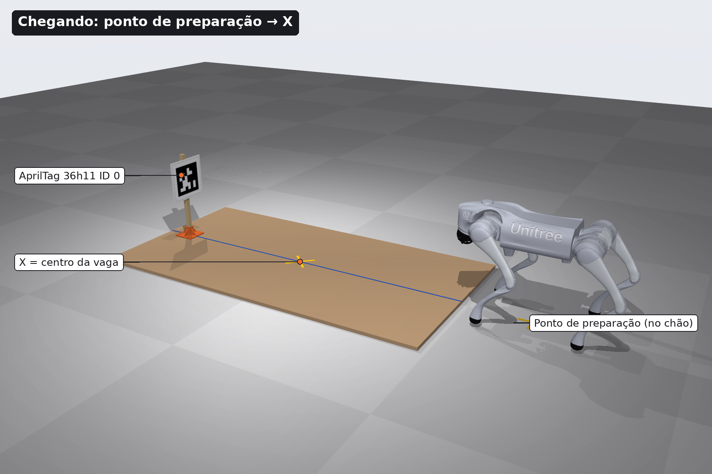
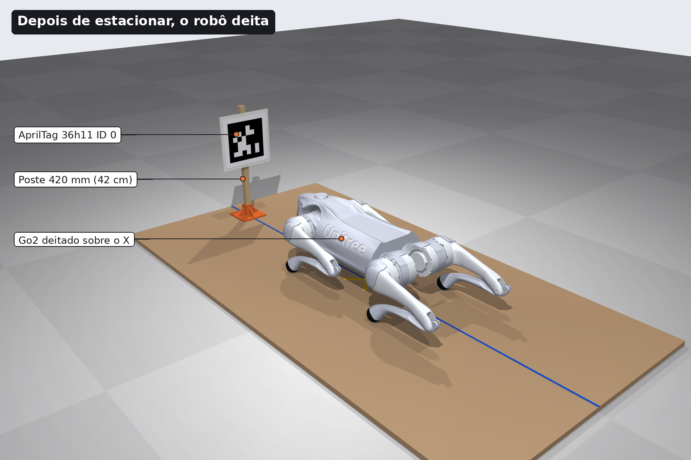

# Estacionamento do Unitree Go2 com AprilTag

Versão 1.0 · 31/10/2026

O robô termina a navegação, vai até um ponto na frente da vaga, enxerga uma AprilTag presa num poste e entra andando de frente até parar **sempre no mesmo lugar**: com o centro do corpo sobre um **X** marcado no chão. Depois ele se deita ali. Para sair, ele levanta e anda de ré.

## Dá para fazer só com isto?

**Sim.** Para estacionar você só precisa de:

1. uma chapa de MDF com uma linha de centro e um X marcados com fita;
2. um poste com a AprilTag, na frente do X;
3. o software que lê a tag pela câmera frontal do Go2 e guia o robô até o X.

Este pacote tem exatamente isso, em duas partes.

| Parte | Pasta | O que tem | Quem usa |
|---|---|---|---|
| 1. Construção | `parte1_construcao_apriltag/` | Desenhos passo a passo, lista de materiais, PDF da tag, 2 peças para imprimir | Você (oficina) |
| 2. Software | `parte2_software_estacionamento/` | Especificação completa do estacionamento | Claude Code |
| — | `imagens/` | Desenhos com medidas e imagens 3D | Todos |

## Ordem de trabalho

1. **Monte a vaga** seguindo a Parte 1, passos 1 a 6. Dá para fazer numa tarde.
2. **Entregue a Parte 2 ao Claude Code**, junto com os valores que você mediu (Parte 1, seção 5).
3. **Faça o ajuste fino** (Parte 1, passo 7) quando o software já estiver mostrando a imagem da câmera.
4. **Grave a posição de referência**: você coloca o robô sobre o X e o software memoriza como a tag aparece. Daí em diante o robô estaciona sozinho.

---

## A vaga em uma imagem

Todas as medidas estão em **mm** e, entre parênteses, em **cm**.

| O quê | Medida |
|---|---|
| Chapa de MDF | 1600 × 840 mm (160 × 84 cm), espessura 15–18 mm (1,5–1,8 cm) |
| Linha de centro | No sentido do comprimento, a 420 mm (42 cm) de cada borda comprida |
| X (centro da vaga) | Na linha de centro, a 800 mm (80 cm) de cada ponta: o meio da chapa |
| Centro do poste (P) | Na linha de centro, a 120 mm (12 cm) da borda da FRENTE, que dá 680 mm (68 cm) à frente do X |
| Poste | 420 mm (42 cm) de altura, seção 20 × 20 mm (2 × 2 cm) |
| Placa da tag | 200 × 200 mm (20 × 20 cm) |
| Papel da tag | 180 × 180 mm (18 × 18 cm) |
| Quadrado preto da tag | 144 mm (14,4 cm) |
| Centro da tag | 300 mm (30 cm) acima do topo do MDF |
| Face da tag até o X | 661 mm (66,1 cm) |
| Ponto de preparação (no chão) | 1100 mm (110 cm) atrás do X, ou seja, 300 mm (30 cm) atrás da borda de trás do MDF |

**Frente** é o lado do poste. **Trás** é o lado por onde o robô entra. O robô entra andando de frente, olhando para a tag.

| | |
|---|---|
|  |  |
|  |  |

---

## Lista de materiais

| Item | Quantidade | Observação |
|---|---|---|
| Chapa de MDF 15 ou 18 mm (1,5 ou 1,8 cm), 1600 × 840 mm (160 × 84 cm) | 1 | Peça o corte na madeireira. O Go2 sobe essa borda sem problema |
| Sarrafo de pinus 20 × 20 mm (2 × 2 cm) com 420 mm (42 cm), **ou** perfil de alumínio 20 × 20 (V-slot) com 420 mm (42 cm), **ou** poste impresso em PETG (2 metades) | 1 | Poste |
| Placa de 200 × 200 mm (20 × 20 cm): MDF 6 mm (0,6 cm) **ou** a placa impressa | 1 | Fundo da tag. Precisa ser plana |
| Pé do poste impresso (`pe_do_poste.stl`) **ou** uma cantoneira em L de 50 mm (5 cm) | 1 | Segura o poste em pé |
| PETG | ~200 g (placa e pé) + ~210 g (poste) | Só o que você for imprimir |
| Parafuso para madeira 4 × 20 mm | 6 | 4 no pé, 2 na placa (poste de madeira ou impresso) |
| Parafuso M3 × 20 mm cabeça chata (escareada) + porca M3 | 2 + 2 | Só no poste impresso, para unir as metades |
| Cola epóxi (tipo Araldite) | 1 | Só no poste impresso |
| Parafuso M4 × 10 mm + porca martelo M4 | 2 + 2 | Só se o poste for perfil de alumínio |
| Folha A4 fosca (sulfite 90 g ou fotográfico **fosco**) | 1–2 | Para imprimir a tag |
| Cola spray para papel, ou fita dupla face fina | — | Colar a tag na placa |
| Fita colorida (isolante ou de demarcação de piso), azul e amarela | 1 rolo de cada | Linha de centro e X |
| Trena, régua de 1 m (100 cm), esquadro, lápis, parafusadeira | — | Ferramentas |

Os detalhes e as opções de cada material estão na Parte 1.

---

## Créditos

- Modelo 3D do Go2 usado nas imagens: [MuJoCo Menagerie](https://github.com/google-deepmind/mujoco_menagerie/tree/main/unitree_go2), derivado do [URDF oficial da Unitree](https://github.com/unitreerobotics/unitree_ros/tree/master/robots/go2_description) (licença BSD-3, Unitree Robotics).
- Imagem da AprilTag: [AprilRobotics/apriltag-imgs](https://github.com/AprilRobotics/apriltag-imgs), família tag36h11, ID 0.
