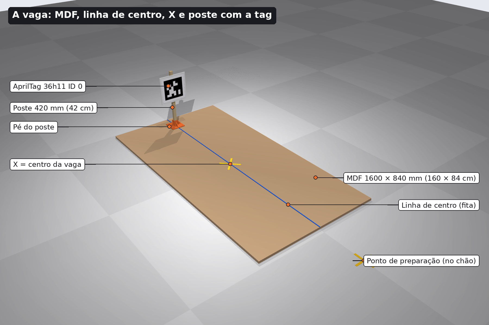
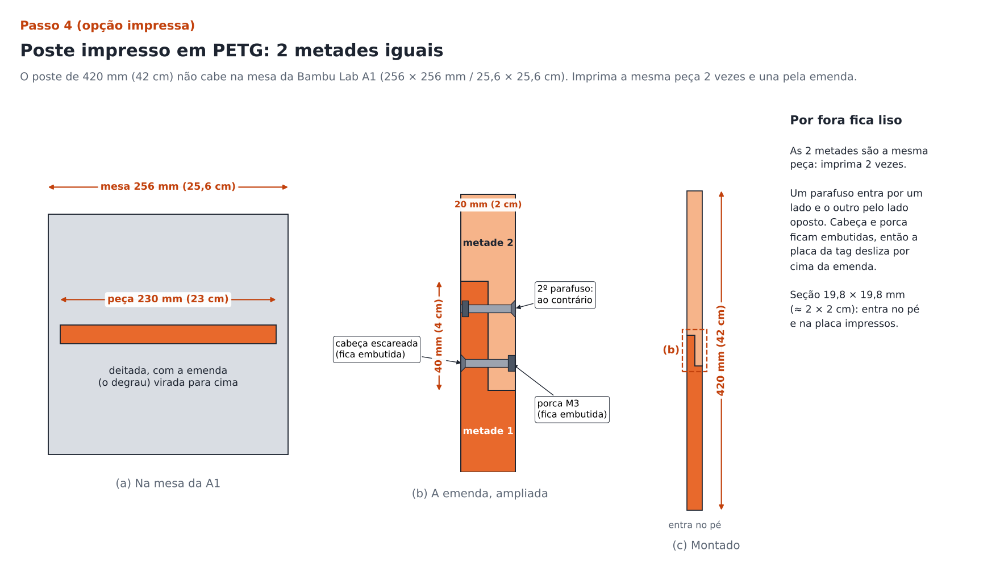
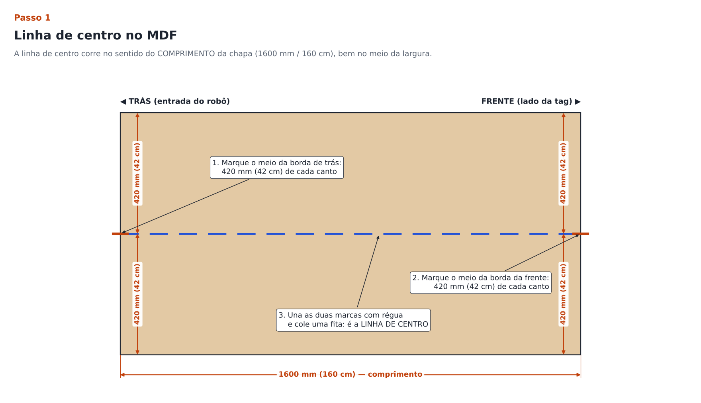
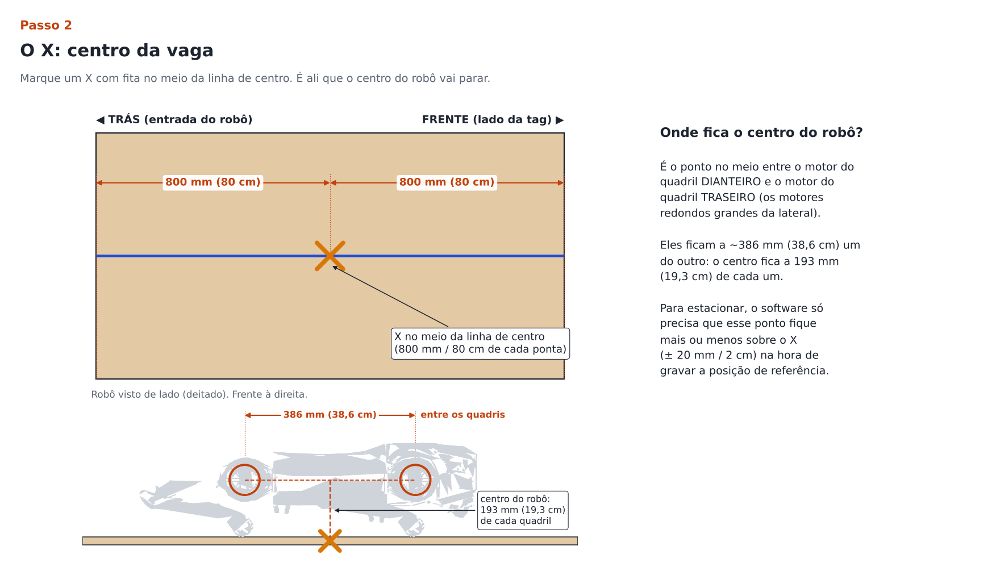
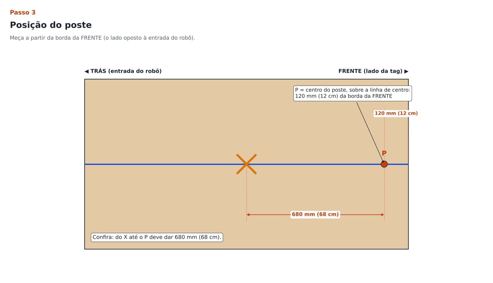
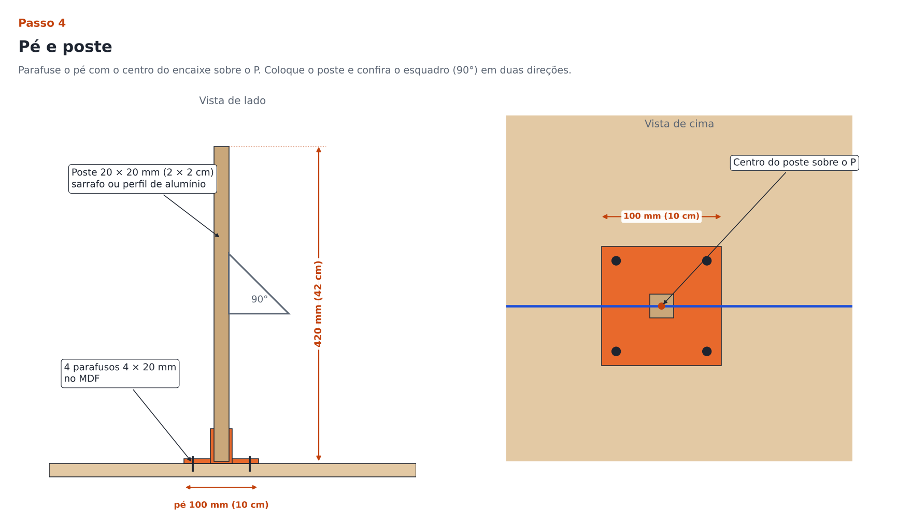
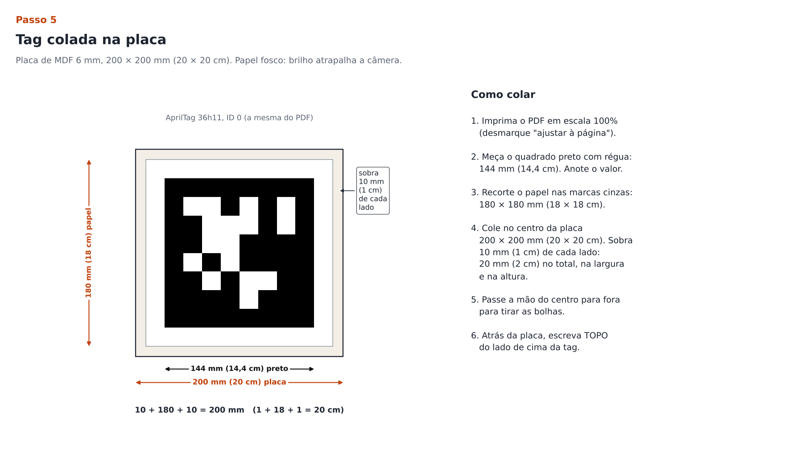
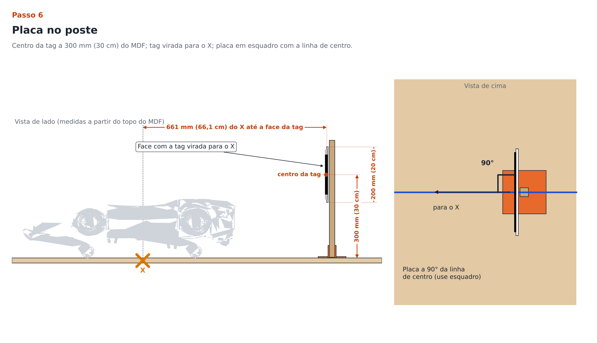
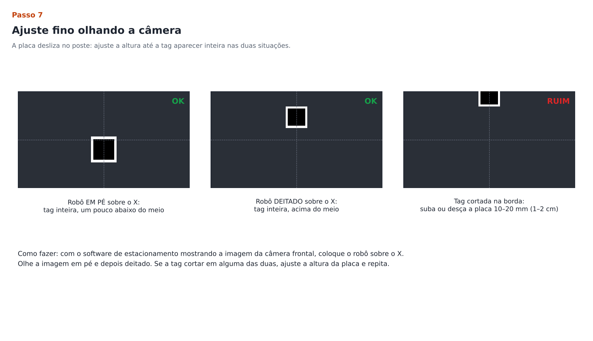

# Parte 1 — Construção da vaga e do poste da AprilTag

A AprilTag fica num poste **na frente do robô**, sobre a linha de centro da vaga. O robô entra andando de frente, vê a tag com a câmera frontal e usa a posição dela para parar com o centro do corpo sobre o **X**.

Todas as medidas estão em **mm** e, entre parênteses, em **cm**. As alturas são medidas a partir do **topo do MDF**, que é onde o robô pisa.

---

## 1. Palavras usadas nos desenhos

| Palavra | O que é |
|---|---|
| **Comprimento** | O lado maior da chapa: 1600 mm (160 cm) |
| **Largura** | O lado menor da chapa: 840 mm (84 cm) |
| **Frente** | A borda curta onde fica o poste. O robô estacionado olha para ela |
| **Trás** | A borda curta oposta. O robô entra por ela |
| **Linha de centro** | Uma reta no sentido do comprimento, bem no meio da largura |
| **X** | O centro da vaga, no meio da linha de centro. O centro do robô para em cima dele |
| **P** | O ponto onde fica o centro do poste |

---

## 2. Medidas principais

| O quê | Medida | Por quê |
|---|---|---|
| Família e ID da tag | tag36h11, ID 0 | Família padrão, resistente a erro de leitura |
| Quadrado preto da tag | **144 mm (14,4 cm)** de lado | É esse número que vai no software (`tag_size = 0.144`) |
| Papel impresso, com a borda branca | 180 × 180 mm (18 × 18 cm) | A borda branca faz parte da tag: não corte |
| Placa de fundo | **200 × 200 mm (20 × 20 cm)** | Sobra 10 mm (1 cm) de cada lado do papel: 20 mm (2 cm) no total |
| Altura do **centro** da tag | **300 mm (30 cm)** | Explicação logo abaixo |
| Borda de baixo e de cima da placa | 200 mm (20 cm) e 400 mm (40 cm) | Consequência da linha acima |
| Poste | **420 mm (42 cm)** de altura, seção 20 × 20 mm (2 × 2 cm) | Sobra espaço para subir ou descer a placa |
| Centro do poste (P) | Na linha de centro, a **120 mm (12 cm)** da borda da frente | Fica a 680 mm (68 cm) do X |
| Face da tag até o X | **661 mm (66,1 cm)** | Vai para o software |
| Espaço entre o nariz do robô e a tag | ≈ 330 mm (33 cm) | O robô não encosta na placa |

### Por que o centro da tag fica a 300 mm (30 cm)

A câmera frontal do Go2 fica a uns **355 mm (35,5 cm)** do chão com o robô **em pé** e a uns **170 mm (17 cm)** com o robô **deitado** (medido no modelo 3D oficial; em pé é uma estimativa).

- Em pé, chegando de longe, a tag fica quase na altura da câmera.
- Em pé, sobre o X, a tag aparece um pouco abaixo do meio da imagem.
- Deitado, a tag aparece acima do meio da imagem, mas inteira. Assim o software confere a posição depois que o robô deita.

300 mm (30 cm) é o meio-termo. A placa **desliza no poste**, então você ajusta olhando a câmera (passo 7).

---

## 3. Materiais e opções

### Base (chapa de MDF)

| Item | Detalhe |
|---|---|
| MDF 15 ou 18 mm (1,5 ou 1,8 cm) | 1600 × 840 mm (160 × 84 cm). Peça o corte na madeireira, com as bordas no esquadro |
| Fita da linha de centro | Fita isolante ou de demarcação de piso, **azul** (qualquer cor que contraste com o MDF) |
| Fita do X | Fita **amarela**, dois pedaços de uns 100 mm (10 cm) cruzados |

O Go2 sobe a borda de 15–18 mm (1,5–1,8 cm) sem dificuldade.

### Tag impressa

| Item | Recomendação |
|---|---|
| Arquivo | `apriltag_36h11_id0_A4.pdf` (nesta pasta). Também tem `apriltag_36h11_id0_2000px.png`, se precisar |
| Impressão | Folha A4, escala **100%** (desmarque "ajustar à página"). Impressora laser de preferência: o preto fica mais uniforme |
| Papel | Fosco: sulfite 90 g ou papel fotográfico **fosco**. Não use papel brilhante nem plastificação com brilho: o reflexo atrapalha a câmera |
| Conferência | Meça o quadrado preto com régua: tem que dar **144 mm (14,4 cm)**. Se der 143 ou 145 mm (14,3 ou 14,5 cm), tudo bem, mas anote o valor e passe para o software |

### Placa de fundo (onde o papel é colado)

Precisa ser **rígida e plana**. Qualquer curvatura distorce a tag e o robô calcula a posição errada.

| Material | Serve? | Observação |
|---|---|---|
| **Placa impressa (`stl/placa_apriltag.stl`)** | **Recomendado** | Já vem com o encaixe deslizante para poste 20 × 20 mm (2 × 2 cm). Precisa de mesa de impressão de pelo menos 220 × 220 mm (22 × 22 cm) |
| **MDF 6 mm (0,6 cm), 200 × 200 mm (20 × 20 cm)** | **Recomendado** | Barato e plano. Prenda no poste com 2 parafusos pela frente, fora da área do papel, ou com cola quente por trás |
| PVC expandido ou papel pluma 5 mm (0,5 cm) | Serve | Leve e plano. Cole numa ripa e prenda a ripa no poste |
| Acrílico 3 mm (0,3 cm) | Serve | Use papel fosco por cima por causa do reflexo |
| Papelão | Só para teste rápido | Empena com umidade. Se usar, cole duas camadas e troque por MDF depois |

### Poste (haste vertical)

| Opção | Tamanho | Como a placa impressa prende |
|---|---|---|
| **Sarrafo de pinus 20 × 20 mm (2 × 2 cm)** | 420 mm (42 cm) | 2 parafusos para madeira 4 × 20 mm pelos furos da lateral do encaixe. Se o sarrafo não entrar no encaixe, lixe até entrar justo |
| **Perfil de alumínio 20 × 20 (V-slot)** | 420 mm (42 cm) | 2 parafusos M4 × 10 mm pelos furos da lateral + 2 porcas martelo M4 no canal do perfil |
| **Poste impresso em PETG** (`stl/poste_metade_imprimir_2x.stl`) | 420 mm (42 cm) montado, com 2 metades de 230 mm (23 cm) | 2 parafusos para madeira 4 × 20 mm pelos furos da lateral. Faça antes um furo-guia de 3 mm no poste |
| Cabo de vassoura (redondo) | 420 mm (42 cm) | Não entra no pé nem na placa impressos. Use cantoneira e abraçadeiras |

#### Poste impresso (para quem não quer comprar sarrafo)

O poste inteiro tem 420 mm (42 cm) e não cabe na mesa da Bambu Lab A1, que tem 256 × 256 mm (25,6 × 25,6 cm). Por isso ele vem em **2 metades iguais** de 230 mm (23 cm): imprima a mesma peça **2 vezes**. As metades se sobrepõem 40 mm (4 cm) numa emenda em degrau, e o total dá 230 + 230 − 40 = 420 mm (23 + 23 − 4 = 42 cm).

- **Para unir:** passe cola epóxi (tipo Araldite) nas duas faces do degrau, encaixe e aperte 2 parafusos M3 × 20 mm de cabeça chata (escareada) com porca M3. Um parafuso entra por um lado e o outro pelo lado oposto: em cada furo há um rebaixo cônico para a cabeça e, do outro lado, um encaixe sextavado para a porca. Cabeça e porca ficam embutidas, então a placa da tag desliza por cima da emenda.
- **Seção 19,8 × 19,8 mm (≈ 2 × 2 cm):** um pouco menor que 20 mm para entrar com folga no pé e no encaixe da placa.
- **Rigidez:** o PETG é mais flexível que a madeira, mas para segurar a placa da tag sobra. Só não use o poste como apoio.

Se a sua impressora for a **A1 mini** (mesa 180 × 180 mm / 18 × 18 cm), a placa impressa de 200 mm (20 cm) não cabe: use a placa de MDF 6 mm.

### Pé do poste

| Opção | Como |
|---|---|
| **Pé impresso (`stl/pe_do_poste.stl`)** | 100 × 100 mm (10 × 10 cm), 4 parafusos para madeira 4 × 20 mm no MDF. O poste entra no encaixe quadrado. Se ficar folgado, dê uma volta de fita crepe na ponta do poste |
| Cantoneira metálica em L de 50 mm (5 cm) | 2 parafusos no MDF e 2 no poste |
| Bloco de madeira | Parafuse o bloco no MDF por baixo e o poste no bloco |

### Peças para imprimir

Todas já abrem na posição certa para imprimir, sem suporte.

| Arquivo | Tamanho | PETG | Como imprimir |
|---|---|---|---|
| `stl/placa_apriltag.stl` | 200 × 200 × 29 mm (20 × 20 × 2,9 cm) | ~140 g | Face lisa na mesa (já vem assim). 4 paredes, 25% de preenchimento |
| `stl/pe_do_poste.stl` | 100 × 100 × 46 mm (10 × 10 × 4,6 cm) | ~55 g | Base na mesa. 4 paredes, 25% de preenchimento |
| `stl/poste_metade_imprimir_2x.stl` (opcional, **2 cópias**) | 230 × 20 × 20 mm (23 × 2 × 2 cm) cada | ~105 g cada, ~210 g as duas | Deitada, com o degrau para cima (já vem assim). **100%** de preenchimento, para ficar rígida e os parafusos morderem |

PETG, ponto de partida: bico 235–245 °C, mesa 75–80 °C, ventoinha 30–50%. Na Bambu Lab A1, use o perfil de PETG do Bambu Studio e a placa texturizada (PEI) que vem com a impressora. Em mesa de PEI **liso**, passe cola bastão antes (o PETG gruda demais).

---

## 4. Montagem passo a passo

### Passo 1 — Linha de centro

1. Deite a chapa no lugar onde a vaga vai ficar. Decida qual borda curta é a **frente** (onde vai o poste).
2. Na borda de **trás**, meça 420 mm (42 cm) a partir de um canto e marque. Confira medindo do outro canto: também tem que dar 420 mm (42 cm).
3. Faça o mesmo na borda da **frente**.
4. Una as duas marcas com uma régua longa (ou uma linha esticada) e risque. Cole a fita azul por cima.

### Passo 2 — O X (centro da vaga)

1. Sobre a linha de centro, meça 800 mm (80 cm) a partir da borda de **trás** e marque. Confira pela frente: também dá 800 mm (80 cm).
2. Cole dois pedaços de fita amarela cruzados formando um X, com o cruzamento exatamente na marca.

O **centro do robô** é o ponto no meio entre o motor do quadril dianteiro e o motor do quadril traseiro (os motores redondos grandes na lateral). Eles ficam a uns 386 mm (38,6 cm) um do outro. Você vai usar isso no fim, quando colocar o robô sobre o X para gravar a referência.

### Passo 3 — Posição do poste (P)

1. Sobre a linha de centro, meça **120 mm (12 cm)** a partir da borda da **frente** e marque um ponto: é o **P**.
2. Confira: do X até o P tem que dar **680 mm (68 cm)**.

### Passo 4 — Pé e poste

1. Coloque o pé com o centro do encaixe sobre o P e com as bordas paralelas à linha de centro.
2. Marque os 4 furos, faça um furo-guia fino e parafuse com os parafusos 4 × 20 mm.
3. Encaixe o poste. Se ele for impresso, cole e parafuse as 2 metades antes e espere a cola curar (veja o tempo na embalagem).
4. Confira com o esquadro que o poste está a 90° do MDF, olhando de lado e olhando de frente.

### Passo 5 — Tag na placa

1. Imprima o PDF em escala 100%.
2. Meça o quadrado preto: 144 mm (14,4 cm). Anote o valor medido.
3. Recorte o papel nas marcas cinzas: 180 × 180 mm (18 × 18 cm).
4. Passe cola spray (ou cubra a área com fita dupla face fina) e cole no centro da placa. Sobra 10 mm (1 cm) de cada lado: 10 + 180 + 10 = 200 mm (1 + 18 + 1 = 20 cm), na largura e na altura.
5. Passe a mão do centro para fora para tirar as bolhas.
6. Atrás da placa, escreva **TOPO** do lado de cima da tag. Se a tag for girada depois, o software calcula tudo errado.

### Passo 6 — Placa no poste

1. Encaixe a placa no poste com a **tag virada para o X**.
2. Suba ou desça até o centro da tag ficar a **300 mm (30 cm)** do topo do MDF. A borda de baixo da placa fica a 200 mm (20 cm) e a de cima a 400 mm (40 cm).
3. Apoie um esquadro na linha de centro e encoste na placa: ela tem que ficar a 90° da linha.
4. Aperte os 2 parafusos da lateral do encaixe.
5. Confira com a trena: do X até a face da tag tem que dar **661 mm (66,1 cm)**.

### Passo 7 — Ajuste fino olhando a câmera

Faça este passo quando o software (Parte 2) já estiver mostrando a imagem da câmera frontal.

1. Coloque o robô **em pé** com o centro sobre o X, olhando para a tag. A tag deve aparecer inteira, um pouco abaixo do meio da imagem.
2. Mande o robô **deitar**. A tag deve continuar inteira, agora acima do meio.
3. Se ela cortar em alguma das duas situações, suba ou desça a placa 10–20 mm (1–2 cm) e repita.
4. Anote a altura final do centro da tag.

---

## 5. Anote estes valores para a Parte 2

Meça a sua montagem e entregue estes números ao Claude Code junto com a Parte 2.

| Valor | Projeto | Medido na sua montagem |
|---|---|---|
| Lado do quadrado preto (`tag_size`) | 144 mm (14,4 cm) | |
| Face da tag até o X | 661 mm (66,1 cm) | |
| Altura do centro da tag acima do topo do MDF | 300 mm (30 cm) | |
| Espessura do MDF | 15–18 mm (1,5–1,8 cm) | |
| Desvio lateral do centro da tag em relação à linha de centro | 0 mm (0 cm) | |

---

## 6. Opcional: testar antes de ter a chapa grande

Dá para começar o software sem a chapa de 1600 × 840 mm (160 × 84 cm):

- parafuse o pé num pedaço de MDF de 300 × 300 mm (30 × 30 cm) e coloque um peso em cima para o poste não tombar;
- cole a linha de centro e o X direto no chão, com o X a 680 mm (68 cm) do centro do poste;
- meça a altura da tag a partir do **chão**.

Quando a chapa grande chegar, o robô vai ficar 15–18 mm (1,5–1,8 cm) mais alto. Monte de novo pelos passos 1 a 6 e **grave a referência outra vez** no software.

---

## 7. Checklist

- [ ] Linha de centro a 420 mm (42 cm) das duas bordas compridas
- [ ] X a 800 mm (80 cm) das duas pontas
- [ ] P a 120 mm (12 cm) da borda da frente, 680 mm (68 cm) do X
- [ ] Poste a 90° nas duas direções
- [ ] Tag impressa a 100% e quadrado preto medido
- [ ] Papel sem bolhas e TOPO escrito atrás
- [ ] Tag virada para o X, centro a 300 mm (30 cm) do MDF, face a 661 mm (66,1 cm) do X
- [ ] Placa a 90° da linha de centro
- [ ] Valores da seção 5 anotados
