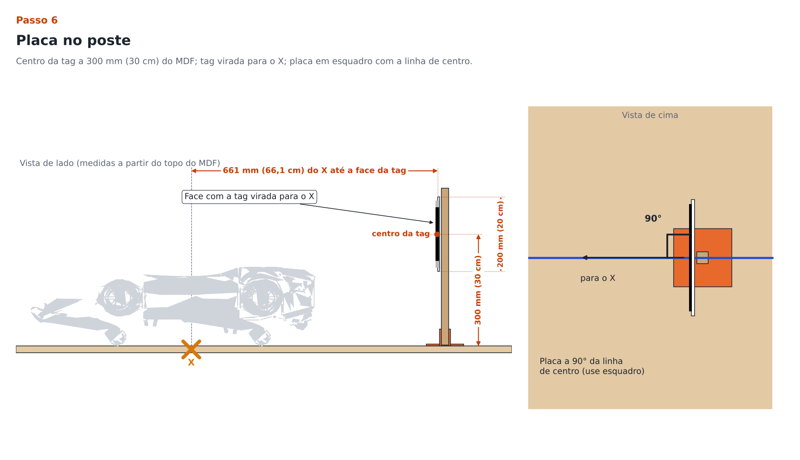
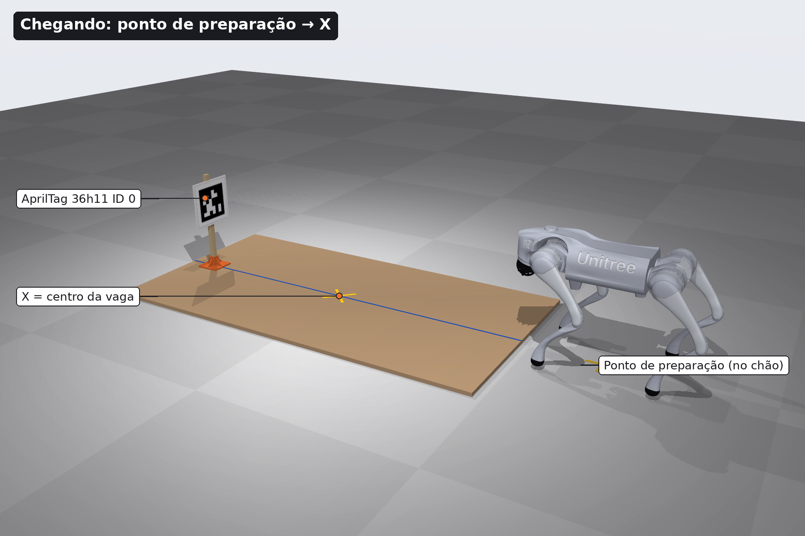
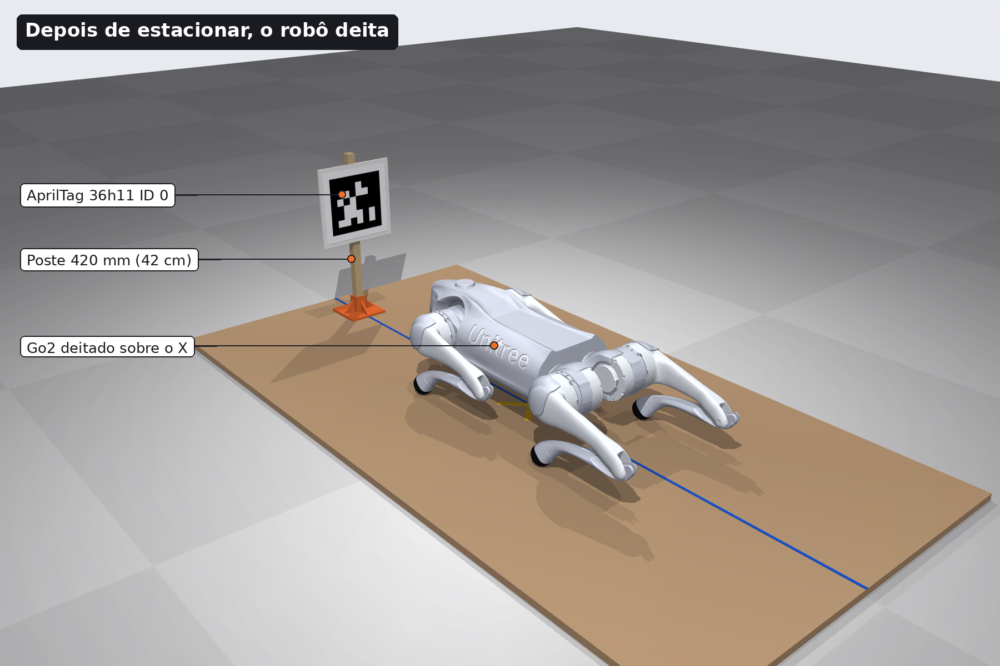

# Parte 2 — Software de estacionamento com AprilTag

> **Para o Claude Code.** Este documento é a especificação. Leia inteiro antes de escrever código. Antes de começar, inspecione o repositório do usuário para descobrir a stack de navegação que já existe. Faça ao usuário as perguntas da seção 11 que o repositório não responder.
>
> Unidades: no código, use metros e radianos. Neste texto, cada medida aparece em metros e também em mm e cm, porque o usuário confere tudo com trena.


---

## 1. Contexto

- **Robô:** Unitree Go2 (quadrúpede), provavelmente EDU. Confirmar com o usuário o modelo e como o PC fala com o robô: `unitree_sdk2` (DDS, cabo Ethernet, robô em 192.168.123.161) ou WebRTC (`go2_ros2_sdk`).
- **O que já existe:** uma stack de navegação funcionando (provavelmente ROS 2 + Nav2, com mapa e localização). Ela leva o robô até perto da vaga.
- **O que falta (sua tarefa):**
  1. levar o robô do fim da navegação até a vaga e fazê-lo **parar com precisão** sobre o X;
  2. fazê-lo **deitar** ali e conferir a posição deitado;
  3. fazê-lo **sair**: levantar e andar de ré até o ponto de preparação, devolvendo o controle à navegação.
- **Hardware da vaga** (construído pelo usuário):
  - chapa de MDF de 1600 × 840 mm (160 × 84 cm), 15–18 mm (1,5–1,8 cm) de espessura, deitada no chão;
  - linha de centro com fita, no sentido do comprimento, e um **X** de fita no meio dela, que é o centro da vaga;
  - poste na frente da vaga com uma **AprilTag tag36h11, ID 0, quadrado preto de 0,144 m (144 mm / 14,4 cm)**, virada para o X.
- **Fora do escopo:** ligar ou desligar o robô. **Não chame `Damp` (API 1001)** em nenhum estado.
- **Restrição:** o usuário não solda. Não proponha mudanças de hardware que exijam solda.

## 2. Geometria da vaga

Use estes valores como padrão num arquivo YAML de parâmetros. O usuário mede a montagem real e pode passar valores diferentes.

Defina o frame **`dock`**:

- origem no topo do MDF, exatamente no cruzamento do X;
- **x** aponta para a tag (a direção "para frente" do robô estacionado);
- **y** para a esquerda do robô;
- **z** para cima.

| Elemento | Posição no frame `dock` |
|---|---|
| Centro do robô estacionado (projeção de `base_link` no chão) | (0, 0, 0), yaw = 0 |
| Centro da tag | x = 0,661 m (661 mm / 66,1 cm); y = 0; z = 0,300 m (300 mm / 30 cm). Face virada para −x, ou seja, para o robô |
| Lado do quadrado preto da tag | 0,144 m (144 mm / 14,4 cm) |
| Centro do poste | x = 0,680 m (680 mm / 68 cm), y = 0 |
| Chapa de MDF | x de −0,800 a +0,800 m (±800 mm / ±80 cm); y de −0,420 a +0,420 m (±420 mm / ±42 cm) |
| Pose de preparação (*staging*) | x = −1,10 m (−1100 mm / −110 cm), y = 0, yaw = 0. Fica no chão, 0,30 m (300 mm / 30 cm) atrás da borda de trás do MDF, de frente para a tag |



**Degrau do MDF.** Durante a aproximação, o robô sobe a borda de 15–18 mm (1,5–1,8 cm). A pose medida da tag oscila nesse momento. Mantenha a velocidade baixa e confie no filtro (seção 7). Verifique também se o costmap do Nav2 marca a borda do MDF ou o poste como obstáculo: a aproximação final é feita fora do Nav2, então só a pose de preparação precisa estar livre.

**Convenção de eixos da tag.** Detectores diferem: no `apriltag` (C) o z da tag aponta para dentro da tag; em outros pacotes, para fora. Não presuma. Com o detector rodando, coloque a câmera de frente para a tag, olhe os eixos no RViz e só então escreva a transformação fixa `tag → dock`.

**Câmera do Go2 (valores aproximados, só para começar).** Lente na frente da cabeça, cerca de 0,32 m (320 mm / 32 cm) à frente do centro do corpo e 0,044 m (44 mm / 4,4 cm) acima dele. Em pé, isso dá ~0,355 m (355 mm / 35,5 cm) acima do piso onde o robô pisa; deitado, ~0,17 m (170 mm / 17 cm). A inclinação é desconhecida. Prefira o método de **referência gravada** da seção 5, que não depende desses valores.



## 3. Objetivo e critérios de sucesso

1. A partir da pose de preparação, o robô entra andando de frente e para com o centro sobre o X.
2. **Precisão no ponto final, ainda em pé:**
   - longitudinal (x) ≤ 5 mm (0,5 cm);
   - lateral (y) ≤ 10 mm (1 cm);
   - yaw ≤ 2°.

   A meta é apertada porque o usuário pretende instalar depois um acessório fixo na vaga que depende do robô parar sempre no mesmo lugar. Nada mecânico corrige a posição: tudo depende do controle.
3. O robô **deita** (`StandDown`, API 1005) e o software **confere a posição deitado** pela tag. Fora da tolerância: levanta, recua e tenta de novo (no máximo 2 novas tentativas).
4. **Sair:** o robô levanta e anda de ré até a pose de preparação, depois devolve o controle para a navegação.
5. 18 de 20 estacionamentos seguidos dentro da tolerância (seção 9).

## 4. Arquitetura proposta

Crie um pacote ROS 2 `go2_dock`. Adapte os nomes à stack existente.

```
câmera frontal ──► calibração (camera_info) ──► detector AprilTag ──► pose da tag
                                                                       │
Nav2 (já existe) ──► leva à pose de preparação                         ▼
                                     dock_controller (máquina de estados, controle holonômico)
                                                    │  cmd_vel ou SportClient.Move(vx, vy, vyaw)
                                                    │  StandDown / StandUp / BalanceStand / RecoveryStand
                                                    ▼
                                                  Go2
```

Componentes:

1. **Fonte de imagem.** Use o que existir:
   - `go2_ros2_sdk` (WebRTC) publicando `/camera/image_raw`;
   - `unitree_sdk2` / `unitree_sdk2_python` com `VideoClient` (DDS, modelos EDU);
   - uma câmera USB extra, se o usuário preferir.
2. **Calibração intrínseca.** `camera_calibration` (`cameracalibrator`) com tabuleiro de xadrez. A câmera do Go2 é grande-angular: avalie se o modelo `plumb_bob` basta ou se precisa de modelo olho-de-peixe. Salve um YAML de `camera_info` e publique junto com a imagem.
3. **Detector.** `apriltag_ros` para ROS 2 (christianrauch) ou equivalente: família `36h11`, `size: 0.144`, `ids: [0]`, frame `dock_tag`. Saída: detecções e TF câmera → tag.
4. **`dock_controller`.** O nó principal (seções 5 a 7).
5. **Interfaces.** Uma action ou serviço `dock` e outro `undock`, para chamar da árvore de comportamento ou da missão. Se a stack usa o Docking Server do Nav2 (`opennav_docking`), avalie expor interfaces compatíveis com `DockRobot` / `UndockRobot`. O controlador de aproximação do Nav2 foi feito para robôs diferenciais. Para o Go2, que anda de lado, um controlador holonômico próprio é mais simples e mais preciso; justifique a escolha no README.
6. **Visualização para o ajuste fino.** Um modo que mostra a imagem da câmera com a detecção desenhada (ou instruções para abrir no RViz / `rqt_image_view`). O usuário precisa disso para ajustar a altura da placa (Parte 1, passo 7) antes de gravar a referência.

## 5. Precisão: referência gravada (*teach and repeat*)

A posição final é definida pela **pose da tag vista pela câmera**, não por geometria calculada. Isso elimina erros de calibração externa (posição e inclinação da câmera).

1. **Modo de ensino** (`ros2 run go2_dock teach`):
   - o usuário coloca o robô em pé à mão (ou pelo controle) com o centro do corpo sobre o X e alinhado com a linha de centro. O centro do corpo é o ponto médio entre os motores dos quadris dianteiro e traseiro;
   - grave a pose da tag no frame da câmera, em pé: **REF_EM_PE** (média de 2 s de detecções);
   - mande deitar (`StandDown`), espere estabilizar e grave **REF_DEITADO**;
   - salve as duas num YAML, junto com o desvio-padrão medido.
2. **No estacionamento,** o controlador leva o erro entre a pose atual da tag e REF_EM_PE a zero.
3. **Depois de deitar,** compare a pose atual com REF_DEITADO. A diferença em x, no frame do corpo, é o erro longitudinal final.



## 6. Máquina de estados do `dock_controller`

| Estado | O que faz | Sai quando |
|---|---|---|
| `IR_PARA_PREPARACAO` | `NavigateToPose` do Nav2 até a pose de preparação (frame `map`; a pose da vaga no mapa fica salva em parâmetro) | Chegou → `PROCURAR_TAG` |
| `PROCURAR_TAG` | Parado; espera a tag ID 0 em ≥ 5 quadros seguidos | Viu → `APROXIMAR`; 5 s sem ver → girar ±15° e tentar; falhou → `ERRO` |
| `APROXIMAR` | Controle holonômico até REF_EM_PE (seção 7). **Desligue o desvio de obstáculos nativo do Go2** nesta fase (o poste fica perto do nariz do robô) e religue depois. No `unitree_sdk2` isso costuma ser o `ObstaclesAvoidClient`; confirme o que existe na versão do usuário | Erro dentro da tolerância por 1 s → `ASSENTAR`; tag perdida > 1 s → `RECUAR` |
| `ASSENTAR` | Velocidade zero por 1 s; confere o erro de novo | Ok → `DEITAR`; fora → `APROXIMAR` |
| `DEITAR` | `StandDown` (API 1005); espera ~2 s | → `CONFERIR_DEITADO` |
| `CONFERIR_DEITADO` | Compara com REF_DEITADO | Ok → `ESTACIONADO`; fora → `LEVANTAR_E_REPETIR` |
| `LEVANTAR_E_REPETIR` | Levanta (ver `SAIR`); recua 0,30 m (300 mm / 30 cm) | → `APROXIMAR` (até 2 vezes) → `ERRO` |
| `RECUAR` | Ré lenta até ver a tag de novo, no máximo até a pose de preparação | → `PROCURAR_TAG` |
| `ESTACIONADO` | Publica o estado e o erro final (em pé e deitado) | — |
| `SAIR` (action `undock`) | Levanta: `StandUp` (1004) e depois `BalanceStand` (1002), ou `RecoveryStand` (1006); confirme qual sequência a versão do SDK do usuário exige para voltar a andar. Depois, ré a 0,10 m/s até a pose de preparação, corrigindo y e yaw pela tag enquanto ela estiver visível | → devolve o controle |
| `ERRO` | Para, publica o motivo | Intervenção do usuário |

## 7. Controlador de aproximação

- Erro no frame do corpo: (ex, ey, eyaw), entre a pose atual da tag e REF_EM_PE, já convertido para movimento do corpo.
- Comandos: `vx = kx·ex`, `vy = ky·ey`, `vyaw = kyaw·eyaw`. Comece com kx = ky = 0,8 1/s e kyaw = 1,0 1/s.
- Saturação:
  - |vx| ≤ 0,15 m/s, e ≤ 0,05 m/s nos últimos 0,10 m (100 mm / 10 cm);
  - |vy| ≤ 0,08 m/s;
  - |vyaw| ≤ 0,3 rad/s.
- **Zona morta do Go2:** velocidades muito pequenas podem não gerar passo nenhum. Meça a menor velocidade que move o robô e, perto do alvo, use pulsos curtos (mover 0,3 s, parar 0,5 s, medir de novo).
- **Filtro:** mediana das últimas 5 detecções + passa-baixa (α ≈ 0,3). Descarte detecções com erro de decodificação alto ou com a tag muito inclinada.
- Taxa de controle: 10–20 Hz. Sem detecção nova por 0,3 s → velocidade zero.

## 8. Segurança

- Botão de parada (tópico ou serviço) que zera velocidades e cancela a action.
- Limites de velocidade sempre ativos. Timeout geral de 90 s para o estacionamento inteiro.
- Nunca mande `Damp`.
- Se a tag sumir durante o `APROXIMAR`, pare antes de recuar. Nada de andar às cegas para frente.
- Registre (log) cada tentativa com os erros finais em pé e deitado: isso alimenta o teste da seção 9.

## 9. Testes de aceitação

1. **Detector:** com o robô parado a 1,0 m (1000 mm / 100 cm) da tag, o desvio-padrão da pose da tag em 10 s deve ficar ≤ 2 mm (0,2 cm) e ≤ 0,5°.
2. **Repetibilidade:** 20 estacionamentos seguidos, começando de poses aleatórias a 1–2 m (100–200 cm) da pose de preparação. Anote os erros em pé e deitado. Meta: ≥ 18/20 com x ≤ 5 mm (0,5 cm), y ≤ 10 mm (1 cm), yaw ≤ 2°.
3. **Conferência física:** em 5 das 20 tentativas, o usuário mede com régua a distância do centro do robô ao X. Compare com o erro que o software informou.
4. **Sair:** 10 saídas seguidas até a pose de preparação sem tocar no poste.
5. **Falhas:** cubra a tag no meio da aproximação; o robô deve parar e recuar.

Se o critério 2 falhar no eixo x, relate os números ao usuário. Não invente correções sem dados.

## 10. Entregáveis

- Pacote `go2_dock` com: `dock_controller`, ferramenta `teach`, arquivos launch, `params.yaml` (geometria da seção 2, ganhos, tolerâncias, pose da vaga no mapa), configuração do RViz.
- Arquivos de calibração: `camera_info` e referências gravadas.
- Testes unitários do controlador e das transformações, rodando sobre dados gravados (rosbag).
- `README.md` do pacote com: como calibrar a câmera, como fazer o ajuste fino da placa, como gravar a referência, como chamar `dock` e `undock`, como integrar à missão.

## 11. Perguntas para o usuário (faça antes de codar)

1. Qual Go2: Air, Pro ou EDU? Como o PC fala com o robô: cabo (DDS) ou Wi-Fi (WebRTC)?
2. Qual distribuição do ROS 2 e onde roda a stack: no computador do robô ou num PC?
3. Como a navegação manda velocidade hoje: `cmd_vel` para qual ponte?
4. Já existe imagem da câmera frontal num tópico? Qual resolução?
5. Onde fica a vaga no mapa (pose aproximada do X e direção da linha de centro, no frame `map`)?
6. Os valores medidos da Parte 1 (seção 5): `tag_size`, distância da face da tag ao X, altura do centro da tag, espessura do MDF e desvio lateral.
